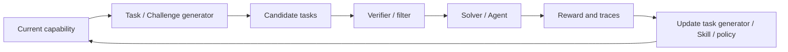

# 自生成任务与 Self-Play

> 本目录讨论 Agent 如何构造下一轮训练或探索环境。核心不是“任务越难越好”，而是如何生成接近能力边界、可验证、与目标分布相关的课程。

## 研究链路



## 待深读论文清单

本方向尚未发布完整单篇解读。以下论文将按“任务生成机制、验证方式、外部泛化、课程退化风险”四个维度逐篇展开。

| 论文 | 关键角色 | 重点阅读问题 |
| --- | --- | --- |
| [R-Zero](https://arxiv.org/abs/2508.05004) | Challenger + Solver | 如何维持能力边界任务与可靠 verifier？ |
| [Socratic-SWE](https://arxiv.org/abs/2606.07412) | Skill → Task → Solver | 真实仓库任务如何避免数据泄漏？ |
| [Skill Self-Play](https://arxiv.org/abs/2607.22529) | Proposer + Solver + Skill Controller | 任务、Skill 与策略如何避免共同退化？ |
| [Native Evolution](https://arxiv.org/abs/2604.18131) | Explorer + World Knowledge | 无外部奖励时如何验证环境知识的价值？ |
| [SAGE](https://arxiv.org/abs/2603.15255) | Challenger + Planner + Solver + Critic | 多角色分工是否带来独立信息而非重复对话？ |

## 阅读原则

```text
生成任务是否可验证？
任务是否位于当前能力边界？
任务是否与外部目标分布相关？
Agent 是否只是在适应自己生成的题目？
新更新是否通过新鲜独立任务验证？
```
