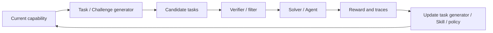

# 自生成任务与 Self-Play

> 本目录讨论 Agent 如何构造下一轮训练或探索环境。核心不是“任务越难越好”，而是如何生成接近能力边界、可验证、与目标分布相关的课程。

## 研究链路



## 单篇解读

| 论文 | 关键角色 | 单篇解读 |
| --- | --- | --- |
| R-Zero | Challenger + Solver | [阅读](r-zero.md) |
| Socratic-SWE | Skill → Task → Solver | [阅读](../skill-sop/socratic-swe.md) |
| Skill Self-Play | Proposer + Solver + Skill Controller | [阅读](skill-self-play.md) |
| Native Evolution | Explorer + World Knowledge | [阅读](native-evolution.md) |
| SAGE | Challenger + Planner + Solver + Critic | [阅读](sage.md) |

## 阅读原则

```text
生成任务是否可验证？
任务是否位于当前能力边界？
任务是否与外部目标分布相关？
Agent 是否只是在适应自己生成的题目？
新更新是否通过新鲜独立任务验证？
```
