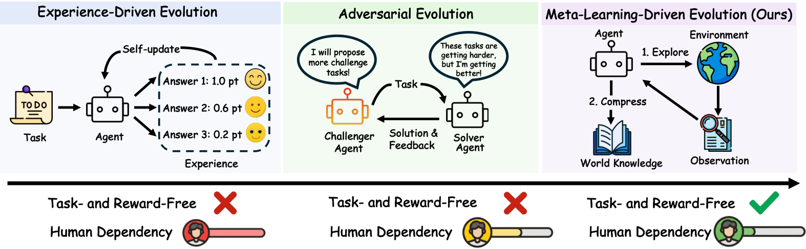
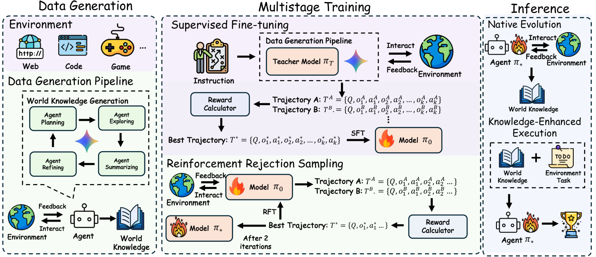

# Native Evolution：在任务到来前先探索未知环境

> 论文：**[Training LLM Agents for Spontaneous, Reward-Free Self-Evolution via World Knowledge Exploration](https://arxiv.org/abs/2604.18131)**  
> 研究对象：未知环境探索、World Knowledge、任务前的主动适应。  
> 需要区分：推理时没有外部奖励，不代表训练时没有监督。论文在训练阶段使用下游任务表现作为 outcome-based reward。

## 1. 从“接到任务才行动”到“先理解环境”

普通 Agent 的动作通常被当前任务条件化：

\[
a\sim\pi(a\mid o,\operatorname{Task})
\]

Native Evolution 提出另一种生命周期：Agent 进入陌生环境后，尚未收到具体任务，就主动浏览、总结和建立环境知识 \(\mathcal K\)。等任务真正到来，再利用这份知识执行。

```text
进入未知网站/游戏/仓库
→ 主动探索环境结构
→ 提炼 World Knowledge K
→ 未来拿到具体任务
→ K 作为上下文中的“环境心智地图”参与决策
```

{ .paper-figure }

## 2. World Knowledge 与普通 Skill 的区别

论文用 Markdown 文档保存 \(\mathcal K\)，便于接入现有 Agent。但它强调这不是通用功能 Skill：

| 类型 | 主要内容 |
| --- | --- |
| Skill | 某类任务怎么做，例如测试网页、调用工具 |
| World Knowledge | 某个具体环境如何组织，例如某网站导航、某游戏规则、某仓库模块关系 |

例如“ACL 2025 网站有哪些栏目、日期信息分散在哪些页面、检索入口在哪里”是 World Knowledge；“遇到网站时先搜索再点击”更像一般策略。

## 3. 原文 Figure 2：训练与推理的两阶段

{ .paper-figure }

推理时的两阶段：

1. **Native Evolution Phase**：探索环境并生成 \(\mathcal K\)，不依赖当前用户给出的具体任务；
2. **Knowledge-Enhanced Execution Phase**：拿到任务后，将 \(\mathcal K\) 与当前观察一起输入策略。

训练时则不是无监督的。论文以“这份世界知识能否提高潜在下游任务成功率”作为 outcome reward，训练模型学会探索什么、如何压缩信息。也就是说，**任务无关探索发生在推理时，但探索策略的形成仍来自训练期结果反馈。**

## 4. 为什么知识长度不是越长越好

World Knowledge 是上下文资产，过短会遗漏结构，过长会带来噪声。论文对 Qwen3-30B-A3B 比较：

| World Knowledge 长度 | 游戏网站表现趋势 |
| --- | --- |
| 0 | 无知识基线 |
| 4k-8k | 明显收益 |
| 8k-16k | 从 30.74 升至 39.71 |
| 16k-32k | 继续提升到 41.56 |
| 32k-64k | 略降到 40.72 |

这反映长上下文记忆的典型 trade-off：过度细节可能干扰检索和决策。World Knowledge 应更像环境的结构化地图，不是原始浏览历史的完整复制。

## 5. 实验设置

论文在网页环境中测试两个 backbone：Qwen3-30B-A3B-Instruct-2507 和 Seed-OSS-36B-Instruct。评测包含：

| 类别 | 基准 / 域 |
| --- | --- |
| 浏览与任务执行 | WebWalker、WebVoyager |
| 环境知识类网站 | Conference、Game、Organization、Education |
| 检索/工具类任务 | Wolfram、Apple、Dictionary、Coursera |

对照包括无 World Knowledge、Prompt-only（使用 Gemini 生成或 Base 自己生成的提示知识）、本方法的 SFT 和 RFT。

## 6. 主结果：训练后的主动探索带来什么

原文 Table 1 中 Qwen3-30B 的两个平均指标：

| 方法 | WebWalker/WebVoyager/四类网站 Avg | Wolfram/Apple/Dictionary/Coursera Avg |
| --- | ---: | ---: |
| Without | 22.04 | 41.08 |
| Prompt-only（Gemini） | 29.85 | 55.92 |
| Prompt-only（Base） | 19.50 | 40.76 |
| Ours SFT | 38.17 | 51.50 |
| Ours RFT | **40.91** | **57.44** |

Seed-OSS-36B 上，RFT 的相应平均为 37.50 和 56.79，相比 Without 的 16.26 和 39.93 也有明显增长。

### 6.1 如何理解

- `Prompt-only (Gemini)` 已经很强，说明外部强模型生成的环境提示本身有价值；
- `Prompt-only (Base)` 有时甚至低于 Without，说明未经训练的模型主动写出的“世界知识”可能是噪声；
- SFT 和 RFT 训练后，模型能生成更有用的 \(\mathcal K\)，RFT 多数场景进一步改善；
- RFT 不在所有列都最高，例如 Qwen3-30B 在 Wolfram 列低于 SFT，因此“更强训练阶段一定更好”不成立。

## 7. 这篇论文的证据边界

论文支持：

1. Agent 可以被训练成在任务前主动探索环境并写出可用的环境知识；
2. 该知识在论文网页任务上能提升下游执行；
3. 中等长度的知识优于过短或过长；
4. 推理时不需要额外的外部 reward 或具体任务指令来触发探索。

需要谨慎：

```text
训练期仍使用 outcome reward，因此不是完全无监督；
World Knowledge 的新鲜度在动态网页中可能很快失效；
主动探索本身有 token、工具调用和安全成本；
环境先验的收益不代表所有任务都值得预探索；
网页环境结果不能直接推广到现实世界具身环境或企业系统。
```

## 8. 高频问题

### Q1：推理时无奖励，Agent 怎么知道探索是否有用？

**回答：**它在训练阶段已经通过下游任务 outcome reward 学到了一种探索和总结策略。推理时不再需要即时奖励，类似一个训练好的 Agent 自动执行“先建地图再办事”的习惯。

### Q2：World Knowledge 和 RAG 索引有什么区别？

**回答：**RAG 通常在问题出现后检索外部资料；World Knowledge 是 Agent 在进入环境后先主动构造的紧凑环境表示。两者可以组合，但一个强调预探索与结构压缩，另一个强调按查询检索。

### Q3：为什么不直接保存全部网页内容？

**回答：**全部内容会占用上下文、包含无关噪声且难以在后续决策中调用。论文的长度分析显示知识过长时收益会饱和甚至下降。

## 9. 阅读结论

Native Evolution 把自进化的时间点前移：

> Agent 不等任务出现才被动搜索，而是在陌生环境中先形成可复用的环境模型，再用它缩短后续任务的探索路径。

真正难点在于如何训练出高价值、低噪声、可更新且不过期的 World Knowledge。
