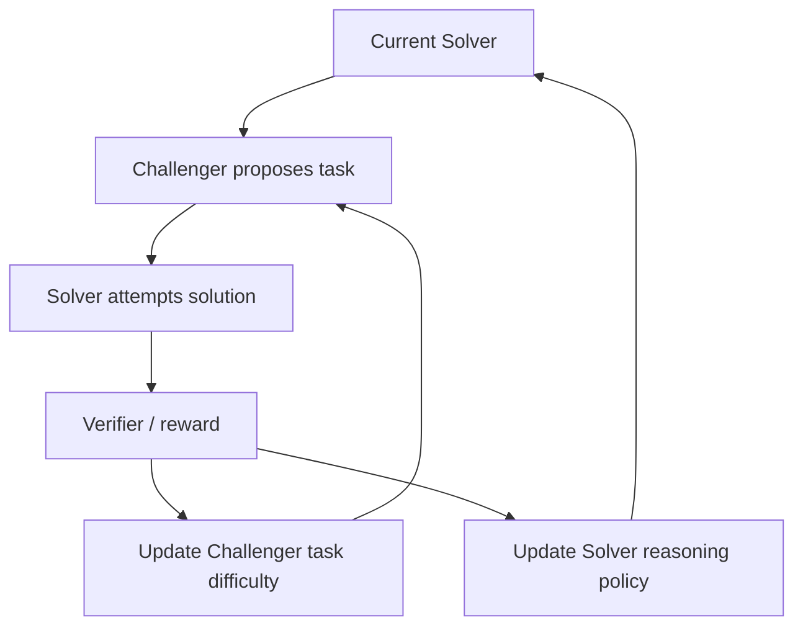

# R-Zero：零数据条件下的推理自演化

> 论文：**[R-Zero: Zero-Data Self-Evolving LLM Reasoning](https://arxiv.org/abs/2508.05004)**  
> 作者单位：腾讯 AI Seattle Lab、Washington University in St. Louis、University of Maryland、UT Dallas 等。  
> 方向：Challenger-Solver 自博弈、自生成课程与推理训练。

## 1. 研究问题

大模型推理训练通常依赖人工标注题目、答案或合成数据。R-Zero 关注：

> 在没有人工训练数据的条件下，能否通过两个协作/竞争角色自动生成可验证推理任务，并共同提升推理能力？

## 2. Challenger-Solver 闭环



Challenger 的目标不是生成任意困难任务，而是生成：

```text
足够困难，能够暴露 Solver 当前能力边界；
同时可验证，能够形成可靠训练信号。
```

## 3. 进化对象

R-Zero 同时更新：

```text
任务 / 课程分布
+
Solver 的推理策略
```

因此它属于参数级或策略级自进化，而不仅是外部 Memory/Skill 更新。

## 4. 实验解读

论文在零人工数据的设定下，报告对数学推理和通用推理 benchmark 的提升。阅读实验时需要特别核查：

- 问题生成是否拥有可靠的可验证答案；
- 生成题目是否与测试题分布相近；
- Challenger 是否会退化为出简单但高通过率的题；
- Solver 更新是否在独立 benchmark 上仍然有效；
- 课程演化是否比随机自生成任务更有效。

## 5. 证据边界

R-Zero 可证明自生成课程在其验证机制下可以带来训练信号，但不能自动证明：

```text
所有无数据任务都能 self-play；
生成的任务天然覆盖真实世界难题；
没有 verifier 时仍可稳定演化；
多轮训练不会出现 reward / curriculum collapse。
```

## 6. 阅读结论

R-Zero 的重要意义在于：

> 自进化训练不一定需要外部人工题库，但必须具备能维持任务难度、可验证性和独立泛化评测的课程机制。
