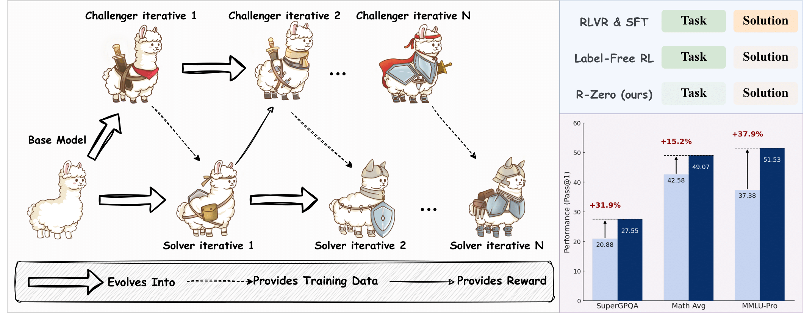
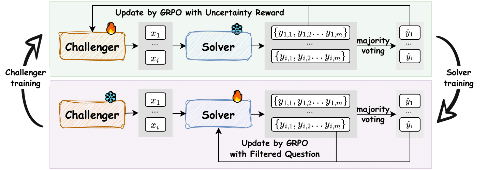

# R-Zero：从零人工任务开始的 Challenger-Solver 课程演化

> 论文：**[R-Zero: Self-Evolving Reasoning LLM from Zero Data](https://arxiv.org/abs/2508.05004)**  
> 研究对象：零人工训练任务、Challenger-Solver 共演化、数学与通用推理 RL。  
> 核心前提：当前版本主要适用于答案可以客观验证或用一致性伪标签近似验证的领域，不能直接推广到开放式文本生成。

## 1. 要解决的问题

推理模型训练通常依赖人工题目、标准答案或高质量合成数据。R-Zero 想减少这一依赖：从一个基础模型出发，让它自己提出问题、自己筛选伪标签、自己训练 Solver。

难点不在于生成问题，而在于生成的题要同时满足：

```text
不是 Solver 已经完全会的题
不是所有 rollout 都失败的无效难题
答案能被足够可靠地确定
与下游能力分布有一定关系
不会在多轮中退化成重复题或伪标签噪声
```

R-Zero 用 Challenger 提出接近 Solver 当前能力边界的题目，再让 Solver 在这些题上进行 RL。

## 2. 原文 Figure 1 与 Figure 2：两个角色如何共演化

{ .paper-figure }

{ .paper-figure }

> 图源：R-Zero 原文 Figure 1、Figure 2。上半部分训练 Challenger 出题，下半部分冻结 Challenger 后构造 Solver 的训练数据。

流程可以写成：

```text
当前 Solver
→ Challenger 生成候选题目
→ Solver 对每题采样多次答案
→ 根据自一致性估计题目是否位于能力边界
→ 过滤题目，并用多数投票形成伪标签
→ Solver 用这些题目做 GRPO
→ 得到下一代 Solver
→ 进入下一轮
```

Challenger 与 Solver 不共享“同一个即时目标”：Challenger 希望制造适合训练的困难问题，Solver 希望解出被筛选的题目。

## 3. 为什么奖励目标是 50% 成功率附近

对一个候选问题 \(x\)，令 Solver 采样 \(m\) 次，最多数的回答为伪标签 \(\tilde y(x)\)，采样一致比例为：

\[
\hat p(x;S_\phi)=\frac{1}{m}\sum_{j=1}^{m}\mathbb{1}\{y_j=\tilde y(x)\}
\]

R-Zero 的不确定性奖励为：

\[
r_{\operatorname{uncertainty}}(x,\phi)
=1-2\left|\hat p(x;S_\phi)-\frac{1}{2}\right|
\]

它在 \(\hat p\approx0.5\) 时最大：

| Solver 对题目的表现 | 训练价值直觉 |
| --- | --- |
| \(\hat p\approx1\) | 题过易，模型已经掌握，梯度有限 |
| \(\hat p\approx0\) | 题过难，所有采样都失败，伪标签不可靠 |
| \(\hat p\approx0.5\) | 接近能力边界，既有挑战也有可学习信号 |

这就是 frontier curriculum 的基本思想。但 50% 只是当前模型的不确定性代理，不保证题目与真实下游分布相关。

## 4. 伪标签怎么来，可靠性有什么问题

R-Zero 使用多次采样的多数投票作为伪标签，再用该标签训练 Solver。这要求任务具有相对客观、可规范化的答案形式，因此论文先聚焦数学。

论文的 Table 4 显示伪标签质量会随迭代下降：

| 数据轮次 | 伪标签准确率 |
| --- | ---: |
| Iter 1 数据 | 79.0% |
| Iter 2 数据 | 69.0% |
| Iter 3 数据 | 63.0% |

而较晚轮数据对对应 Solver 的训练价值也不总是上升。这是自生成训练常见风险：课程越往后越难，答案一致性越低，噪声会逐渐侵蚀训练信号。

因此 R-Zero 的多轮增益不能只看“题目越来越难”，还要看伪标签质量是否还能支撑 RL。

## 5. 实验设置

论文在 Qwen3-4B、Qwen3-8B、OctoThinker-3B、OctoThinker-8B 上进行三轮迭代，分别报告：

| 类别 | 基准 |
| --- | --- |
| 数学推理 | AMC、Minerva、MATH、GSM8K、Olympiad、AIME24/25 |
| 通用推理 | SuperGPQA、MMLU-Pro、BBEH 等 |

对照包含 Base Model 与 Base Challenger。后者用于检查收益是否只来自“换成更擅长出题的初始角色”，而非完整共演化训练。

## 6. 数学主结果：不同模型的迭代并不完全一致

原文 Table 1 中的平均数学分数：

| 模型 | Base | Challenger | Iter 1 | Iter 2 | Iter 3 |
| --- | ---: | ---: | ---: | ---: | ---: |
| Qwen3-4B | 42.58 | 44.36 | 48.06 | 48.44 | **49.07** |
| Qwen3-8B | 49.18 | 51.87 | 53.39 | 53.84 | **54.69** |
| OctoThinker-3B | 26.64 | 27.51 | 27.76 | 28.20 | **29.32** |
| OctoThinker-8B | 36.41 | 36.98 | 37.80 | 38.23 | **38.52** |

### 6.1 如何读

- Qwen3-4B 从 42.58 到 49.07，提升 6.49 points；
- Qwen3-8B 从 49.18 到 54.69，提升 5.51 points；
- 小模型也有提升，但在 AIME 等极难项上波动很大；
- Base Challenger 已经比 Base Model 好，说明角色初始化和生成分布本身也贡献了一部分收益。

例如 Qwen3-4B 的 AIME25 从 6.15 在 Iter 1 提升到 9.17，但 Iter 2、3 都变为 4.27；这提醒我们，不应该用总平均掩盖个别高难基准的波动。

## 7. 通用推理：训练数学任务后有没有迁移

原文 Table 2 中 Qwen3-4B 的通用推理 Overall 从 27.10 提升到 Iter 2 的 34.92，Iter 3 为 34.64；Qwen3-8B 从 34.49 提升到 38.73。

| 模型 | Base Overall | Iter 1 | Iter 2 | Iter 3 |
| --- | ---: | ---: | ---: | ---: |
| Qwen3-4B | 27.10 | 34.27 | **34.92** | 34.64 |
| Qwen3-8B | 34.49 | 37.93 | 38.45 | **38.73** |

这说明从数学 self-play 中学到的部分推理模式能够迁移到 SuperGPQA、MMLU-Pro、BBEH 等。但迁移不是单调的：4B 的 Iter 3 比 Iter 2 略低，意味着后续课程可能开始引入更多噪声或向数学分布过度专化。

## 8. R-Zero 真正证明了什么

论文支持以下结论：

1. 在可规范化答案的数学任务中，可以从零人工题库启动 Challenger-Solver 循环；
2. 以能力边界为目标的题目生成能提供训练信号；
3. 三轮内，多个模型在数学和部分通用推理基准上提升；
4. 多数投票伪标签在早期可用，但其质量会随演化轮数下降。

它没有证明：

```text
无人工数据等于无外部先验；基础模型本身已包含大量预训练知识；
自一致性伪标签总是正确；
更多轮迭代会持续提高；
方法天然适用于不可客观验证的开放任务；
生成题目与真实用户任务分布自动一致。
```

## 9. 高频问题

### Q1：R-Zero 真的是完全零数据吗？

**回答：**它不使用人工提供的训练题和标签来启动该循环，但基础 LLM 已经过预训练，也使用任务格式、采样、GRPO 等人工设计机制。更准确的说法是“零人工任务/标签的在线课程生成”，不是完全没有人类先验。

### Q2：为什么不直接让 Challenger 出最难题？

**回答：**极难题常导致所有 Solver rollout 失败，既无法形成可靠伪标签，也没有可区分的优势信号。R-Zero 追求的是接近 50% 成功率的可学习边界。

### Q3：多数投票是不是会放大模型错误？

**回答：**会有风险，特别是在模型一致地犯同一种错时。Table 4 中后期伪标签准确率下降正是证据之一，因此 R-Zero 当前更适合答案可规范化、可做强过滤的领域。

### Q4：Iter 3 一定比 Iter 1 好吗？

**回答：**不一定。平均分可能继续上升，但具体基准会波动；通用推理的 4B 也出现 Iter 2 高于 Iter 3 的情况。多轮自进化需要独立验证、早停和数据质量监控。

## 10. 阅读结论

R-Zero 说明自生成课程可以替代部分人工题库，但它的可靠性依赖一个很严格的条件：

> 任务必须足够可验证，课程必须落在能力边界，伪标签质量还必须在多轮中被持续监控。

它是理解 self-play 的起点，也清楚暴露了 self-play 最难的问题：生成任务容易，保证这些任务产生长期有益更新很难。
