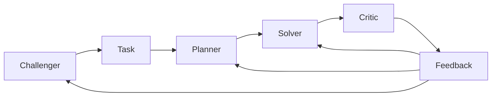

# SAGE：多角色协作下的自演化推理

> 论文：**[SAGE](https://arxiv.org/abs/2603.15255)**  
> 方向：Challenger、Planner、Solver、Critic 多角色共同演化。

## 1. 研究问题

单一 Agent 同时承担任务生成、规划、执行和评价，容易形成内部偏差闭环。SAGE 将这些职责拆给多个角色。

## 2. 角色结构

| 角色 | 任务 |
| --- | --- |
| Challenger | 生成挑战或课程 |
| Planner | 将任务拆成可执行计划 |
| Solver | 执行推理或操作 |
| Critic | 评估中间过程和结果 |

## 3. 研究意义

多角色分工可以降低单一 Prompt 同时承担所有目标的负担，但并不能自动消除偏差。若角色共享模型、共享训练数据或共享 verifier 盲点，错误仍可能被放大。

## 4. 阅读结论

SAGE 适合用于理解多 Agent 自进化的一个基本原则：

> 角色拆分应服务于独立信息和独立约束，而不是只增加对话轮数。
