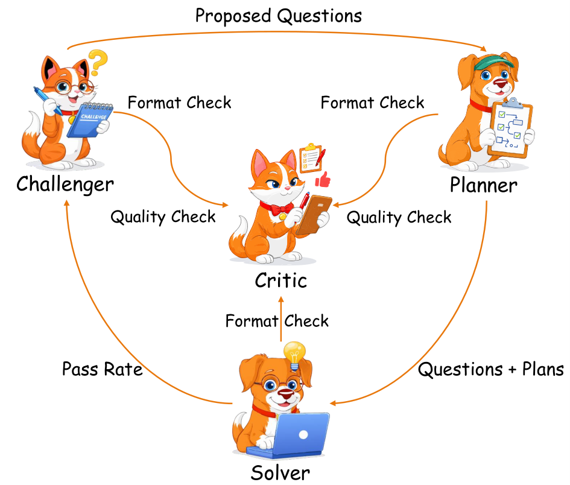
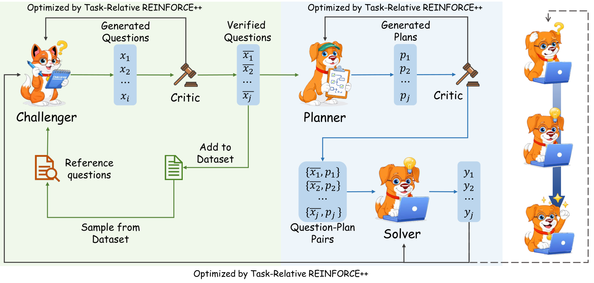

# SAGE：用 Challenger、Planner、Solver、Critic 维持自生成课程

> 论文：**[SAGE: Multi-Agent Self-Evolution for LLM Reasoning](https://arxiv.org/abs/2603.15255)**  
> 研究对象：可验证数学/代码任务、多角色共演化、质量过滤和 OOD 评测。  
> 与双角色 self-play 的差别：SAGE 将“出题、规划、作答、筛查”分给四个角色，以降低任务质量和长链推理同时失控的风险。

## 1. 为什么再加 Planner 和 Critic

Challenger-Solver 架构面临两个常见问题：

```text
题目可能形式正确但不可解或无意义
Solver 需要在长题中自己规划，训练信号过于稀疏
出题者可能为了制造难度而产生坏验证器
自生成数据逐轮积累后质量漂移
```

SAGE 引入四种角色，它们共享同一个 LLM backbone，但通过不同的角色提示和奖励承担不同职责。

{ .paper-figure }

{ .paper-figure }

## 2. 四个角色与训练目标

| 角色 | 输出 | 主要目标 |
| --- | --- | --- |
| Challenger | 问题与验证信息 | 生成接近 Solver 边界、可验证的任务 |
| Planner | 分步计划 | 把复杂任务拆成可执行推理步骤 |
| Solver | 最终答案 | 通过外部 verifier 获得正确性奖励 |
| Critic | 质量/格式评分 | 过滤低质量任务和计划，抑制课程漂移 |

Challenger 的难度奖励基于 Solver 多次作答的平均验证分：

\[
r_d(q,v)=1-\bar s_{\operatorname{gt}}(q,v)
\]

但论文不会直接把“Solver 不会”当作可训练任务。Critic 和格式/验证过滤器共同检查题目、计划和契约是否可用，防止通过无效任务制造虚假难度。

## 3. 为什么共享 backbone 仍然有意义

四个角色并不是四个独立模型，而是同一参数模型在不同 prompt 下执行不同社会角色。好处是：

```text
不需要训练四套模型
角色输出能共享底座的知识
可用 role-relative advantage 分别归一化不同角色的 reward
```

风险也很明显：角色可能共享同样的盲点。Critic 并不天然独立于 Challenger 或 Solver，因此 SAGE 仍依赖外部可验证奖励来锚定最终正确性。

## 4. 实验设置

论文从 500 个 seed examples 启动，在数学和代码可验证任务上训练，并比较 AZR、MAE 等自演化方法。评测包括：

| 类别 | 基准 |
| --- | --- |
| 代码 | HEval+、MBPP+、LiveCodeBench v1-5 |
| 数学 | GSM8K、MATH、AIME、AMC、OlympiadBench 等 |
| OOD | 独立于训练分布的代码和数学集合 |

论文使用外部答案/单元测试作为 correctness verifier，因而结果不能直接移植到主观写作、开放检索或缺少真实奖励的任务。

## 5. 主结果：不同规模的效果不同

原文 Table 1 中，Qwen-2.5-7B 的平均表现：

| 方法 | Code Avg | Math Avg | Overall Avg |
| --- | ---: | ---: | ---: |
| Base Model | 52.0 | 45.4 | 47.6 |
| AZR | 55.2 | 46.8 | 49.6 |
| MAE | 54.9 | 45.0 | 48.3 |
| SAGE | **55.5** | **47.5** | **50.1** |

Qwen-2.5-3B 上，SAGE 的 Overall 为 42.0，高于 Base 的 40.4；Qwen-3-4B 上，SAGE 为 55.9，略高于 Base 的 55.7，但低于该模型在部分单项上的表现。

这说明：

- SAGE 的增益在 7B 上更明显；
- 不同 backbone 的训练稳定性不一样；
- 不能只根据“多角色”就假设必然优于更大的或更强的单角色基础模型。

## 6. OOD：内部训练好，不代表外部泛化好

原文 Table 2 报告 ID / OOD 平均：

| Backbone | Base OOD | AZR OOD | MAE OOD | SAGE OOD |
| --- | ---: | ---: | ---: | ---: |
| Qwen-2.5-3B | 18.0 | 17.1 | 17.5 | **19.0** |
| Qwen-2.5-7B | 24.6 | 27.4 | 25.0 | **28.8** |
| Qwen-3-4B | 35.6 | 28.2 | 32.2 | **36.0** |

SAGE 的 OOD 数字在三个 backbone 中都优于相应 Base，尤其 7B 从 24.6 到 28.8。这比只看 ID 更有说服力，因为它表明 Challenger 生成的课程没有完全锁死在训练格式里。

但 OOD 集的数量和构成仍决定结论边界，不能把表中提升解释成对任何新领域的泛化保证。

## 7. 消融：Critic 不是装饰性模块

原文 Table 3 在 Qwen-2.5-3B 上比较：

| 变体 | Code Avg | Math Avg | Overall Avg |
| --- | ---: | ---: | ---: |
| SAGE 完整版本 | **49.4** | **38.3** | **42.0** |
| 不训练 Challenger | 45.6 | 36.4 | 39.5 |
| 不训练 Solver | 47.0 | 33.8 | 38.2 |
| 不训练 Critic | 44.8 | 38.2 | 40.4 |

去掉任何一个角色都会下降，尤其不训练 Solver 的 Math Avg 从 38.3 降到 33.8；不训练 Critic 的 Code Avg 降到 44.8。这个结果支持四个角色的互补性，但不表示它们绝对独立，因为共享 backbone 和提示模板仍可能相互影响。

## 8. 论文证明与局限

论文支持：

1. 在可验证数学和代码任务中，四角色闭环可以从少量 seed 数据扩展课程；
2. Critic 过滤和 Planner 分解有助于稳定自生成训练；
3. 多个模型规模上获得了 ID 与部分 OOD 改进；
4. 消融表明 Challenger、Solver、Critic 都有可测贡献。

局限：

```text
仍依赖 500 个 seed examples 和外部 verifier；
Critic 与其他角色共享 backbone，独立性有限；
主要验证数学和代码，不代表开放域 Agent；
论文也建议监控训练动态并使用 early stopping；
多角色意味着更高的 rollout 与训练成本。
```

## 9. 高频问题

### Q1：SAGE 与 R-Zero 最大区别是什么？

**回答：**R-Zero 主要是 Challenger-Solver 的双角色课程；SAGE 额外显式加入 Planner 与 Critic。Planner 给长推理提供结构，Critic 负责质量过滤，目标是降低自生成课程漂移。

### Q2：Critic 不也是同一个模型吗，如何防止自我确认？

**回答：**确实不能完全防止。SAGE 的关键锚点仍是数学答案或代码测试的外部 verifier；Critic 主要做质量与格式过滤，而不是最终真值来源。

### Q3：为什么 OOD 比 ID 更重要？

**回答：**self-play 很容易把模型训练成适应自己生成的题。OOD 指标更能检查生成课程是否带来了可迁移能力，而非只提高内部任务分数。

## 10. 阅读结论

SAGE 的价值在于将自生成课程拆成明确的职责链：

> 出题要靠 Challenger，复杂推理要靠 Planner，正确性要靠外部 verifier，课程质量还要靠 Critic 过滤。

多角色不是魔法，但它提供了一个可消融、可审查的课程质量控制框架。
