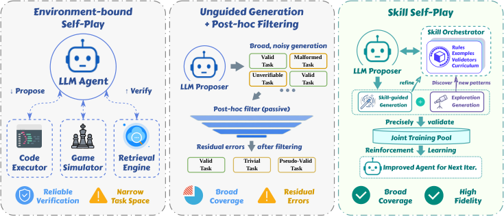
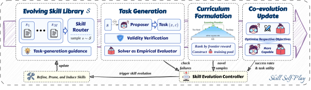

# Skill Self-Play：用动态 Skill Library 约束开放式自博弈

> 论文：**[Skill Self-Play: Pushing the Frontier of LLM Capability with Co-Evolving Skills](https://arxiv.org/abs/2607.22529)**  
> 研究对象：Proposer、Solver、Skill Controller、任务验证契约与动态 Skill 路由。  
> 核心问题：开放式自生成任务很丰富但难验证，环境绑定任务可验证但覆盖窄；能否用 Skill 作为中间层，同时维持任务多样性和验证可靠性？

## 1. 任务多样性与可靠验证的冲突

Self-play 常在两个极端之间权衡：

| 路线 | 优点 | 缺点 |
| --- | --- | --- |
| 环境绑定任务 | 有清晰测试、反馈可靠 | 任务空间狭窄，容易局限在固定环境 |
| 自由生成任务 | 题目多样、可持续扩展 | 可能生成无效契约、错误答案或伪难题 |

Skill-SP 将 Skill 看成中间层：每条 Skill 提供可验证的局部执行结构；Skill Controller 动态路由不同 Skill，又避免任务始终困在单一环境。

{ .paper-figure }

## 2. 原文 Figure 3：Proposer、Solver 与 Skill Controller 的共同演化

{ .paper-figure }

完整循环为：

```text
Skill Library
→ Controller 选择/路由 Skill
→ Proposer 在 Skill 引导下生成 task + hidden verification contract
→ 质量门控，筛掉格式或契约无效的任务
→ 按 frontier reward 排序，组成 Solver curriculum
→ Solver 训练并产生执行反馈
→ Controller 负责 Skill refinement、pruning、induction
→ 新 Skill 再参与下一轮任务生成
```

## 3. 关键公式：难度奖励前必须先通过质量门

对任务 \((\mathbf{x},\mathbf{c})\)，\(\mathbf c\) 是只给环境看的验证契约。Solver 成功概率为 \(v_{\operatorname{solve}}\)。Proposer 奖励写成：

\[
\mathcal R_{\operatorname{propose}}
=\mathbb{1}_{\{(\mathbf{x},\mathbf{c})\ \text{is valid}\}}
\cdot\left(1-2\left|v_{\operatorname{solve}}-\frac{1}{2}\right|\right)
\]

其中有效任务必须同时满足：

```text
schema compliant
∩ contract valid
∩ probe consistent
```

这比仅追求 50% 成功率多了一道关键门槛。没有质量门时，Proposer 可以生成语义不完整、契约自相矛盾的题，使 Solver 很难但没有学习价值。

## 4. Skill Controller 如何维护库

Controller 不只是检索器。论文让它依据任务反馈做三件事：

| 操作 | 含义 |
| --- | --- |
| Pruning | 长期产生低 frontier reward 的 Skill 被淘汰 |
| Induction | 从高价值探索任务中抽取候选新 Skill |
| Refinement | 根据验证失败和统计信息修订已有 Skill |

因此 Skill-SP 的 Skill Library 既提供任务生成条件，又是持续学习的状态。它与 R-Zero 的差异在于：R-Zero 主要直接演化任务分布；Skill-SP 让任务分布先经过显式 Skill 结构调控。

## 5. 实验设置

论文覆盖两类任务：

| 类别 | 基准 |
| --- | --- |
| 工具调用 | API-Bank、BFCL |
| 逻辑/编程推理 | JavaScript、Python、Java、Live 等设置 |

主比较采用多个不同能力和对齐状态的 backbone。消融集中测试：

- 是否使用动态 Skill routing；
- 是否让 Skill Library 演化；
- 是否冻结 Proposer 或 Feedback Solver；
- 是否取消 Skill 引导变成 Unguided Self-Play。

## 6. 消融结果：完整闭环为何更强

原文 Table 3 的 Overall：

| 变体 | Overall | 相对完整系统 |
| --- | ---: | ---: |
| Full System | **66.7** | - |
| Unguided SP | 64.1 | -2.6 |
| Uniform routing | 64.8 | -1.9 |
| Frozen skills | 64.4 | -2.3 |

各模块下降幅度不夸张，但方向一致：

- **Unguided SP** 下降，说明不受 Skill 约束的开放生成更容易偏离有效课程；
- **Uniform routing** 下降，说明按上下文动态选择 Skill 比平均使用所有 Skill 更有效；
- **Frozen skills** 下降，说明库的更新不是可有可无的缓存，而对后续课程有贡献。

原文 Table 4 进一步冻结不同模型角色：

| 变体 | Overall | 相对完整系统 |
| --- | ---: | ---: |
| Full System | **66.7** | - |
| Frozen proposer | 64.6 | -2.1 |
| Frozen feedback solver | 63.7 | -3.0 |
| Frozen both | 63.5 | -3.2 |

Feedback Solver 的影响较大，表明课程构造依赖对当前能力边界的持续估计，而不是只靠初始 Proposer。

## 7. 什么叫“推动能力前沿”

论文把“前沿”实现为目标成功率接近 50% 的可验证任务，而不是难度越高越好。一个 good task 需满足：

```text
任务契约可执行
Solver 既不总能做对，也不总是失败
任务由某条或某组 Skill 提供结构引导
通过环境验证而非 LLM 自评
```

这仍不保证与真实用户任务一致。它只是使内部课程更可能产生有效梯度，而非证明训练任务的外部价值。

## 8. 论文的证据边界

论文支持：

1. 动态 Skill routing 能在论文的工具调用和推理基准上改善自博弈训练；
2. Skill Library 的 refinement / pruning / induction 对结果有独立贡献；
3. 质量门控可以抑制自由任务生成中的无效契约；
4. Proposer 和反馈 Solver 的持续更新对保持课程价值有帮助。

但没有证明：

```text
Skill 路由必然覆盖所有需要探索的新能力；
hidden contract 不会被生成器间接 exploit；
50% frontier 与外部用户价值一致；
Skill Library 会无限期稳定增长；
工具调用和推理的收益能迁移到开放域世界知识任务。
```

## 9. 高频问题

### Q1：Skill-SP 和 R-Zero 都用 50% 难度，有什么不同？

**回答：**R-Zero 直接用 Solver 自一致性训练 Challenger；Skill-SP 在生成任务前先路由 Skill，并对任务格式、验证契约和 probe 一致性做门控，再以 frontier reward 排序。它更强调“任务为何可验证”。

### Q2：为什么 Uniform routing 会下降？

**回答：**不同 Skill 覆盖的任务结构不同。均匀使用会让 Proposer 接收不相关或冲突的指导，既影响任务质量，也增加学习分布噪声。

### Q3：Skill Library 变大是否总是更好？

**回答：**不是。论文显式包含 pruning；低价值或冗余 Skill 会降低路由质量、占用上下文并诱导重复任务。有效演化必须同时会新增和删除。

## 10. 阅读结论

Skill Self-Play 提供了一个兼顾开放性与可验证性的设计：

> 让 Skill 限定并丰富任务生成空间，用环境契约验证任务，用持续维护的 Skill Library 反过来改进下一轮课程。

它最值得借鉴的是质量门控和库治理，而不是把 self-play 简化为“自己出题自己训练”。
