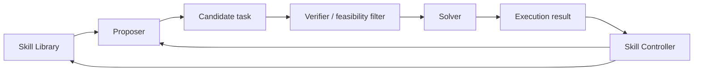

# Skill Self-Play：技能驱动的自博弈课程

> 论文：**[Skill Self-Play](https://arxiv.org/abs/2607.22529)**  
> 方向：Proposer、Solver、Skill Controller 共同演化；开源项目由 Qwen-Applications 组织发布。

## 1. 研究问题

开放任务生成往往缺少可靠验证器，纯自生成题目容易退化。Skill Self-Play 的基本思路是使用 Skill 作为中介：Skill 既约束任务生成，也为 Solver 提供可执行能力基础。

## 2. 系统结构



### 角色分工

| 角色 | 职责 |
| --- | --- |
| Proposer | 生成具有学习价值的候选任务 |
| Solver | 执行任务并形成轨迹 |
| Skill Controller | 管理 Skill 的提取、路由或修订 |

## 3. 方法价值

Skill 将开放任务与可验证执行连接起来：

```text
已有 Skill 限制任务可行性；
新任务暴露 Skill 缺口；
执行结果决定 Skill 是否修订；
更新后的 Skill 影响下一轮任务生成。
```

## 4. 实验阅读重点

- Proposer 是否生成仅对当前 Solver 容易的任务；
- Skill Library 是否造成任务分布封闭；
- verifier 是否能过滤无解、重复或无学习价值的任务；
- skill routing 是否真的帮助迁移；
- 在外部 benchmark 上是否有独立收益。

## 5. 阅读结论

Skill Self-Play 代表“任务、Skill 与策略共同演化”的方向。其可靠性不取决于角色数量，而取决于任务验证、Skill 继承和外部评测是否充分。
