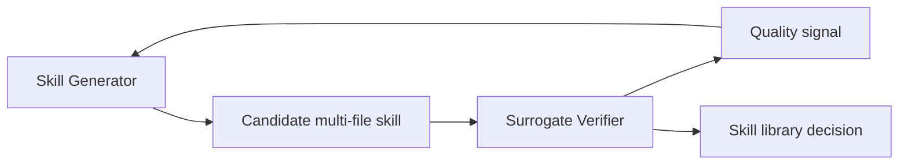

# CoEvoSkills：Skill Generator 与 Surrogate Verifier 的共同演化

> 论文：**[CoEvoSkills](https://arxiv.org/abs/2604.01687)**  
> 方向：多文件 Skill Package、生成器与替代验证器共同演化。

## 研究问题

真实 Skill 往往不是一段文字或单个函数，而可能包含：

```text
脚本
配置
资源文件
目录结构
依赖声明
测试逻辑
```

在真实测试答案不可直接访问的前提下，如何验证这些 Skill Package 是否值得保存，是一个核心难题。

## 方法概览



CoEvoSkills 的基本思路是让 Generator 与 Surrogate Verifier 共同演化：前者学习生成更有用的 Skill 包，后者学习提供可用的替代性验证信号。

## 为什么需要 Surrogate Verifier

在受保护评测或缺少 ground-truth 的环境中，直接使用真实测试答案会造成泄漏；只依赖 LLM 自评又可能不可靠。Surrogate Verifier 是在两者之间的折中。

## 实验阅读重点

- 验证器训练或校准数据来自哪里；
- 验证器分数与真实任务效用的一致性；
- 多文件 Skill 是否真的可安装、可执行；
- Generator 是否通过迎合 verifier 获得虚假高分；
- 评测是否包含独立真实执行。

## 证据边界

共同演化的风险在于：

```text
Generator 学会利用 Verifier 的盲点
Verifier 学会迎合 Generator 的输出分布
二者共同提升的内部指标不代表外部任务收益
```

因此外部执行验证仍是必要条件。

## 阅读结论

CoEvoSkills 说明，在复杂 Skill Package 场景中，验证器本身也可能成为需要优化的系统部件；但 verifier 共演化必须配合独立测试，防止闭环自洽而外部失效。
