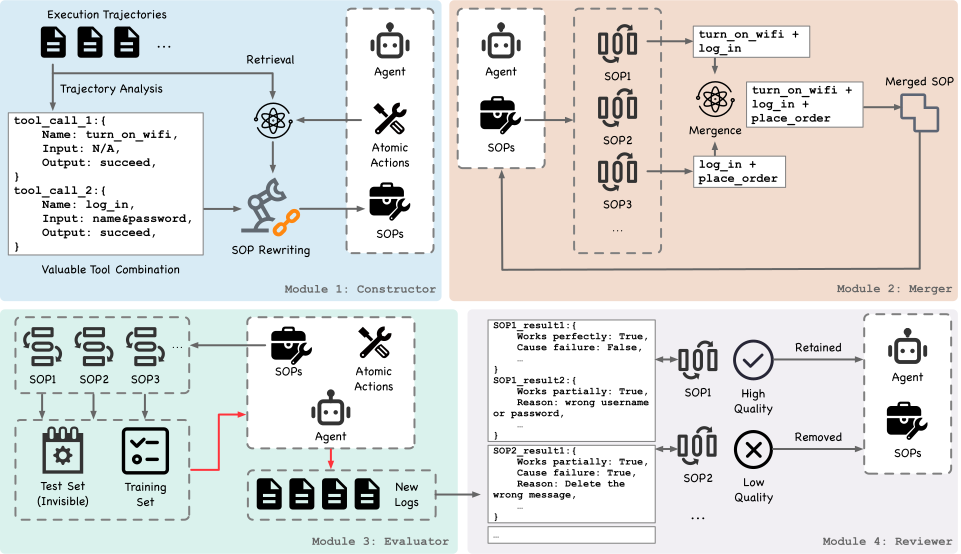
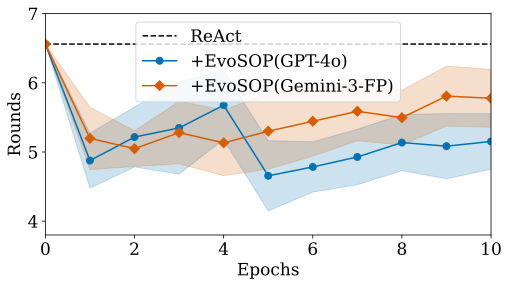
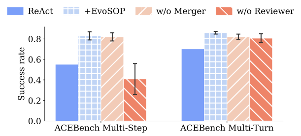

# EvoSOP：把原子工具演化为可维护的标准作业流程

> 论文：**[From Atomic Actions to Standard Operating Procedures: Iterative Tool Optimization for Self-Evolving LLM Agents](https://arxiv.org/abs/2607.07321)**  
> 研究对象：原子工具、可调用 SOP、高阶工具库的构建与治理。  
> 关键观点：从轨迹中生成 SOP 只是开始；一个长期可用的 Agent 还必须合并重复 SOP、验证真实效用，并及时删除低价值能力。

## 1. 问题背景：原子工具为什么会造成重复推理

多数 Tool Agent 的能力库由低层函数组成，例如：

```text
search(query)
read_file(path)
write_file(path, content)
list_records(filter)
update_record(id, fields)
```

单个动作很通用，但对反复出现的多步流程并不高效。一个 Agent 每次遇到“查找信息 - 校验条件 - 更新记录 - 再确认”的任务，都需要重新规划相同的子流程。这会带来：

1. 重复的推理 token 和交互轮数；
2. 中间步骤遗漏或顺序错误；
3. 成功轨迹没有沉淀为后续可以直接调用的能力；
4. 仅不断增加新工具时，Toolset 膨胀，反而干扰选择。

EvoSOP 将一组经常共同出现的原子动作抽象为 **Standard Operating Procedure（SOP）**。SOP 不只是自然语言总结，而是带有语义 schema 和可执行逻辑的高阶可调用工具。

## 2. 原文 Figure 1：工具集的完整生命周期

{ .paper-figure }

> 图源：EvoSOP 原文 Figure 1。点击可放大。图中四个模块构成持续循环，而不是一次性“从轨迹生成工具”。

论文将工具集优化拆成四个角色：

| 模块 | 输入 | 输出 | 解决的问题 |
| --- | --- | --- | --- |
| Constructor | 任务执行轨迹 | 候选 SOP | 从重复原子动作中抽取可复用程序 |
| Merger | 候选 SOP 与已有库 | 更通用的 SOP | 合并语义/功能重叠的能力 |
| Evaluator | 更新后的工具库 | 新执行轨迹和真实表现 | 在环境中验证是否真的有用 |
| Reviewer | 表现统计、错误和冗余信息 | Keep / Revise / Remove | 剪枝，阻止低质工具长期积累 |

可以把整个闭环理解为：

```text
执行任务
→ 从轨迹抽取 SOP
→ 与旧 SOP 合并
→ 在真实任务中重新运行
→ 根据成功率、错误和冗余审查
→ 保留或淘汰 SOP
```

## 3. Constructor：如何从轨迹得到 SOP

给定轨迹 \(\xi\)，Constructor 首先找出经常共同出现、且存在逻辑依赖的原子动作片段：

\[
\xi'_i=f_{\operatorname{extract}}(\xi_i)
\]

然后结合原子工具集合 \(\mathcal{F}_{\operatorname{atomic}}\)，将片段改写为 SOP：

\[
\mathcal{S}_i=f_{\operatorname{rewrite}}(\xi'_i,\mathcal{F}_{\operatorname{atomic}})
\]

一个合格 SOP 至少需要说明：

```text
何时可调用
需要哪些输入
内部依赖哪些原子工具
执行顺序和条件分支
预期输出或失败条件
```

这使 SOP 与“成功轨迹摘要”不同。摘要仅供模型阅读；SOP 则被注册为工具，可在下一次任务中直接调用。

## 4. Merger 与 Reviewer：为什么生成得越多不一定越好

### 4.1 Merger：把局部流程提升为一般流程

如果每条成功轨迹都生成一个 SOP，库中会出现大量近似能力。例如：

```text
查找订单 - 校验状态 - 修改地址
查找订单 - 校验状态 - 修改电话
查找订单 - 校验状态 - 修改配送时间
```

Merger 的目标是识别共同的前置检查和工具链，将其归并为更一般的“查找并验证订单后更新允许修改的字段”。论文认为这种抽象有两层作用：减少上下文噪声，并让每个保留的 SOP 覆盖更多任务。

### 4.2 Reviewer：删除才是长期演化的一部分

Reviewer 汇总训练任务上的执行反馈，检查：

- SOP 是否真的被调用；
- 调用后成功率是否提升；
- 是否频繁报错或引入错误分支；
- 是否与别的 SOP 冗余；
- 是否只在非常狭窄的上下文有效。

论文将保留后的能力集合写为：

\[
\mathcal{S}_{\operatorname{solid}}
=\{s\mid f_{\operatorname{check}}(s,\mathcal{R}_s)\neq\operatorname{remove}\}
\]

其中 \(\mathcal{R}_s\) 是 Reviewer 收集到的该 SOP 相关反馈。它不是对 SOP 文本打一个“看起来合理”的分，而是尽量依赖执行表现决定去留。

## 5. 实验设置

论文在两类基准测试工具集演化：

| 基准 | 子设置 | 重点 |
| --- | --- | --- |
| ACEBench | Multi-Step、Multi-Turn | 多步和多轮工具调用 |
| Tau2Bench | Telecom Solo | 电信业务的任务完成能力 |

评测中的基础 Agent 是 ReAct 与 DFSDT。对照方法包括：

- **ASI**：一次性从轨迹生成 Skill/SOP；
- **DRAFT**：重写工具描述与使用指导；
- **EvoSOP**：反复构建、合并、评测和剪枝。

评测阶段使用 GPT-4o 作为基础 Agent；工具集构建阶段还使用 GPT-4o、Gemini-3-Flash-Preview 和 Qwen-Max，以观察跨模型稳健性。

## 6. 主结果：成功率与工具维护要一起读

原文 Table 1 报告平均成功率，单位为百分比，括号中是标准误。以下保留其中最能看出方法差异的行：

| 基准 / Agent | 基线 | 一次生成或描述优化 | EvoSOP |
| --- | ---: | ---: | ---: |
| ACEBench Multi-Step, ReAct, GPT-4o | 80.8 | ASI 60.0 | **84.2** |
| ACEBench Multi-Step, DFSDT, GPT-4o | 78.3 | DRAFT 75.0 | **85.0** |
| ACEBench Multi-Turn, ReAct, GPT-4o | 72.2 | ASI 57.2 | **79.4** |
| ACEBench Multi-Turn, DFSDT, GPT-4o | 69.4 | DRAFT 66.1 | **74.4** |
| Tau2Bench Telecom Solo, ReAct, GPT-4o | 37.1 | ASI 37.7 | **40.9** |

### 6.1 这些数字说明什么

1. **一次生成不等于改进。** 在 ACEBench Multi-Step 的 ReAct 设置中，ASI 从 80.8 降到 60.0；这说明未经维护的新 SOP 可能比原子工具更容易误导 Agent。
2. **EvoSOP 的收益来自完整生命周期。** 同一设置中 EvoSOP 达到 84.2，不是因为“只要生成 SOP 就有效”，而是因为后续的合并、评测和淘汰缓解了质量不稳定的问题。
3. **收益不是所有场景都巨大。** Tau2Bench 从 37.1 到 40.9，绝对提升小于 ACEBench；不同环境的工作流复用程度不同，不能期待同一幅度。
4. 表格中的标准误提醒我们：有些相近数值的差异需要结合多次运行和显著性判断，不能只看最高的一格。

## 7. 推理轮数：高阶工具应同时节省规划成本

{ .paper-figure }

> 图源：EvoSOP 原文 Figure 2。

如果 SOP 只提升了成功率，却让模型在调用前花更多轮数选择工具，它的实用性仍有限。Figure 2 关注每个 epoch 的平均 reasoning rounds。论文报告 EvoSOP 在改善任务成功率的同时减少交互/推理轮数，说明部分常见多步逻辑确实被封装为更短的调用路径。

但“轮数更少”只有在成功率没有下降时才有意义。一个快速失败的 Agent 也会使用很少轮数，因此必须与 Table 1 的任务完成指标联合看。

## 8. 消融：剪枝和合并为什么不可缺少

{ .paper-figure }

> 图源：EvoSOP 原文 Figure 3。

论文移除 Reviewer 与 Merger 后观察性能下降。作者的解释可以拆成两点：

- **没有 Reviewer**：Constructor 会持续产生局部有效、但质量不稳定的 SOP；它们累积后增加工具选择负担，错误 SOP 还会反复被调用。
- **没有 Merger**：多个相似流程不能形成更通用的程序单元，工具库保持碎片化；低频、过窄 SOP 更容易被后续任务忽略或错误淘汰。

这个消融告诉我们，SOP 系统的瓶颈不只是代码生成质量，更是能力库的长期治理。

## 9. 论文证明了什么，没有证明什么

论文支持的结论：

1. 从原子动作构造高阶 SOP 可以提高部分工具任务的成功率；
2. 构建、合并、评测和剪枝的组合优于一次性扩充工具库；
3. 在论文测试设置中，EvoSOP 同时改善了成功率与平均推理轮数；
4. 长期工具演化必须处理冗余和错误能力累积。

论文没有直接证明：

```text
所有成功轨迹都适合固化成 SOP；
SOP 一定能跨越完全不同的工具生态；
Reviewer 的判断在开放环境中总是可靠；
工具库越大时仍能保持同样的选择效率；
高阶工具不会隐藏底层权限或安全风险。
```

## 10. 高频问题

### Q1：EvoSOP 与给 Agent 写一段经验 Prompt 有什么根本区别？

**回答：**经验 Prompt 是供模型阅读的文本；EvoSOP 将多个原子动作、输入输出和约束封装成可调用的高阶工具。它影响的不只是模型的提示词，还改变了 Agent 可选择的 action space。

### Q2：为什么 ASI 一次性生成 SOP 在一些设置中反而下降？

**回答：**生成的 SOP 可能不可执行、过度特化、与已有工具重复，或在新任务中错误匹配。没有环境验证和剪枝时，这些候选能力会污染工具上下文并增加选择困难。

### Q3：Merger 是为了减少工具数量吗？

**回答：**减少数量只是结果。更核心的作用是把多个局部、相似的动作片段抽象成覆盖更广的 SOP，让工具的适用条件更清楚、调用频率更高，也更容易接受后续评测。

### Q4：EvoSOP 是否训练了底层 LLM？

**回答：**论文的主要演化对象是外部工具/SOP 集合，而不是基础模型权重。它属于非参数、结构化的 Agent 自进化。

## 11. 阅读结论

EvoSOP 最值得学习的不是“从轨迹生成一个新工具”，而是其完整生命周期观：

> 自进化能力库必须允许创建，也必须允许验证、合并、淘汰和回滚；否则新能力会逐渐成为新的噪声来源。
