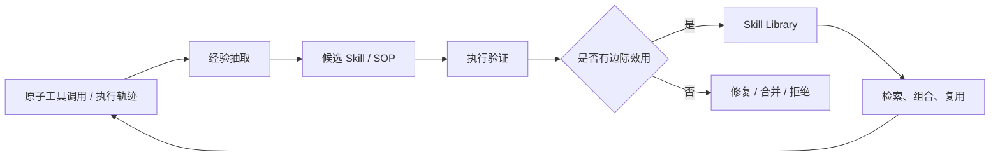

# Skill 与 SOP 演化

> 本目录关注如何把执行轨迹、原子工具调用和失败案例沉淀为可复用、可验证、可维护的能力包。Skill 可以是代码函数、工具组合、SOP、多文件脚本包或可执行工作流。

## 研究链路



## 单篇解读

| 论文 | 主要对象 | 单篇解读 |
| --- | --- | --- |
| EvoSOP | 原子动作到高阶 SOP | [阅读](evosop.md) |
| Socratic-SWE | 编码 Agent Skill 与课程生成 | [阅读](socratic-swe.md) |
| MUSE-Autoskill | Skill 生命周期 | [阅读](muse-autoskill.md) |
| CoEvoSkills | Skill Package 与 Surrogate Verifier | [阅读](coevoskills.md) |
| SkillScriptBench | 可执行 Skill Package 评测 | [阅读](skillscriptbench.md) |
| SkillEvoReg | 演化中的过拟合与正则 | [阅读](skillevoreg.md) |

## 阅读重点

```text
Skill 是否能执行？
Skill 是否比原子工具有边际效用？
Skill 是否在未见任务上可复用？
Skill 是否有版本、验证、合并、淘汰和回滚？
```
