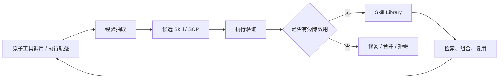

# Skill 与 SOP 演化

> 本目录关注如何把执行轨迹、原子工具调用和失败案例沉淀为可复用、可验证、可维护的能力包。Skill 可以是代码函数、工具组合、SOP、多文件脚本包或可执行工作流。

## 研究链路



## 单篇阅读

| 论文 | 主要对象 | 入口 |
| --- | --- | --- |
| [EvoSOP](evosop.md) | 原子动作到高阶 SOP | 构建、合并、评估与剪枝 |
| [Socratic-SWE](socratic-swe.md) | 编码 Agent Skill 与课程生成 | 轨迹提炼、仓库任务与梯度对齐 |
| [MUSE-Autoskill](muse-autoskill.md) | Skill 生命周期 | 创建、记忆、管理、评测与跨 Agent 使用 |
| [CoEvoSkills](coevoskills.md) | 多文件 Skill Package | 共同演化 Generator 与 Surrogate Verifier |
| [SkillEvoReg](skillevoreg.md) | Skill 演化正则 | 控制膨胀、反例验证与长期泛化 |
| [SkillScriptBench](skillscriptbench.md) | 可执行 Skill Package 评测 | 文档、脚本、一致性与保真 |

## 阅读顺序

```text
EvoSOP：为什么生成能力后还要合并和剪枝
→ MUSE-Autoskill：Skill 的完整生命周期和成本账
→ CoEvoSkills：隐藏测试下如何共同演化 Skill 与验证器
→ SkillScriptBench：如何把 Skill 的可执行性与保真测清楚
→ SkillEvoReg：长期演化如何防止局部更新逐渐过拟合
→ Socratic-SWE：如何把 Skill 接到代码 Agent 任务生成与 RL 训练
```

## 阅读重点

```text
Skill 是否能执行？
Skill 是否比原子工具有边际效用？
Skill 是否在未见任务上可复用？
Skill 是否有版本、验证、合并、淘汰和回滚？
```

注意：Skill 可“生成”不等于可“继承”。每篇文章中的结果需结合任务可执行性、独立验证、库规模、成本和跨任务迁移一起判断。
