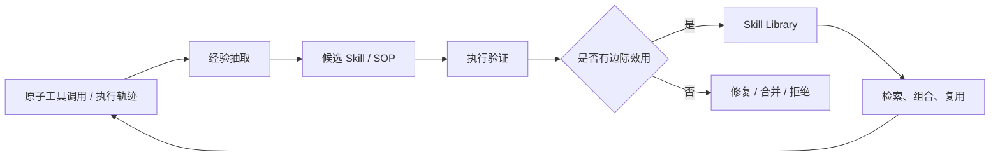

# Skill 与 SOP 演化

> 本目录关注如何把执行轨迹、原子工具调用和失败案例沉淀为可复用、可验证、可维护的能力包。Skill 可以是代码函数、工具组合、SOP、多文件脚本包或可执行工作流。

## 研究链路



## 待深读论文清单

本方向尚未发布完整单篇解读。以下论文将在完成原文方法、实验表和证据边界核验后，逐篇转为本地文章。

| 论文 | 主要对象 | 重点阅读问题 |
| --- | --- | --- |
| [EvoSOP](https://arxiv.org/abs/2607.07321) | 原子动作到高阶 SOP | SOP 构建、合并、评估与剪枝如何协同？ |
| [Socratic-SWE](https://arxiv.org/abs/2606.07412) | 编码 Agent Skill 与课程生成 | Skill 如何驱动可验证任务生成与 Solver 更新？ |
| [MUSE-Autoskill](https://arxiv.org/abs/2605.27366) | Skill 生命周期 | Skill 如何创建、检索、修订、合并与退役？ |
| [CoEvoSkills](https://arxiv.org/abs/2604.01687) | Skill Package 与 Surrogate Verifier | 生成器与替代验证器如何避免共同偏差？ |
| [SkillScriptBench](https://arxiv.org/abs/2610.04008) | 可执行 Skill Package 评测 | Skill 如何在安装、执行、修复与迁移层面被评估？ |
| [SkillEvoReg](https://arxiv.org/abs/2609.30861) | 演化中的过拟合与正则 | 如何避免 Skill 库膨胀和局部验证过拟合？ |

## 阅读重点

```text
Skill 是否能执行？
Skill 是否比原子工具有边际效用？
Skill 是否在未见任务上可复用？
Skill 是否有版本、验证、合并、淘汰和回滚？
```
