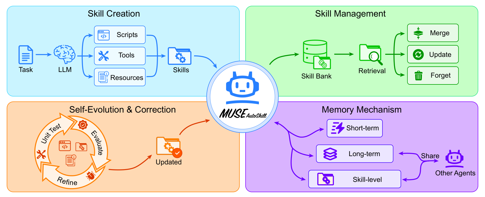

# MUSE-Autoskill：Skill 的创建、记忆、管理、评测与修订

> 论文：**[MUSE-Autoskill: Self-Evolving Agents via Skill Creation, Memory, Management, and Evaluation](https://arxiv.org/abs/2605.27366)**  
> 研究对象：可执行 Skill 的完整生命周期、跨 Agent 复用、Skill 引入后的质量与成本权衡。  
> 核心观点：Skill 系统不能只关注“生成一个新能力”，还要负责保存、发现、调用、评价、修订和跨 Agent 转移。

## 1. 研究问题：Skill 不是一段经验文本

一段经验总结可能告诉 Agent “下次先检查输入格式”；一个真正的 Skill 则更像可复用工作单元：

```text
何时适用
所需工具与依赖
执行步骤
输入输出约束
错误处理
验证方式
```

论文认为很多既有系统只覆盖生命周期的一个局部：能创建 Skill，却没有可靠的 memory / management；或能使用人工 Skill，却不能从自身经验中创造和修订。MUSE-Autoskill 试图把这些环节放进同一 Agent 框架。

## 2. 原文 Figure 2：统一 Skill 生命周期

{ .paper-figure }

> 图源：MUSE-Autoskill 原文 Figure 2。图中展示 Skill 在创建、记忆、管理、评测、修订之间循环。

论文把 MUSE 的能力拆成五个阶段：

| 阶段 | 问题 | 系统动作 |
| --- | --- | --- |
| Creation | 现有 Skill 无法覆盖任务怎么办？ | Skill Creator 从成功轨迹合成候选 Skill |
| Memory | Skill 如何保存、索引和检索？ | Skill Bank 与相关任务经验共同存储 |
| Management | 近似或过期 Skill 如何处理？ | 合并、版本化、筛选和上下文管理 |
| Evaluation | 新 Skill 是否真的更有用？ | 在任务执行中比较质量、延迟、token 等指标 |
| Refinement | Skill 失败时如何修订？ | 基于失败记录更新 Skill 内容或结构 |

这套分类值得直接借鉴到自己的 Agent 项目：**不把 Skill Library 当成一个只增不减的文件夹。**

## 3. Agent 运行时流程

MUSE 的 Master Agent 在 ReAct 循环中处理任务。遇到问题时：

```text
任务到来
→ 检索是否已有适配 Skill
→ 若有，加载并执行
→ 若没有，Skill Creator 从成功轨迹合成新 Skill
→ 评估是否值得保存
→ 更新 Skill Bank 与相关记忆
```

论文还把上下文压缩建模为对 ReAct turn 的有选择保留：早期关键约束和末尾最近状态被固定保留，中间轨迹可按 Skill 需要进行压缩。这避免 Skill 使用本身反而让上下文无限增长。

## 4. 实验设置：不仅测“会不会”，还测“花多少”

论文在 SkillsBench 的 51 个任务上测试三类 Agent 配置：Codex、Hermes 和 MUSE-Autoskill。任务涵盖：

| 领域 | 任务数 |
| --- | ---: |
| Science & Engineering | 14 |
| Data Analysis | 15 |
| Document Processing | 9 |
| Ops & Planning | 13 |
| 合计 | 51 |

对每个 Agent，论文比较三种条件：

```text
without skills：没有 Skill 的基础表现
with human skills：人工 Skill 的参考上限
self-created skills：由 MUSE 根据自己的轨迹生成 Skill
```

这个比较很合理：只同无 Skill 比较，无法知道自动生成 Skill 是否接近人工 Skill；只同人工 Skill 比较，又看不到它本身带来的相对收益。

## 5. 主结果：自动生成 Skill 带来多少收益

原文 Table 4 汇总 51 个任务的准确率：

| 配置 | Accuracy |
| --- | ---: |
| MUSE-Autoskill without skills | 53.19% |
| MUSE-Autoskill with human skills | 68.40% |
| MUSE-Autoskill self-created skills | 60.35% |

这组数字需要分层解释：

1. 人工 Skill 比无 Skill 高 15.21 个百分点，说明该基准中的任务确实存在可复用 workflow。
2. 自动生成 Skill 比无 Skill 高 7.16 个百分点，证明自动创建不是完全无效。
3. 自动生成 Skill 仍低于人工 Skill 8.05 个百分点，说明 Skill synthesis、评测和维护还远未达到“自动等价人工工程化”的程度。

论文摘要中的 `87.94%` 指的是在生成 Skill 相关子任务上的表现，不能与 51 个任务的宏平均 60.35% 混为同一指标。

## 6. 跨 Agent 使用：Skill 的价值不应绑定在创建者身上

原文 Table 3 按领域报告不同 Agent 使用人类 Skill 的表现。以宏平均为例：

| Agent | 无 Skill | 有人类 Skill |
| --- | ---: | ---: |
| Codex | 52.11 | 67.28 |
| Hermes | 47.89 | 61.21 |
| MUSE-Autoskill | 53.19 | 68.40 |

这说明结构化 Skill 不只是为某一个生成模型写的私有提示，至少在论文的任务协议中能跨 Agent 提升表现。但跨 Agent 的可迁移性并不意味着完全模型无关：每个模型的工具格式、上下文窗口、代码执行能力不同，Skill 包仍需在目标 Agent 上运行验证。

## 7. 成本分析：Skill 可以更快，但不是零成本

论文 Table 6 给出 token、延迟和平均 turn 数。MUSE 生成一个 Skill 的一次性成本为：

| 阶段 | Tokens | Latency | Turns |
| --- | ---: | ---: | ---: |
| Skill creation（35 个生成任务） | 383K | 164 s | 7 |

而在 35 个任务上的后续使用成本为：

| MUSE 配置 | Tokens | Latency | Turns |
| --- | ---: | ---: | ---: |
| Without skills | 578K | 684 s | 20 |
| With human skills | 615K | 656 s | 19 |
| With generated skills | **493K** | **411 s** | **15** |

这张表说明 Skill 的经济账：创建时要额外投入，但如果后续有足够多的复用任务，生成 Skill 可降低整体执行 token、延迟和轮数。它不是“任何单次任务都应该先自动造 Skill”，而是一个复用次数与创建成本的权衡问题。

## 8. 应如何理解论文的贡献

MUSE-Autoskill 支持的结论：

- Skill 的创建、存储、调用、评测和修订可以放入一个统一 Agent 生命周期；
- 人类编写 Skill 在 SkillsBench 上有明显价值；
- 自动生成 Skill 可以回收部分价值，并在后续任务中降低执行成本；
- Skill 可以在不同 Agent 间一定程度迁移。

不应过度推导的结论：

```text
自动 Skill 已经达到人工 Skill 的可靠性；
Skill 的创建成本在任何任务分布下都能摊薄；
跨 Agent 迁移不需要重新验证；
Skill 文本越长或越详细就越好；
Skill Library 可无限增长而无需淘汰机制。
```

## 9. 高频问题

### Q1：MUSE 的自动 Skill 比人工 Skill 低，为什么还值得研究？

**回答：**人工 Skill 的质量本身就是很强的参考标准。自动生成从 53.19% 提升到 60.35%，说明自我积累有实际价值；与人工 68.40% 的差距则清晰暴露了当前瓶颈，尤其是 Skill 的正确性、泛化和长期管理。

### Q2：Skill 会不会让上下文变得更长？

**回答：**会，所以论文专门讨论 Context Management。Skill 需要被检索、选择和压缩，而不是每次全量加载。否则 Skill Bank 越大，模型的工具选择和 token 成本反而越差。

### Q3：为什么要报告 latency、token 和 turns？

**回答：**Skill 的目标不仅是提高一次成功率，还应把重复推理压缩成可复用流程。若成功率不变但成本大幅增加，工程价值有限；若少走几步但成功率下降，也没有意义。

### Q4：自动生成 Skill 应该永久保存吗？

**回答：**不应该默认永久保存。论文提供完整生命周期的方向，但生产系统仍需要版本、验证集、回滚、失效检测和权限隔离。一次成功轨迹可能包含偶然条件，不足以成为长期能力。

## 10. 阅读结论

MUSE-Autoskill 的启示是：

> Skill 不是“从成功案例复制出一段说明”，而是一个需要创建成本、复用收益、持续评测和长期维护的能力资产。

它特别适合与 EvoSOP 对读：EvoSOP 从原子工具合成高阶程序，MUSE 则强调围绕 Skill Bank 建立完整的运行时与管理生命周期。
