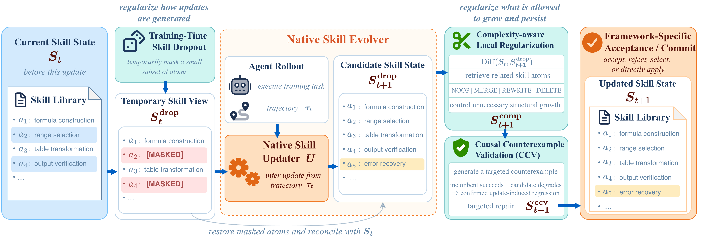

# SkillEvoReg：防止 Skill 演化在长期闭环中过拟合

> 论文：**[SkillEvoReg: Regularizing Agent Skill Evolution Against Overfitting](https://arxiv.org/abs/2609.30861)**  
> 研究对象：Skill 更新的结构膨胀、局部验证过拟合、更新诱发回归。  
> 核心观点：Skill Evolution 也是一种持续学习过程，不能只看“当前更新是否提高验证分数”，还要约束复杂度，并检查新版本是否破坏了旧版本已支持的行为。

## 1. 什么是 Skill Evolution Overfitting

假设当前 Skill 状态为 \(S_t\)，一次执行轨迹为 \(\tau_t\)，原生更新器提出候选：

\[
\widetilde{S}_{t+1}=U(S_t,\tau_t)
\]

如果系统不断接受局部有效的更新，可能产生三类长期问题：

| 类型 | 含义 |
| --- | --- |
| Structural accumulation | 不断堆叠例外、规则和示例，Skill 越来越长 |
| Semantic specialization | 把最近任务的局部规律误当成通用指导 |
| Update-induced regression | 新编辑破坏了旧 Skill 已能完成的行为 |

这三种问题不必同时发生。一条很长的 Skill 未必已经性能下降；一条短编辑也可能精准破坏某个边界条件。因此只看 token 数或只看当前 validation 都不足够。

## 2. 原文 Figure 2：三类正则如何插入 Skill Evolution

{ .paper-figure }

> 图源：SkillEvoReg 原文 Figure 2。三类机制分别作用于更新生成、结构控制和行为验证。

SkillEvoReg 不替换现有系统的原生 Skill updater，而是在其外部加入三个正则层：

```text
Native Skill Evolver 产生候选更新
→ Training-time Skill Dropout
→ Complexity-aware Local Regularization
→ Causal Counterexample Validation
→ 交给原系统的 commit 机制
```

## 3. 三个组件分别解决什么

### 3.1 Skill Dropout：避免更新器过度依赖既有 Skill

训练时随机隐藏部分 Skill 或局部内容，让更新器不能机械复述当前库。它类似神经网络中的 dropout：不是直接评价某一条规则，而是通过扰动输入，降低更新器对偶然共现或特定模板的依赖。

目标不是让 Agent 忘掉已有经验，而是让候选更新在不完整 Skill 上仍能保持较好的功能，从而更可能形成稳健、简洁的规则。

### 3.2 Complexity-aware Local Regularization：控制无收益的结构增长

系统并不追求最短 Skill，而是惩罚相对于当前版本没有足够行为收益的结构扩张，例如：

```text
重复规则
过窄的任务例外
近似示例的无限累积
无必要的多层说明和脚本分支
```

“local”意味着比较候选 \(\widetilde S_{t+1}\) 与当前 \(S_t\)，而不是用一个固定长度阈值粗暴截断。因为有些真正必要的更新确实需要增加结构。

### 3.3 Causal Counterexample Validation（CCV）：验证更新是否伤害旧行为

复杂度小不代表安全。CCV 针对某次候选更新构造或筛选反例：

```text
使用旧 Skill 可以通过的情况
→ 切换到候选新 Skill 后是否失败？
```

它关注的是候选更新的因果效应，而不只是全局平均分。如果一个局部编辑只影响少数高价值行为，平均 validation 可能看不出来；CCV 试图专门暴露这种回归。

## 4. 动机实验：IID 还在涨，迁移已经开始掉

论文在 SpreadsheetBench 跟踪原生 SkillOpt 八个 epoch：

| 时刻 | IID / Familiar 方向 | Transfer 方向 | Skill 结构 |
| --- | --- | --- | --- |
| Epoch 4 | transfer 达到峰值 46.67% | IID-transfer gap 为 7.50 points | 尚可控 |
| Epoch 8 | IID 达到 61.67% | transfer 降到 37.50% | lexical length 达到初始的 23.6 倍 |

这是一种很典型的持续学习现象：系统对熟悉的更新证据越来越适配，表面 IID 指标继续增长，但对结构变化后的任务迁移变差。SkillEvoReg 由此主张：**Skill 是否应该继承，不能只由最近验证集决定。**

## 5. 实验协议

论文在三类设置中挂接 SkillEvoReg，同时保留各自的原生 updater 与 evaluator：

| 设置 | 主要问题 |
| --- | --- |
| SkillOpt | 单一持续演化 Skill 的交付与最终测试 |
| SkillEvolBench | 更新过程中的重放、结构变化、组合与对抗条件 |
| ContinualSkillBench | Skill Library 可创建/修改，考察长期库治理 |

这点很重要。它不是提出一个只对单一 Agent 有效的新 Skill 格式，而是测试正则化机制是否能跨不同演化框架发挥作用。

## 6. 结果一：结构更小不必然牺牲能力

原文 Table 1 中，SkillOpt 的部分结果如下：

| 数据集 | 方法 | Delivery Test | Final Test | Skill tokens | Complexity |
| --- | --- | ---: | ---: | ---: | ---: |
| Spreadsheet | SkillOpt | 54.75 | 47.00 | 6,060 | 116.96 |
| Spreadsheet | SkillEvoReg | **58.50** | **59.25** | **2,341** | **57.21** |
| SearchQA | SkillOpt | 80.46 | **80.86** | 7,924 | 124.42 |
| SearchQA | SkillEvoReg | **81.14** | 80.39 | **1,833** | **39.51** |
| LiveMath | SkillOpt | 34.79 | **36.41** | 6,749 | 110.52 |
| LiveMath | SkillEvoReg | **35.02** | 30.18 | **1,606** | **36.52** |

### 6.1 不能只读成“正则化一定更好”

- Spreadsheet 上，SkillEvoReg 同时提高 Final Test，并显著减少 token 和复杂度，是最理想的情况；
- SearchQA 上，Delivery 略升但 Final 略降 0.75，说明更简洁不必然转换为最终泛化收益；
- LiveMath 上，Final 从 36.41 降至 30.18，说明正则化也可能压掉某些有用的领域特化信息。

论文的结论因此应该表述为：正则化**控制了状态增长，并在部分迁移/后期设置中改善表现**，而不是“在每个数据集、每项指标都提高”。这类负例正是文章可信度的一部分。

## 7. 结果二：长期库治理

原文 Table 3 在 ContinualSkillBench 的 frozen held-out 评测中比较最终 Skill Library：

| 域 | 方法 | Overall | # Skills | Tokens | Complexity |
| --- | --- | ---: | ---: | ---: | ---: |
| Mathematics | Baseline | 67.90 | 33 | 21,952 | 612.26 |
| Mathematics | SkillEvoReg | **69.50** | 32 | **16,368** | **438.30** |
| Law | Baseline | 65.42 | 24 | 25,826 | 645.78 |
| Law | SkillEvoReg | **70.69** | 20 | **19,941** | **507.97** |
| Finance | Baseline | 68.63 | 28 | 78,193 | 1,596.72 |
| Finance | SkillEvoReg | **69.10** | 17 | **71,715** | **1,436.19** |
| Office | Baseline | **82.49** | 18 | 19,038 | 502.45 |
| Office | SkillEvoReg | 81.05 | 17 | **16,087** | **414.60** |
| Healthcare | Baseline | 70.92 | 42 | 33,646 | 822.07 |
| Healthcare | SkillEvoReg | **73.12** | 34 | **28,416** | **727.60** |

这张表有两个层次：

1. SkillEvoReg 在五个域中都减少了库规模或复杂度；
2. 它在 Mathematics、Law、Finance、Healthcare 上提高 Overall，但 Office 略降。

因此，不应把“库更小”当成唯一目标。真正目标是以更少、更可维护的 Skill 保留或提高外部能力；Office 的结果提醒我们，正则强度和任务结构仍需调节。

## 8. SkillEvoReg 与 Selection Is Not Learning 的关系

两篇论文都关心“更新是否值得继承”，但位置不同：

| 工作 | 判断对象 | 主要风险 |
| --- | --- | --- |
| SkillEvoReg | 外部 Skill / Skill Library 的一次编辑 | 结构膨胀、局部规则、更新回归 |
| Selection Is Not Learning | 模型参数更新后的未来模型 | 任务可学但优化后状态变差 |

可以理解为：SkillEvoReg 是对 **非参数能力状态** 做长期正则，Selection Is Not Learning 是对 **模型继承状态** 做独立确认。

## 9. 高频问题

### Q1：SkillEvoReg 是不是简单限制 Skill 长度？

**回答：**不是。它包含训练时 Skill Dropout、局部复杂度正则和针对候选更新的 CCV。长度只是结构复杂度的一部分；一条短规则也可能造成严重回归。

### Q2：为什么当前验证集提升还会导致迁移退化？

**回答：**每次更新来自有限且近期的轨迹。系统可能不断加入对最近任务有用的例外，导致 Skill 对已见结构更精确、对新结构更脆弱。论文的 SpreadsheetBench 轨迹正展示了 IID 上升而 transfer 回落的现象。

### Q3：CCV 和普通回归测试有什么区别？

**回答：**普通回归测试检查固定测试集；CCV 试图围绕“这一次候选更新可能破坏什么”构造或选择针对性反例，并比较旧 Skill 与新 Skill 的行为差异，更接近更新级因果验证。

### Q4：论文是否证明正则化总能提升最终性能？

**回答：**没有。Table 1 的 LiveMath 和 Table 3 的 Office 都显示某些最终指标下降。论文证明的是正则化能稳定控制 Skill 状态增长，并在多类设置中改善或保持有竞争力的性能，而不是保证单调收益。

## 10. 阅读结论

SkillEvoReg 最重要的提醒是：

> 自进化不是“只要当前任务进步就持续追加规则”。每一次持久化 Skill 更新都应同时回答：它带来多少新效用、增加多少复杂度、是否伤害了已经成立的能力。
