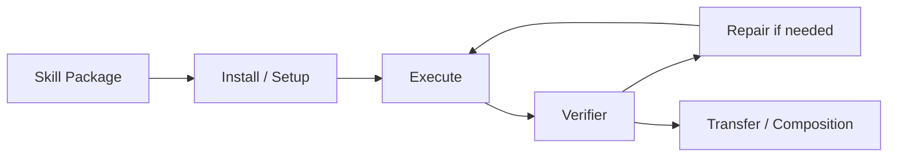

# SkillScriptBench：可执行 Skill Package 的评测

> 论文：**[SkillScriptBench](https://arxiv.org/abs/2610.04008)**  
> 方向：脚本化 Skill、可执行 Package、修复与迁移评测。

## 研究问题

当 Skill 只是自然语言说明时，评测往往只能判断其描述是否合理。真实 Agent 需要的是可执行能力，因此应评测：

```text
Skill 是否可安装？
依赖是否完整？
脚本是否能运行？
失败后是否能修复？
能否被后续任务组合与迁移？
```

## 评测对象

SkillScriptBench 将 Skill 定义为更接近软件包的对象：

```text
说明文档 + 脚本 + 资源 + 配置 + 执行约束
```

这使评测从文本质量转向执行质量。

## 评测意义



该框架可用于检验 Skill 演化系统是否真正产生了可执行资产。

## 阅读结论

SkillScriptBench 的核心贡献是评测观念转变：

> 对工具型 Agent 而言，Skill 的真实性不取决于文本描述的流畅度，而取决于其在依赖、执行、修复和迁移条件下的实际行为。
