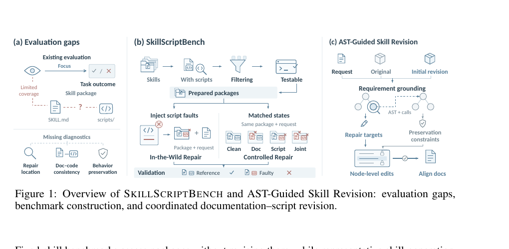

# SkillScriptBench：可执行 Skill Package 的修复与保真评测

> 论文：**[SkillScriptBench: Benchmarking Self-Evolution of Executable Agent Skill Packages Beyond Markdown](https://arxiv.org/abs/2610.04008)**  
> 研究对象：包含说明文档、脚本、资源和配置的可执行 Skill Package。  
> 核心观点：Skill 自进化不能只评估文档写得是否合理，还要分别测试脚本修复、文档修复、文档与代码一致性，以及不破坏原本正确行为的能力。

## 1. 为什么 Markdown 级评测不够

在很多 Agent 系统中，一个 Skill 常以 `SKILL.md` 表示。但可执行 Skill 往往还有脚本、配置、资源和调用关系。只修改 Markdown 可能出现：

```text
文档说明正确，但脚本仍然报错
脚本修好了，但参数说明还停留在旧版本
修复了当前问题，却破坏了此前正确的功能
```

SkillScriptBench 因此将评测对象从“文本说明”升级为 **Skill Package**，把代码与文档的协同维护纳入自进化的定义。

## 2. 原文 Figure 1：基准与 AST-Guided Revision

{ .paper-figure }

> 图源：SkillScriptBench 原文 Figure 1 裁图。左侧说明现有评测缺口，中间是两条 benchmark track，右侧是 AST-Guided Skill Revision。

图中的三部分分别对应：

1. **Evaluation gaps**：既有评测常只关注任务是否完成，无法定位文档、脚本一致性和保真问题；
2. **SkillScriptBench**：构建真实包修复任务和受控故障状态；
3. **AST-Guided Skill Revision**：将维护请求关联到代码 AST 节点与调用关系，再进行受限的脚本编辑并同步文档。

## 3. Benchmark 由哪些任务组成

论文共构建 **350 个任务**，分为两条轨道：

| 轨道 | 任务数 | 构造方式 | 主要意义 |
| --- | ---: | --- | --- |
| In-the-Wild Repair | 150 | 从超过 35,000 个 GitHub Skill roots 中筛选 100 个包，注入脚本故障 | 检验真实包修复能力 |
| Controlled Repair | 200 | 来自 50 个包，在同一维护请求下设置四种状态 | 分离不同错误类型的影响 |

Controlled Repair 的四种状态为：

```text
Clean：原始正确包
Doc：仅文档故障
Script：仅脚本故障
Joint：文档和脚本同时故障
```

这种配对设计让评测不只问“最后成功了吗”，还可以问：

- 方法能否修好 Script fault？
- 只需要修文档时，会不会误改代码？
- Clean package 上，方法会不会引入回归？
- 文档与脚本是否保持一致？

## 4. AST-Guided Skill Revision 如何工作

论文将 AST-Guided Skill Revision 作为可插拔的修订阶段，接在已有方法的初步修改之后：

```text
维护请求 + 原始 Package + 初步 Revision
→ Requirement Grounding
→ 定位相关 AST 节点与调用关系
→ 限制代码编辑范围
→ 用 preservation constraints 防止误改
→ 同步更新文档，使其符合修改后的脚本
```

其核心不是“让模型多改一些代码”，而是减少无关编辑。维护请求可能只涉及某个参数的默认值或行为边界；若模型在整个包内自由修改，容易引入新错误。AST 和调用关系提供结构化定位，保真约束则提醒系统不要破坏与当前请求无关的行为。

## 5. 结果：脚本修复、文档修复与保真必须分别看

论文在四个 LLM 上比较，得到三个重要结果：

1. 同时修改文档和脚本的方法能够修复 Script fault；
2. 但在纯文档修复或 Clean package preservation 上，并不稳定地超过 Markdown-only revision；
3. 加入 AST-Guided Skill Revision 后，修复成功和跨重复运行的稳定性都有明显提升。

原文摘要给出平均绝对提升：

| 方法底座 | Faulty Package Repair Success 提升 | 三次运行均解决的比例提升 |
| --- | ---: | ---: |
| Raw Package | +21.9 pp | +20.8 pp |
| CoEvoSkills adaptation | +27.7 pp | +31.5 pp |

论文正文还报告，在四个模型上，AST-guided 阶段将 Raw Package 的 faulty-package repair 从 54.8% 提升至 76.7%；将 CoEvoSkills adaptation 从 48.8% 提升至 76.5%。

### 5.1 为什么“三次均解决”是重要指标

LLM Agent 修复代码常有随机性。单次成功可能只是采样到恰好可行的 patch；要求三次运行都成功，更接近观察修订过程是否稳定。`+20.8 pp`、`+31.5 pp` 表示方法不只提高单次命中，也提高可重复的工程可靠性。

## 6. 这篇基准与 CoEvoSkills 的关系

CoEvoSkills 研究“如何演化多文件 Skill”，SkillScriptBench 则追问“如何证明这种演化真的修好了 Package，且没有破坏正确行为”。两者关系如下：

| 工作 | 主要对象 | 核心问题 |
| --- | --- | --- |
| CoEvoSkills | 生成器与 surrogate verifier | 如何在隐藏测试下迭代改进 Skill？ |
| SkillScriptBench | Package 级评测与 AST 修订 | 如何拆分修复、文档一致性和保真？ |

SkillScriptBench 也把 CoEvoSkills 作为适配对象之一，说明它不是替代生成框架，而是提供更严格的评测和修复工具。

## 7. 证据边界

论文证明了：

- Package 级 Skill 的评测不能只看任务结果或 Markdown；
- 文档、脚本和保真应作为不同能力分别测量；
- AST 定位和调用关系能减少无关代码修改，并改善故障包修复稳定性；
- 按照论文构造的 350 个任务，现有方法在不同故障状态上的表现差异很大。

它没有证明：

```text
AST 定位可以覆盖动态语言中的所有运行时依赖；
所有维护请求都能被形式化为局部 AST 编辑；
更严格的 preservation constraints 不会漏掉必要的跨文件修改；
GitHub 中筛选出的包完全代表企业内部 Skill 生态。
```

## 8. 高频问题

### Q1：为什么不只跑最终测试就够了？

**回答：**最终测试只说明某次任务结果，不能区分“修了脚本”“修了文档”“两者不同步”还是“把原来正确的功能改坏了”。SkillScriptBench 通过 Clean / Doc / Script / Joint 配对状态分别测量这些能力。

### Q2：AST-Guided Revision 是不是限制了模型的创造性？

**回答：**它限制的是无关编辑范围，不是禁止复杂修复。对于维护任务，盲目改动整个包经常是风险来源；AST 和调用关系帮助模型把修改集中在与需求相关的节点，保留其他已正确行为。

### Q3：为什么要同步文档？

**回答：**Skill 的调用者通常依据 `SKILL.md` 使用脚本。若脚本接口变化而文档不变，后续 Agent 会按错误说明调用正确脚本，仍然失败。因此文档-脚本一致性本身就是可执行能力的一部分。

### Q4：350 个任务是否足以评价所有 Skill 系统？

**回答：**不够。它覆盖了多种包结构、语言和维护请求，但仍受所采样 GitHub Skill roots、注入故障类型和可执行检查范围限制。它是比 Markdown 级评测更严格的一步，而不是终局基准。

## 9. 阅读结论

SkillScriptBench 对自进化 Agent 的价值在于提出一个更工程化的标准：

> 一条 Skill 是否“进化成功”，不仅要看是否完成当前任务，还要看脚本是否可执行、文档是否同步、已有行为是否保留，以及多次运行是否稳定。
