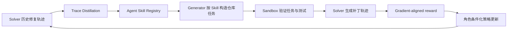
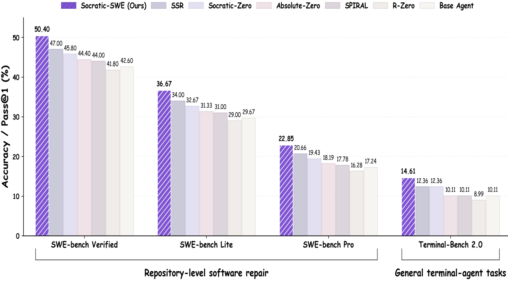

# Socratic-SWE：由解题轨迹驱动的自进化编码 Agent

> 论文：**[Socratic-SWE: Self-Evolving Coding Agents via Trace-Derived Agent Skills](https://arxiv.org/abs/2606.07412)**  
> 研究对象：软件工程 Agent 的修复轨迹、Skill Registry、仓库内自生成任务、Generator-Solver 联合训练。  
> 核心问题：历史修复轨迹怎样不只被当作训练样本，还能被提炼成可复用 Skill，并进一步生成真正能训练 Solver 的仓库级修复任务？

## 1. 为什么代码 Agent 的自进化特别难

给编码 Agent 做自进化，不能只让它“自己出题、自己做题”。软件工程任务有几个额外约束：

```text
任务必须和仓库状态一致
修复后必须能执行验证器
任务不能泄露真实评测答案
难度必须位于当前 Solver 的可学习区域
新任务带来的梯度还要与目标能力方向一致
```

随机修改代码、生成任意 bug，往往会得到两类低价值任务：

- **太容易**：模型本来就会，更新几乎没有信息；
- **太偏/太难**：任务虽然复杂，但训练更新无法迁移到目标基准。

Socratic-SWE 的主要贡献是把“生成可验证任务”和“选择对 Solver 有训练价值的任务”分开处理。

## 2. 整体闭环：轨迹、Skill、任务和策略更新



论文使用一个共享策略 \(\pi_\theta\)，但通过不同 prompt 让它承担两个角色：

| 角色 | 输入 | 输出 |
| --- | --- | --- |
| Generator | 仓库、Skill、当前 Solver 结果 | 候选修复任务和验证器 |
| Solver | 被接受的任务、仓库和验证器 | 修复 patch / 工具调用轨迹 |

共享参数不代表两种目标混在一起。论文通过角色条件化奖励分别优化“生成什么任务”和“怎样修复任务”。

## 3. Trace-Derived Skill：从成功与失败中提炼什么

论文中的 Skill 不是某个具体 patch，而是从解题轨迹中抽象出可迁移的修复知识，例如：

```text
定位某类失败时应先查看哪些文件
某个库常见的 API 使用约束
修改循环边界后需要补充哪些回归测试
多文件变更时如何验证调用链一致性
```

Skill Registry 的功能是让 Generator 不只随机编辑仓库，而能围绕过去出现过的有效修复模式构造新任务。这样，“经验”既影响 Solver 的行为，也影响下一轮课程分布。

## 4. 任务验证：为什么要在仓库 sandbox 中执行

Generator 提出的候选任务 \((\tau,v,r)\) 包含任务描述、验证器和仓库。论文将候选按以下顺序过滤：

```text
格式检查
→ 与仓库事实的 grounding 检查
→ sandbox 中的执行检查
→ 语义/可判定性检查
```

只有通过验证的任务才进入下一轮训练集合。这一点非常关键：如果问题本身不可复现、测试不稳定或与代码无关，后续 RL 将优化噪声。

但通过 sandbox 验证不代表任务必然值得训练。它只说明“任务可执行、可判定”；下一步还需要判断该任务产生的更新是否指向目标能力。

## 5. Gradient-Aligned Reward：难题不一定是好训练题

Socratic-SWE 的难点不是简单最大化任务难度，而是衡量候选任务的训练梯度是否和验证目标的梯度方向一致。

直觉上：

```text
一个任务很难
≠
对目标 benchmark 有用
```

论文使用梯度方向的一致性作为 Generator 的奖励依据。若候选任务上的更新方向与 held-out validation 目标更接近，说明它更可能促进真正关心的能力；若方向相反，即使该任务能让 Solver 学到某些局部模式，也不应该优先保留。

论文的附录分析指出，内积会混合“梯度方向”和“梯度大小”：复杂多文件 patch 可能产生大梯度，却不一定有用。因此作者使用 cosine similarity，让评分更聚焦在方向一致性。

## 6. 实验设置

论文以 Qwen3.5-9B 为基础 Agent，在固定 **36k 实例训练预算** 下比较多轮自进化。评测涵盖：

| 基准 | 考察能力 |
| --- | --- |
| SWE-bench Verified | 真实 GitHub issue 修复 |
| SWE-bench Lite | 较小规模的软件工程修复 |
| SWE-bench Pro | 更高难度修复任务 |
| Terminal-Bench 2.0 | 终端工具使用与执行能力 |

对照包括 R-Zero、SPIRAL、Absolute-Zero、Socratic-Zero、SSR 等不同自生成/自进化训练方案。比较的重点不是只看第一轮，而是观察三轮迭代是否持续带来改进。

## 7. 原文 Figure 2：固定预算下的主结果

{ .paper-figure }

> 图源：Socratic-SWE 原文 Figure 2。图中比较所有方法在固定 36k 训练实例预算下的总体表现。

Figure 2 的作用是控制训练数据规模。若一种方法仅仅因为生成了更多数据而更好，不能说明其任务选择或 Skill 机制更有效；固定预算后，比较更接近“同样成本下，哪些训练实例更有价值”。

## 8. 多轮结果：为什么要看曲线而非只报最高分

原文 Table 1 中，Base Agent 在 SWE-bench Verified 为 42.60。下表选取部分迭代结果：

| 方法 | Iteration 1 | Iteration 2 | Iteration 3 | 最终趋势 |
| --- | ---: | ---: | ---: | --- |
| R-Zero | 43.20 | 42.00 | 41.80 | 先微升后退化 |
| SPIRAL | 43.80 | 44.40 | 44.00 | 有提升但后期波动 |
| Absolute-Zero | 44.20 | 45.00 | 44.40 | 第二轮较高，第三轮回落 |
| SSR | 44.20 | 45.80 | 47.00 | 持续提升 |
| Socratic-SWE | 46.20 | 49.80 | **50.40** | 三轮持续提升 |

### 8.1 如何读这张表

1. 自进化不能只看第一轮。R-Zero 在第一轮超过 Base Agent，但后两轮低于第一轮，说明“能产生一次可用更新”不等于长期闭环稳定。
2. Socratic-SWE 在三轮中从 46.20 持续增加到 50.40，论文据此主张 Trace-Derived Skill 与梯度对齐任务选择更能维持后续训练价值。
3. `50.40%` 是特定底座、固定 36k 预算、三轮迭代和该评测协议下的数字；它不是所有编码 Agent 都可直接达到的结论。
4. 还需要看其它基准：论文在 Lite、Pro、Terminal-Bench 2.0 上也报告收益，才使“只对 SWE-bench Verified 过拟合”的解释相对弱一些，但仍无法替代完全独立的复现。

## 9. 消融：哪些组件真正贡献了收益

原文 Table 2 在 SWE-bench Verified 上给出：

| 变体 | Verified | 相对完整方法 |
| --- | ---: | ---: |
| Socratic-SWE | **50.40** | - |
| 去掉 Skill Registry | 46.20 | -4.20 |
| 去掉 Trace Distillation | 48.00 | -2.40 |
| 用 GRPO 替代 GDPO | 48.60 | -1.80 |
| 使用 Qwen3.5-9B 自提取 Skill | 49.80 | -0.60 |
| 用 Claude Opus 4.5 提取 Skill | 51.00 | +0.60 |

这张表可以逐项解释：

- **Skill Registry 的作用最大**：移除后下降 4.20，说明将轨迹经验组织为可检索的能力库，比只依赖一次性的样本提炼更重要。
- **Trace Distillation 有独立贡献**：去掉后下降 2.40，支持“轨迹不是普通训练数据”的设计。
- **GDPO 优于直接 GRPO**：下降 1.80，说明用于任务价值的对齐目标并非无关紧要。
- **Skill 提取器模型影响有限但存在**：强模型提取的 Skill 略好，意味着 Skill 质量仍是上游瓶颈。

### 9.1 Generator reward 消融

论文还比较不同任务生成奖励：

| Generator reward | SWE-bench Verified |
| --- | ---: |
| Hardness \(1-p\) | 47.40 |
| Uncertainty | 48.20 |
| Variance | 48.80 |
| Gradient-aligned | **50.40** |
| Gradient + Difficulty hybrid | 50.60 |

“越难越好”反而最差，因为极难任务会让所有 rollout 都失败，优势值接近零，无法提供有效梯度。梯度对齐奖励更倾向于选择真实修复模式中常见、但当前模型尚未掌握的任务。

## 10. 证据边界与复现实务

论文支持以下观点：

1. 修复轨迹可以被提炼成驱动任务生成的 Skill；
2. repository sandbox 验证能够提高自生成训练任务的可执行性；
3. 相比只追求难度，选择与验证目标梯度方向一致的任务更有效；
4. 在论文设置中，完整闭环比多个自进化基线表现更稳定。

仍需谨慎的部分：

```text
Gradient alignment 需要 held-out validation 信号，计算成本可能较高；
仓库池有限时，Skill 与任务分布可能逐渐贴近评测仓库；
共享策略的 Generator 和 Solver 可能存在角色间干扰；
可验证任务不等于对真实工程需求有价值；
不同语言、依赖系统和代码生态下的迁移仍需要单独测量。
```

## 11. 高频问题

### Q1：Socratic-SWE 和普通 self-play 有什么区别？

**回答：**普通 self-play 常让一个角色出题、另一个角色解题。Socratic-SWE 额外从历史修复轨迹提炼 Agent Skill，用 Skill 约束任务生成，并用仓库 sandbox 验证任务；更进一步，它用梯度对齐判断任务是否真的有利于目标能力。

### Q2：为什么不直接选择最难的 bug？

**回答：**极难任务可能使所有候选 patch 都失败，训练梯度接近无信息；而且困难点可能与目标 benchmark 无关。论文用 Gradient-aligned reward 衡量“更新方向是否有用”，而不是只衡量失败概率。

### Q3：Skill Registry 的作用为什么大？

**回答：**它将一次性轨迹压缩成可复用的修复模式，并使 Generator 能基于当前能力缺口构造任务。去掉它后，任务生成更像从原始轨迹或仓库中盲目采样，Table 2 中验证集表现下降 4.20。

### Q4：50.40 是否意味着模型可以解决一半真实软件问题？

**回答：**不能这样解释。它是 SWE-bench Verified 特定协议下的百分比，依赖问题集、仓库快照、补丁验证方式、模型、训练预算和迭代次数。它能说明该配置下的相对改进，但不是现实软件工程的通用成功率。

## 12. 阅读结论

Socratic-SWE 把软件工程 Agent 的自进化写成一个更严格的闭环：

> 轨迹先沉淀为可迁移 Skill，Skill 再指导可执行任务生成，任务是否被继承还取决于它是否能产生与目标能力一致的训练更新。

它最有价值的部分不是“让模型自己出代码题”，而是把 **任务可执行性** 与 **任务训练价值** 分别验证。
