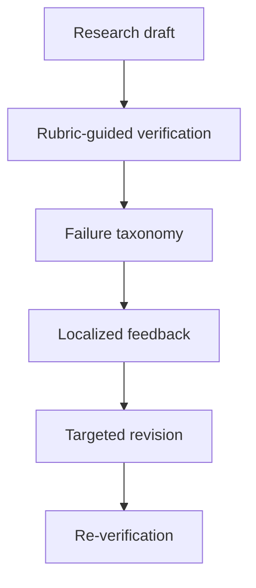

# DeepVerifier：以失败分类驱动的深度研究 Agent 验证

> 论文：**[Inference-Time Scaling of Verification in Self-Evolving Deep Research Agents](https://arxiv.org/abs/2601.15808)**  
> 项目名称：DeepVerifier。  
> 作者单位：腾讯 AI Lab、香港中文大学、新加坡管理大学、中国人民大学等。  
> 发表状态：arXiv 页面标注为 ACL 2026 Findings。

## 1. 研究问题

深度研究 Agent 的最终答案通常包含多个子结论、证据来源和任务覆盖要求。单一“答案是否正确”的 LLM judge 很难定位问题所在。

DeepVerifier 提出：

> 将验证过程分解为明确的失败类别和 rubric，可否在 inference time 形成更可靠的、可操作的修订反馈？

## 2. 方法

论文将失败划分为 5 个主要类别和 13 个子类，并让 verifier 围绕 rubric 检查 Agent 输出。



与一般 agent-as-judge 相比，DeepVerifier 的关键区别是：反馈不只是“好/坏”或总分，而是关联到可修复的失败类型。

## 3. 实验与结果

论文报告：

- 相对 vanilla agent-as-judge 与一般 LLM judge，验证器元评测 F1 提升 12%–48%；
- 在 GAIA 与 XBench-DeepResearch 的困难子集上，推理时准确率提升 8%–11%。

这些数字支持“更细粒度 verifier 有助于 inference-time revision”，但需要注意：提升依赖任务类别、失败 taxonomy 和额外验证调用预算。

## 4. 方法价值

DeepVerifier 代表的不是参数级学习，而是：

```text
输出
→ 可归因验证
→ 局部修订
→ 再验证
```

它将验证器视为 Agent 自进化的核心部件，而非最终评分器。

## 5. 证据边界

阅读该工作时应检查：

- failure taxonomy 是否能覆盖其他领域；
- rubric 是否与任务真值独立；
- verifier 是否增加过多推理成本；
- Agent 是否可能学会迎合 rubric 而非改善真实性；
- 多轮 revision 是否会出现自我确认循环。

## 6. 阅读结论

DeepVerifier 的核心启示是：

> 自进化的质量很大程度上由反馈的可归因性决定。无法定位错误的 verifier，难以支持可靠的长期修订。
