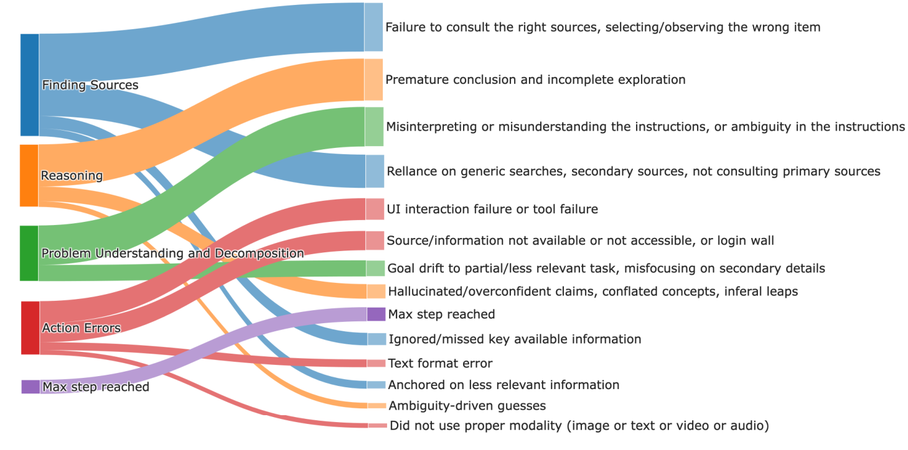
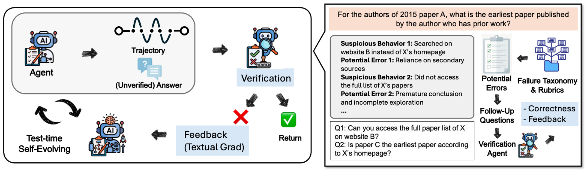

# DeepVerifier：用失败分类驱动深度研究 Agent 的推理时修订

> 论文：**[Inference-Time Scaling of Verification: Self-Evolving Deep Research Agents via Test-Time Rubric-Guided Verification](https://arxiv.org/abs/2601.15808)**  
> 研究对象：深度研究 Agent 的失败 taxonomy、rubric verifier、test-time feedback loop。  
> 需要先区分：本文主要是**推理时反馈与修订**，不是让 Agent 在部署过程中永久更新模型参数。

## 1. 研究背景：为什么一个总分不够用

深度研究 Agent 的错误通常不只是“答案错了”。它可能：

```text
漏掉关键证据
使用不可信或不相关来源
没有满足用户的子要求
推理链在中间步骤断裂
最终答案与收集到的证据不一致
```

如果 verifier 只输出一个总分或“正确/不正确”，Agent 不知道下一轮应该改什么。DeepVerifier 的核心思路是把验证拆成可定位的失败类型，再生成对应的修订反馈。

## 2. 从失败轨迹构造 taxonomy

论文先在 WebAggregatorQA 上收集深度研究 Agent 轨迹，避免与后续 GAIA、BrowseComp、XBench-DeepSearch 的评测集重合。

| 项目 | 数量 / 范围 |
| --- | --- |
| 任务数 | 90 |
| Agent actions | 2,997 |
| 每条轨迹步数 | 2 到 156，平均 33.3 |
| 轨迹 token 总量 | 738M |
| 人工标注错误点 | 555 |
| 主类别 / 子类别 | 5 / 13 |

两名研究人员独立标注错误点，再合并结果；论文报告其中一个标注者错误点与另一人的平均重叠率为 63.0%。这不代表 taxonomy 没有主观性，但说明它并非完全由模型自动猜出。

{ .paper-figure }

> 图源：DeepVerifier 原文 Figure 3。该图将 555 个错误点归入五类、十三个更细的子类。

## 3. 原文 Figure 2：Verification-asymmetry 如何落到 Agent loop

{ .paper-figure }

> 图源：DeepVerifier 原文 Figure 2。点击图片可放大。

论文依据“验证通常比从头求解便宜”的不对称性，将复杂研究任务拆成较小检查项：

```text
Agent 生成研究答案和执行轨迹
→ DeepVerifier 按 rubric 检查失败类别
→ 输出局部化反馈
→ Agent 依据反馈修订答案/继续检索
→ 再次验证
```

这里的自进化是行为层面的：同一个 Agent 在同一任务上多轮反思，逐步改变当前答案和轨迹。基础模型不需要为每轮反馈重新训练。

## 4. Verifier 本身如何评估

论文不只报告“加了 verifier 后答案分数提高”，还对 verifier 做 meta-evaluation。摘要报告 DeepVerifier 相对 vanilla agent-as-judge 与一般 LLM judge，在验证元评测 F1 上提高 12% 到 48%。

这一层评估很必要。若 verifier 本身不能识别真实错误，那么更多反馈轮次只是让 Agent 更频繁地追随错误信号。

但 F1 高也不等于每次反馈都正确。后续结果正显示，重复反馈会同时修复一些错误答案，也会偶尔把原本正确的答案改坏。

## 5. 推理时 scaling 实验：轮数并非越多越好

原文 Table 3 在 GAIA 上比较不同 feedback rounds。以下为 Full split：

| 模型 | 0 轮 | 2 轮 | 4 轮 | 10 轮 | Final Gain | Best Gain |
| --- | ---: | ---: | ---: | ---: | ---: | ---: |
| Claude-3.7 | 52.22 | 56.49 | **60.12** | 58.93 | +6.71 | +7.90 |
| GPT-4.1 | 29.51 | **32.53** | 31.92 | 31.92 | +2.41 | +3.01 |
| DeepVerifier-8B | 26.73 | 30.99 | 31.60 | **32.21** | +5.48 | +5.48 |

### 5.1 如何解释这张表

- Claude-3.7 在第 4 轮达到最高 60.12，但第 10 轮回落到 58.93；
- GPT-4.1 的收益较小，且很早饱和；
- 经过 DeepVerifier-4K SFT 的开源 8B 模型能够随轮数持续提高，但绝对分数仍远低于强闭源模型。

因此“验证可扩展”不应理解为“无限增加反馈轮数即可单调提高”。论文自身的表格说明存在最佳轮数，且不同模型的峰值位置不同。

## 6. 为什么后期会回落：正确答案也可能被改坏

原文 Table 5 统计相邻 feedback round 的状态迁移：

| Round | Incorrect → Correct | Correct → Incorrect |
| --- | ---: | ---: |
| 1 | 18.99% | 12.79% |
| 2 | 9.33% | 4.44% |
| 3 | 6.94% | 4.30% |
| 4 | 8.45% | 1.06% |
| 5 以后 | 修复比例快速接近 0 | 少量回归仍会出现 |

前几轮能修复较多错误，之后可修复空间变小；但 verifier 的假阳性或反馈误导仍可能导致正确答案转为错误答案。这正是 GAIA 曲线出现早期上升、后期波动的原因。

这个实验是很好的阅读提醒：任何“多轮自我反思”方法都应报告 **best score** 和 **final score**，否则只报一个峰值容易掩盖后期退化。

## 7. 外部数据集：不是只在 GAIA 上有效

原文 Table 4 报告：

| 数据集 | 0 轮 | Best | 10 轮 | Final Gain | Best Gain |
| --- | ---: | ---: | ---: | ---: | ---: |
| XBench-DeepSearch | 41.0 | 47.0 | 44.0 | +3.0 | +6.0 |
| BrowseComp | 5.0 | 10.0 | 9.0 | +4.0 | +5.0 |

这使结论更有说服力：相同 verifier 思路在多语言深度搜索和极难网页研究任务上也有收益。不过 BrowseComp 的绝对分数非常低，说明 verifier 不能消除任务本身的困难；它只能在已有能力之上提供局部修订信号。

## 8. DeepVerifier-4K 与开源模型

论文还发布 DeepVerifier-4K：包含 4,646 个高质量 Agent step 的监督微调数据，重点是反思和自我批评。Qwen3-8B 在加入该数据后形成 DeepVerifier-8B，在 GAIA Full 上从 26.7% 上升到 32.2%，增益为 5.5 points；仅使用 CK-Pro 数据的模型增益较小。

这部分说明 verifier 不只能以 API 模块形式调用，也可以通过数据蒸馏转移给开源模型。但它依然是特定数据、特定 Agent 框架下的结果，不能直接推导为“任何 8B 模型学会反思后都能获得相同收益”。

## 9. 论文证明了什么，没有证明什么

论文支持：

1. 失败 taxonomy 能把深度研究 Agent 的错误转成较可操作的 rubric；
2. 该 verifier 在论文元评测中优于若干 judge 基线；
3. 推理时 rubric feedback 在 GAIA、DeepSearch、BrowseComp 上带来有限但可见的改进；
4. 反馈轮数需要控制，过多轮次可能引发回归。

论文没有证明：

```text
taxonomy 已覆盖所有深度研究错误；
更多验证调用总是优于增加基础模型采样；
verifier 对所有领域、语言与工具环境都可靠；
多轮修订可以替代模型训练或独立事实核查；
第 4 轮的最佳分数能稳定复现为最终部署效果。
```

## 10. 高频问题

### Q1：DeepVerifier 是 reward model 吗？

**回答：**它可以作为 outcome reward verifier 使用，但论文的主要用法是推理时产生 rubric 反馈，引导 Agent 修订当前答案。它不只是给一个标量 reward，而是尝试定位失败类别和修复方向。

### Q2：为什么验证可以比求解更容易？

**回答：**对于复杂答案，从头找到所有证据和正确结构可能很难；但给定一个答案后，检查是否漏项、引用是否支持结论、是否满足格式等子问题通常更局部。这种不对称是 DeepVerifier 能拆解检查的前提，但并不是绝对成立。

### Q3：为什么最好分数和最终分数要同时报告？

**回答：**多轮反馈可能既修正错误也引入新错误。只报告最好分数会掩盖继续迭代后的回归；最终分数才更接近固定轮数部署时的实际表现。

### Q4：这算不算 Agent 自进化？

**回答：**算广义的行为自适应或推理时自我修订，但不等于参数持续学习。它更新的是当前任务内的答案、计划和轨迹，不必然形成永久能力。

## 11. 阅读结论

DeepVerifier 最值得借鉴的原则是：

> 自我修订的上限由反馈质量决定。把“答案不好”拆成可验证、可定位的失败类别，比单纯增加反思轮数更重要；同时必须用独立 meta-evaluation 和回归统计约束 verifier 本身。
