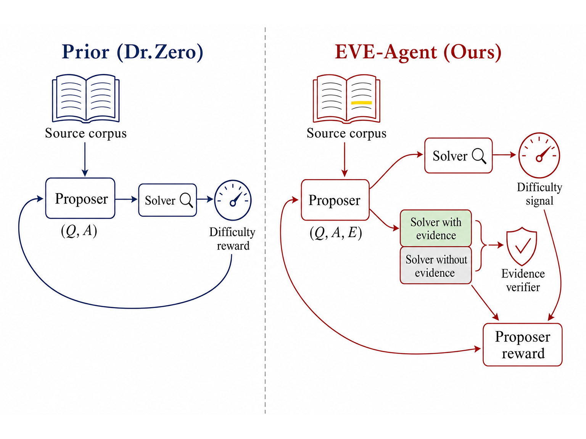
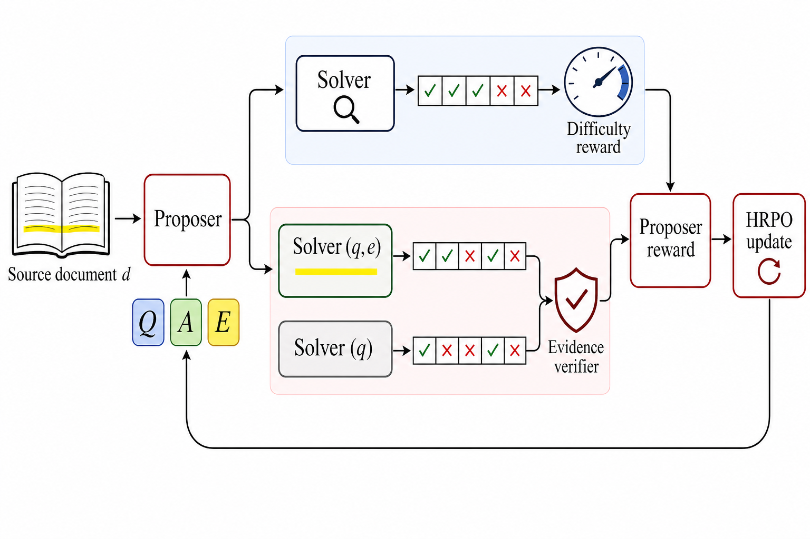

# EVE-Agent：把“有证据”写进自生成训练数据

> 论文：**[EVE-Agent: Evidence-Verifiable Self-Evolving Agents](https://arxiv.org/abs/2605.22905)**  
> 研究对象：自生成搜索题目、答案、可验证证据片段，以及证据的边际效用。  
> 核心问题：如果 Agent 自己生成问题和答案，但答案缺少可核查支持，为什么这些样本应该被继承为下一轮训练数据？

## 1. 仅按难度奖励会产生什么问题

数据自由的 proposer-solver 系统通常这样工作：

```text
Proposer 生成问题与答案
→ Solver 尝试作答
→ Solver 越不确定，任务越“有训练价值”
→ 用这些样本训练下一轮模型
```

但“Solver 不确定”只说明任务不容易，并不说明 Proposer 给出的答案被资料支持。一个语句流畅、答案看似合理、却没有证据支撑的样本，仍可能被错误地当成高价值训练数据。

EVE-Agent 加入一个新条件：每个候选样本必须是 `(question, answer, evidence span)` 三元组，且 evidence span 不是自由解释，而是从源文档或搜索片段中逐字抽取的可定位文本。

## 2. 原文 Figure 1：从难度驱动到证据可验证驱动

{ .paper-figure }

> 图源：EVE-Agent 原文 Figure 1。左侧仅依赖 Solver 难度，右侧增加 evidence verifier 和可审计三元组。

论文并不替换 backbone、retriever、search tool 或 RL 优化器。改变的是 Proposer 提供的训练实例形式，以及评价 Proposer 的奖励。

## 3. 原文 Figure 2：一轮 EVE-Agent 的数据流

{ .paper-figure }

> 图源：EVE-Agent 原文 Figure 2。点击图片可放大。

每一轮 Phase A 可以拆成：

```text
源文档 d
→ Proposer 生成 q, a, e
→ Solver 在可搜索条件下作答，得到任务难度信号
→ 关闭搜索的辅助 rollout：分别给/不给 evidence e
→ 比较两种条件下答对 a 的概率
→ 得到 evidence verifier 分数
→ 结合格式、难度、证据效用和长度，更新 Proposer
```

`e` 必须来自原文档或检索片段。这保证样本可被回看和审计，但不保证该片段一定足以支持最终答案，因此还需要边际效用验证。

## 4. Evidence verifier：测量“证据是否真的帮助答对”

论文定义两种正确概率：

\[
p_+^t(q,e,a)
=\Pr_{\hat a\sim\widetilde\pi_{\mathrm{sol},t}(\cdot\mid q,e)}[\hat a=a]
\]

\[
p_-^t(q,a)
=\Pr_{\hat a\sim\widetilde\pi_{\mathrm{aux},t}(\cdot\mid q)}[\hat a=a]
\]

证据边际价值为：

\[
V_t(q,e,a)=p_+^t(q,e,a)-p_-^t(q,a)
\]

它问的是一个反事实问题：

> 给出这段证据后，Solver 答对目标答案的概率是否真的提高？

如果答案本来就能靠模型记忆猜对，或者证据与答案无关，\(V_t\) 会较小；如果证据明显改善回答概率，它才是可用的训练支撑。

## 5. Proposer 和 Solver 分别学什么

Proposer 的奖励由四部分组成：

\[
R^{\mathrm{pro}}_t
=\frac{1}{2}F_{\mathrm{fmt}}
+R^{\mathrm{DZ}}_t
+\lambda_VV_t
+\lambda_BB(e)
\]

对应：

- 格式可用性；
- 任务难度（difficulty）；
- 证据的边际价值；
- 证据长度约束。

Solver 的奖励不仅包含答案正确性，也包含生成证据与目标证据之间的匹配：

\[
R^{\mathrm{sol}}=R_{\mathrm{correct}}+\lambda_ER_{\mathrm{evidence}}
\]

这样，系统既训练“答对”，也训练“给出正确的答案依据”。

## 6. 实验设置

论文在开放域 QA 数据集上评价 evidence-grounded correctness：

| 数据集 | 特征 |
| --- | --- |
| NQ | 开放域问答 |
| TriviaQA | 事实问答 |
| PopQA | 长尾知识 |
| HotpotQA | 多跳证据 |
| 2WikiMQA | 多跳、多文档 |
| MuSiQue | 多跳推理 |
| Bamboogle | 对抗性/检索需求较高 |

对照有 Initial no-search、Initial search 和 Dr. Zero。评价不只看答案，还拆分为 evidence score、answer-and-evidence 以及最终答案正确性。

## 7. 主结果：答案对，不代表证据也对

原文 Table 2 的最终答案正确率平均值：

| 方法 | 平均答案正确率 |
| --- | ---: |
| Initial（no search） | 0.096 |
| Initial（search） | 0.041 |
| Dr. Zero | 0.115 |
| EVE-Agent | **0.221** |

原文 Table 3 的 Evidence score 平均值：

| 方法 | 平均 Evidence score |
| --- | ---: |
| Initial（no search） | 0.252 |
| Initial（search） | 0.242 |
| Dr. Zero | 0.195 |
| EVE-Agent | **0.313** |

原文 Table 4 的 Answer-and-evidence 平均值：

| 方法 | 平均 Answer-and-evidence |
| --- | ---: |
| Initial（no search） | 0.081 |
| Initial（search） | 0.032 |
| Dr. Zero | 0.044 |
| EVE-Agent | **0.167** |

### 7.1 这三张表为什么不能混成一个分数

- **Answer correctness**：最终答案是否正确；
- **Evidence score**：提供的片段是否被 judge 认为具有证据质量；
- **Answer-and-evidence**：答案和对应证据是否一起成立。

EVE-Agent 在 NQ、TriviaQA、PopQA、HotpotQA 等多个集合上提高答案正确性，但在 MuSiQue、Bamboogle 上的绝对值仍较低。尤其是多跳和对抗性任务中，找到一段相关证据不等于构建完整推理链。

## 8. 这项方法真正限制了什么风险

EVE-Agent 限制的是一种常见的自训练噪声：

```text
模型生成了看似合理的答案
→ 由于问题对 Solver 有难度，样本获得奖励
→ 但答案并没有可核查来源
→ 噪声被写进下一轮训练数据
```

改为衡量 evidence 的边际增益后，系统更偏好“给出证据后真的帮助 Solver 正确作答”的样本。它并不能保证所有 evidence 都是唯一正确来源，也不能替代对来源真实性、时效性和多跳组合的完整审查。

## 9. 高频问题

### Q1：证据来自源文档，为什么还要做边际价值验证？

**回答：**来自文档只证明文本可追溯，不证明它对该答案有支持作用。片段可能无关、过于宽泛，或答案本来无需该片段就能猜中。边际验证比较给/不给证据时的正确概率，检查因果贡献。

### Q2：为什么 Initial search 的答案正确率反而低于 no-search？

**回答：**检索并不天然提高正确率。搜索可能引入噪声、错误片段或分散模型注意力；这也是 EVE-Agent 不只奖励“使用了搜索”，而要求证据产生可测边际效用的原因。

### Q3：EVE-Agent 是 RAG 吗？

**回答：**它使用检索和搜索，但主要贡献不在新的 retriever，而在自生成训练数据的证据验证机制。论文明确保持 backbone、retriever、search tool 和优化框架不变，以隔离 evidence verifier 的作用。

### Q4：有了可引用片段，就能避免幻觉吗？

**回答：**不能完全避免。片段可能被误读、多跳结论仍可能缺失中间证据，来源本身也可能不可靠。EVE-Agent 把训练样本从“不可审计”提升到“可检查”，不是事实性保证器。

## 10. 阅读结论

EVE-Agent 的核心原则可以浓缩为：

> 自进化系统不应因为一个样本难、流畅或格式正确就继承它；它还应能指出一段可核查证据，并证明这段证据对答案有实际帮助。

它为 Agent 自生成数据提供了一个比“难度奖励”更严格的质量门槛。
