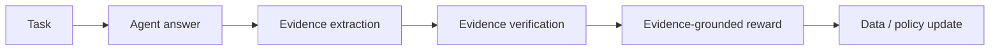

# EVE-Agent：以可验证证据约束自进化

> 论文：**[EVE-Agent: Evidence-Verifiable Self-Evolving Agents](https://arxiv.org/abs/2605.22905)**  
> 方向：证据验证、自生成训练数据、回答与依据的一致性。

## 1. 研究问题

Agent 可以生成表面上流畅、格式正确的答案，但这些答案不一定具有可验证依据。如果这种答案被当作成功轨迹写入训练或记忆闭环，错误会被持续放大。

EVE-Agent 的核心问题是：

> 如何要求自生成的答案同时提供可验证证据，并将证据对答案的实际支持程度纳入反馈？

## 2. 方法直觉



关键不是“是否找到了证据文本”，而是证据是否对答案有边际支持。

## 3. 研究意义

EVE-Agent 将自进化数据的质量条件从：

```text
答案看起来合理
```

提升为：

```text
答案具有可验证证据，且证据与结论存在可检查关联
```

这对深度研究、RAG、工具型 Agent 和自动数据生产都具有直接意义。

## 4. 需要审查的问题

- 证据抽取是否遗漏关键支持；
- 证据验证器是否依赖同一模型，是否存在偏差共振；
- 边际贡献如何估计；
- 证据充分但结论仍错误的情况如何处理；
- 额外验证成本是否可接受。

## 5. 阅读结论

EVE-Agent 的主要启示是：

> 自进化系统不应仅对答案打分，还应对答案的证据基础打分；否则“无依据的流畅输出”会成为长期闭环中的高风险噪声。
