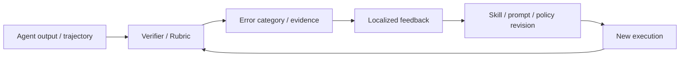

# Verifier 与 Rubric 演化

> 本目录讨论自进化闭环中的反馈层。Verifier、Rubric、证据链和动态 sandbox 决定了 Agent 是否能够识别错误、定位缺陷、拒绝无效更新，并将有效反馈转化为修订信号。

## 研究链路



## 待深读论文清单

本方向的以下论文已列入研究地图，但尚未完成原文实验级解读。

| 论文 | 反馈对象 | 重点阅读问题 |
| --- | --- | --- |
| [DeepVerifier](https://arxiv.org/abs/2601.15808) | 深度研究 Agent 的 rubric 验证 | 失败 taxonomy 与 verifier 元评测如何设计？ |
| [RLCER](https://arxiv.org/abs/2602.10885) | 自演化 CoT Rubric 与 RL 信号 | Rubric 是否会与 Reasoner 发生自我确认偏差？ |
| [EVE-Agent](https://arxiv.org/abs/2605.22905) | 可验证证据链 | 证据的边际贡献如何被可靠评估？ |
| [SkillSandbox](https://arxiv.org/abs/2610.10088) | Skill 的动态执行验证 | sandbox 对照是否能够代表真实任务效用？ |

## 阅读原则

```text
Verifier 的分数是否与真实任务成功相关？
反馈能否定位到具体错误而非只给总分？
Verifier 是否可被当前 Agent 策略迎合？
评测器本身是否独立于被评估系统？
```
