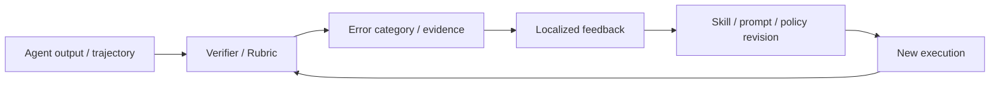

# Verifier 与 Rubric 演化

> 本目录讨论自进化闭环中的反馈层。Verifier、Rubric、证据链和动态 sandbox 决定了 Agent 是否能够识别错误、定位缺陷、拒绝无效更新，并将有效反馈转化为修订信号。

## 研究链路



## 单篇解读

| 论文 | 反馈对象 | 单篇解读 |
| --- | --- | --- |
| DeepVerifier | 深度研究 Agent 的 rubric 验证 | [阅读](deepverifier.md) |
| RLCER | 自演化 CoT Rubric 与 RL 信号 | [阅读](rlcer.md) |
| EVE-Agent | 可验证证据链 | [阅读](eve-agent.md) |
| SkillSandbox | Skill 的动态执行验证 | [阅读](skillsandbox.md) |

## 阅读原则

```text
Verifier 的分数是否与真实任务成功相关？
反馈能否定位到具体错误而非只给总分？
Verifier 是否可被当前 Agent 策略迎合？
评测器本身是否独立于被评估系统？
```
