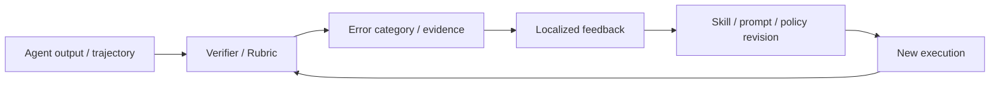

# Verifier 与 Rubric 演化

> 本目录讨论自进化闭环中的反馈层。Verifier、Rubric、证据链和动态 sandbox 决定了 Agent 是否能够识别错误、定位缺陷、拒绝无效更新，并将有效反馈转化为修订信号。

## 研究链路



## 单篇阅读

| 论文 | 反馈对象 | 入口 |
| --- | --- | --- |
| [DeepVerifier](deepverifier.md) | 深度研究 Agent 的 rubric 验证 | 失败 taxonomy、推理时反馈与回归 |
| [RLCER](rlcer.md) | 自演化 CoT Rubric 与 RL 信号 | Reasoner-Rubricator 双角色训练 |
| [EVE-Agent](eve-agent.md) | 可验证证据链 | 证据的边际效用与可审计训练数据 |
| [SkillSandbox](skillsandbox.md) | Skill 的动态执行验证 | 构造专属新场景并比较有/无 Skill 的执行 |

## 阅读顺序

```text
DeepVerifier：先理解输出级错误如何被拆成反馈
→ EVE-Agent：再理解证据如何成为可验证训练信号
→ RLCER：过程级 Rubric 如何和 RL 一起演化
→ SkillSandbox：把验证从文本和分数推进到环境执行对照
```

## 阅读原则

```text
Verifier 的分数是否与真实任务成功相关？
反馈能否定位到具体错误而非只给总分？
Verifier 是否可被当前 Agent 策略迎合？
评测器本身是否独立于被评估系统？
```

对反馈层论文，必须额外问一个问题：提升是否来自更可靠的反馈，还是只是来自更多模型调用、更多搜索或更长的测试时预算？
