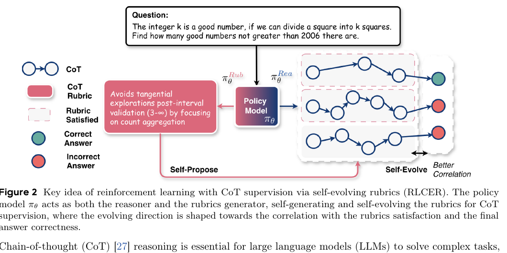
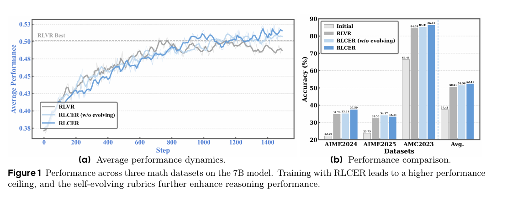

# RLCER：用自提出 Rubric 直接监督推理链

> 论文：**[Reinforcing Chain-of-Thought Reasoning with Self-Evolving Rubrics](https://arxiv.org/abs/2602.10885)**  
> 研究对象：Chain-of-Thought、Reasoner、Rubricator、过程级强化学习信号。  
> 核心问题：当最终答案的对错不足以区分好坏推理链时，模型能否自己提出并逐渐改进评价推理过程的 Rubric？

## 1. Outcome reward 的盲区

传统 RLVR 通常只给最终答案正确性奖励：

\[
r=\begin{cases}
1,&\text{最终答案正确}\\
0,&\text{最终答案错误}
\end{cases}
\]

这会让许多不同质量的推理链得到同一个 reward：

```text
严谨推导后得到答案
偶然猜对答案
中间逻辑错误但最终抵消
利用题目表面模式得到正确格式
```

直接训练过程奖励模型可以更细致，但通常需要大量人工 CoT 标注，并且静态 reward model 可能跟不上训练中不断变化的推理分布。

RLCER 的回答是：让同一个 policy 在不同提示词下扮演 **Reasoner** 和 **Rubricator** 两个角色。

## 2. 原文 Figure 2：一个模型的双角色闭环

{ .paper-figure }

> 图源：RLCER 原文 Figure 2 裁图。蓝线代表推理链，粉色块代表 CoT Rubric，正确/错误答案用于评估 rubric 是否可靠。

流程为：

```text
问题 Q
→ Reasoner 生成 CoT 和最终答案
→ Rubricator 生成多条 CoT 评价规则
→ 检查每条规则是否被当前 CoT 满足
→ 用“规则满足程度与最终正确性之间的相关性”筛选有效 Rubric
→ 有效 Rubric 为 Reasoner 提供过程奖励
→ Rubricator 也因提出更多有效 Rubric 而被奖励
```

这里的关键不是让 Rubricator 自己说“这条规则很合理”，而是用多个 rollout 中的统计相关性约束其有效性。

## 3. 如何判断一条 Rubric 是否有效

设第 \(k\) 条候选 Rubric 的满足指示为 \(v_k\)，最终答案正确性为 \(z\)。论文将满足程度与正确性具有足够强相关的规则视为有效：

\[
\operatorname{corr}(v_k,z)>\alpha
\]

直观解释：

```text
如果满足“枚举所有情况后再汇总”时，答案通常正确
而不满足时，答案通常错误
→ 这条 Rubric 对当前任务分布有监督价值
```

相反，如果一条 Rubric 只是表面格式要求，或者总是被满足却与正确性无关，它不能为过程监督提供可靠信号。

## 4. Reasoner 与 Rubricator 的奖励目标

### 4.1 Reasoner

Reasoner 同时接受：

```text
最终答案正确性
+
有效 Rubric 的满足程度
```

因此它不再只学“答对什么”，还被鼓励“按与正确性相关的过程属性去推理”。

### 4.2 Rubricator

Rubricator 的奖励是其候选规则中有效规则的比例：

\[
r_{\operatorname{rubricator}}
=\frac{|\{\hat{\tau}_k:\hat{\tau}_k\ \text{valid}\}|}{K}
\]

这让 Rubricator 随训练分布变化调整自己的提问方式。论文称之为 self-evolving rubrics：不是固定一套人工规则，而是持续提高“生成与正确性相关的规则”的能力。

## 5. 原文 Figure 1：训练曲线与最终比较

{ .paper-figure }

> 图源：RLCER 原文 Figure 1 裁图。左侧比较训练过程中的平均性能，右侧比较 AIME2024、AIME2025、AMC2023 及平均分。

图中比较四种条件：Initial、RLVR、RLCER without evolving、RLCER。右侧柱状图的平均结果为：

| 方法 | Average Accuracy |
| --- | ---: |
| Initial | 37.48 |
| RLVR | 50.61 |
| RLCER（不演化 Rubric） | 51.56 |
| RLCER | **52.41** |

### 5.1 这组结果说明什么

1. RLVR 从 37.48 到 50.61，证明可验证最终答案的 RL 对数学推理有明显作用；
2. 只加入自提出 Rubric 但不演化，平均到 51.56，说明过程级信号本身有额外价值；
3. 加入 Rubric self-evolution 后到 52.41，增幅存在但比 RLVR 相对 Initial 的增幅小得多；
4. 因此论文支持的是“自演化 Rubric 在 outcome reward 基础上带来补充收益”，不是“仅靠 Rubric 就能取代答案验证”。

从图中可见，RLCER 在 AIME2025 的绝对数值提升尤其明显，但不同数据集上的差距不完全一致，不能把单一子集的变化作为普遍结论。

## 6. 实验设计应关注哪些变量

论文在三个数学数据集上训练 7B 模型，主要分析：

- 没有 outcome reward 时，自提出 Rubric 是否仍可提供过程监督；
- RLCER 是否优于 outcome-centric RLVR；
- 去掉 Rubric 演化后是否下降；
- 生成 Rubric 是否能作为 inference-time prompt hint；
- 规则满足度与最终正确性相关的筛选机制是否确实必要。

这里的评测都属于可验证数学问题。规则有效性依赖最终答案 correctness，因此不要直接把机制迁移到没有可靠结果验证的开放问答任务。

## 7. 风险：内部相关不等于外部因果

RLCER 面临一个天然风险：Reasoner 与 Rubricator 由同一 policy 在不同 prompt 下实例化。它们可能逐渐共享某种偏好：

```text
Reasoner 形成一种固定写法
Rubricator 学会把这种写法评为高质量
内部 Rubric reward 上升
但外部正确率未必同步提高
```

论文用“与最终答案正确性的相关性”过滤规则，是对这个风险的约束；不过相关性仍在当前任务和 rollout 分布中估计，不能自动保证跨领域的因果有效性。

## 8. 论文证明与未证明的内容

论文支持：

1. 在数学推理设置中，自提出 Rubric 可以形成与最终正确性相关的 CoT 监督信号；
2. 与 outcome-centric RLVR 相比，RLCER 在论文的平均指标上更高；
3. Rubric 的持续演化相对于固定自提出规则有额外收益；
4. 生成规则可作为推理时提示进一步改善部分表现。

论文没有证明：

```text
相关性筛选能消除 reward hacking；
一个模型同时充当 Reasoner 和 Rubricator 总是稳定；
方法可直接迁移到开放式、不可验证任务；
更长的 CoT 或更多 Rubric 一定更好；
过程奖励在任意模型规模上都有同样增益。
```

## 9. 高频问题

### Q1：RLCER 和训练一个 process reward model 有什么区别？

**回答：**传统 process reward model 往往需要人工细粒度标注；RLCER 让 policy 自己提出 Rubric，并用规则满足度与最终正确性的统计相关性筛选有效规则。它减少人工标注依赖，但也引入了自我评价偏差风险。

### Q2：为什么要让 Rubric 自演化？

**回答：**训练中 CoT 的分布会变，固定规则可能对新出现的错误模式失效。自演化让 Rubricator 学会持续生成与当前正确性更相关的规则；Figure 1 中 RLCER 相比不演化版本的差距就是这部分设计的直接证据。

### Q3：最终答案正确了，还需要过程奖励吗？

**回答：**需要，因为同一个正确答案可能来自不同质量的推理过程。过程奖励试图让模型偏向更稳定、可解释的推理方式，尤其在泛化时减少偶然 shortcut。但过程监督是否真的改善泛化仍需要独立评估。

### Q4：RLCER 能用于 Agent 工具调用吗？

**回答：**思想上可以把 Rubric 换成工具调用的前置条件、证据检查或安全约束，但论文实验主要是数学 CoT。工具环境存在状态转移、成本和执行不确定性，不能直接把该结果当作已验证结论。

## 10. 阅读结论

RLCER 展示了一种把过程监督自动化的路线：

> 不只奖励“答案是否正确”，还让模型提出“怎样的推理更像正确推理”，并用最终结果约束这些规则是否值得保留。

它的价值在于把 Rubric 本身变成可学习对象；其边界则在于，内部规则的可信度仍必须由独立的结果验证与跨分布测试约束。
