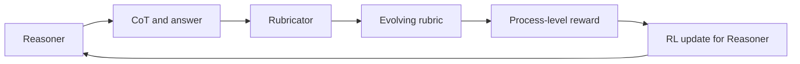

# RLCER：自演化 Rubric 驱动的推理强化

> 论文：**[RLCER: Reinforcing Chain-of-Thought Reasoning with Self-Evolving Rubrics](https://arxiv.org/abs/2602.10885)**  
> 作者单位：字节跳动 Seed、新加坡国立大学、中国科学技术大学。  
> 方向：过程级 Reward、Reasoner-Rubricator 双角色、自演化评价规则。

## 1. 研究问题

只使用最终答案对错作为 reward 时，推理过程中的错误很难被定位。RLCER 尝试让模型同时生成答案与评价推理链质量的 Rubric，从而提供细粒度过程奖励。

## 2. 系统结构



系统中的两个角色：

```text
Reasoner：生成推理链与最终答案
Rubricator：生成、选择或修订评价推理质量的规则
```

## 3. 为什么 Rubric 要自演化

固定 Rubric 可能无法覆盖任务中出现的新错误模式；完全依赖 outcome reward 又过于稀疏。自演化 Rubric 的目标是逐步形成：

```text
条件遗漏检测
中间结论一致性检查
证据与结论对应检查
格式与约束检查
```

## 4. 实验阅读重点

论文的关键证据不应只是最终 benchmark 分数，还应包括：

- Rubric 质量是否被独立评估；
- 过程 reward 是否与最终正确率相关；
- 自生成 rubric 是否提升泛化，还是仅适应当前模型输出；
- 与固定 rubric、outcome reward、人工 rubric 的对照是否充分。

## 5. 风险与边界

RLCER 的核心风险是 reward 规范与当前策略共同演化，导致：

```text
Reasoner 输出某种模式
Rubricator 学会给该模式高分
内部 reward 上升
外部正确率未必提升
```

因此需要独立 verifier、held-out 任务和外部 benchmark 保证过程奖励没有脱离最终目标。

## 6. 阅读结论

RLCER 体现了 2026 年的重要趋势：

> 在 Agentic RL 中，reward 与 rubric 不再被视为固定外部条件，而可能成为可更新、但必须被独立约束的系统组件。
