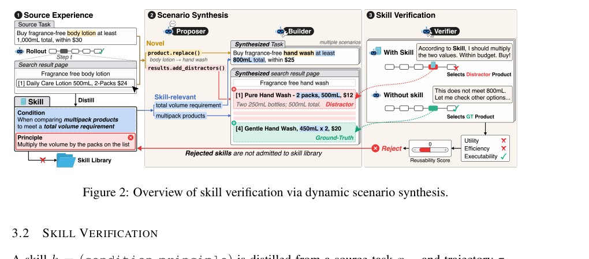

# SkillSandbox：为每条候选 Skill 合成专属验证场景

> 论文：**[SkillSandbox: Skill Verification via Dynamic Scenario Synthesis](https://arxiv.org/abs/2610.10088)**  
> 研究对象：候选 Skill 的可执行性、效用、效率和继承决策。  
> 核心观点：验证 Skill 是否可复用，不能只重放源任务，也不能从静态任务池随便抽题；应该为该 Skill 构造“保留其适用条件、改变其源任务细节”的新环境。

## 1. 为什么已有任务常常无法验证一条 Skill

一条从历史任务蒸馏出的 Skill 可能写着：

```text
当购买多件同类商品以满足总容量条件时，
应先计算每个包装容量，再选择满足总量且价格最优的组合。
```

要验证它是否可复用，至少需要一个既满足“多件商品 + 总容量约束”、又与原购物任务不同的新情境。

现有做法有两个问题：

| 验证方式 | 问题 |
| --- | --- |
| 重放源任务 | 一定会触发该 Skill，但没有新颖性，可能只是记住源样本 |
| 从静态任务池取相似任务 | 有新颖性，但任务未必真正触发 Skill 要处理的状态 |

论文的初步分析发现，即使按指令语义相似从大量候选任务里取 Top-10，也只有最多约 6.66 个任务真正包含该 Skill 相关情境；在连续下游任务流中，很多 Skill 根本得不到足够多的执行机会。

## 2. 原文 Figure 2：从源经验合成验证场景

{ .paper-figure }

> 图源：SkillSandbox 原文 Figure 2 裁图。图中左侧是 source experience，中间是 scenario synthesis，右侧比较 with-skill 与 without-skill 的执行结果。

SkillSandbox 包含三个角色：

| 组件 | 作用 |
| --- | --- |
| Proposer | 从 Skill 条件中提取必须保留的情境，指定哪些源任务细节可以变化 |
| Builder | 在环境中构造新任务与配置，使目标情境真的会出现 |
| Verifier | 比较使用/不使用 Skill 的执行，给出 Keep 或 Reject |

因此它评估的不是 Skill 文本是否优雅，而是：在一个新的、但仍真正需要该 Skill 的环境中，它是否带来可测的行为改善。

## 3. Reusability 的三条标准

论文将一条 Skill \(k=(\operatorname{condition},\operatorname{principle})\) 的可复用性拆成：

1. **Executability**：Skill 所建议的行为在满足条件的环境中能否实际执行；
2. **Utility**：使用 Skill 是否比不使用 Skill 更容易完成任务；
3. **Efficiency**：使用 Skill 是否能以更少动作完成任务。

这三条不能互相替代：

```text
可执行但没效果：可能只是正确的废话
有效但代价很高：可能不适合长期调用
步骤少但成功率下降：可能是过早终止
```

Verifier 根据这些维度综合给出 Keep / Reject，候选 Skill 只有通过验证才进入长期库。

## 4. 为什么“新颖但相关”的场景最难构造

Scenario synthesis 需要同时满足两件事：

```text
保留 condition：让目标 Skill 真正有机会被用到
改变 source-specific details：避免只复现旧任务答案
```

例如原任务是购买 2 包 500ml 洗手液；新场景可以改变商品、价格、包装规格和干扰项，但仍保持“多个包装、总量门槛、比较组合”的结构。这样，Agent 必须复用原则，而不能照搬原始产品名或数字。

## 5. 实验设置

论文使用 ALFWorld 和 WebShop，比较三种 executor：Qwen3.5-9B、Gemini 3.1 Flash-Lite、Qwen3.5-27B。

| 项目 | 设置 |
| --- | --- |
| Source tasks | 每个基线使用同一批 100 个任务生成 Skill |
| Held-out ALFWorld | 140 个官方测试任务 |
| Held-out WebShop | 500 个官方测试任务 |
| Retrieval | 每个任务取 Top-3 Skill |
| Library 状态 | 所有方法在 held-out 评测前冻结库 |

对照包括不使用 Skill、保留全部候选 Skill 的 Vanilla Skill、ReasoningBank、MemP，以及使用源任务重放或下游任务流证据的 ExpeL、ACE、SkillOS。

## 6. 原文主结果：未验证 Skill 可能比没 Skill 更差

原文 Table 2 中，Qwen3.5-9B 的代表性结果：

| 方法 | ALFWorld SR | Steps | WebShop SR | Score | Steps |
| --- | ---: | ---: | ---: | ---: | ---: |
| No Skill | 32.1 | 23.8 | 18.8 | 47.1 | 8.0 |
| Vanilla Skill | 57.9 | 19.3 | 15.6 | 38.0 | 9.6 |
| ExpeL | 42.1 | 22.1 | 21.8 | 52.9 | 7.0 |
| ACE | 45.0 | 21.7 | 15.6 | 35.4 | 10.4 |
| SkillOS | 40.0 | 22.7 | 11.4 | 25.2 | 12.2 |
| SkillSandbox | **66.4** | **17.5** | **22.2** | **59.1** | 7.0 |

### 6.1 不能只看 ALFWorld 的高分

Vanilla Skill 在 ALFWorld 上有 57.9，高于 No Skill；但在 WebShop 上从 18.8 降到 15.6，同时 score 下降、steps 增加。说明未验证 Skill 在某种环境有效，不代表能安全地放入通用库。

SkillSandbox 的重要之处在于两个任务上都超过 No Skill，并在 Qwen3.5-9B 的 ALFWorld 中把平均步骤从 23.8 降到 17.5。它不是单纯选择“最高分 Skill”，而是筛掉在新场景中无法证明价值的 Skill。

## 7. Recovery 与 Regression：为什么成功率之外还要看这两个指标

论文定义：

```text
Recovery：原本不用 Skill 时失败，加入库后成功的 held-out task 比例
Regression：原本不用 Skill 时成功，加入库后失败的 held-out task 比例
```

对 Qwen3.5-9B：

| 方法 | ALFWorld Recovery | ALFWorld Regression | WebShop Recovery | WebShop Regression |
| --- | ---: | ---: | ---: | ---: |
| Vanilla Skill | 30.0 | 4.3 | 5.0 | 8.2 |
| MemP | 14.3 | 3.6 | 6.6 | 8.2 |
| SkillSandbox | **36.4** | **2.1** | **8.0** | **4.6** |

这正好解释了为什么 SkillSandbox 更可靠：它不仅帮助原本失败的任务，还减少对原本成功任务的干扰。

论文特别指出，在 Gemini 的 ALFWorld 设置下，MemP 与 SkillSandbox 的 Recovery 相同，但 SkillSandbox 的 Regression 约低 37%。即使“救回了同样多失败任务”，若同时破坏更多已有成功，最终 SR 仍可能下降。

## 8. 跨模型与跨环境结果

对于 Gemini 3.1 Flash-Lite：

| 方法 | ALFWorld SR | WebShop SR |
| --- | ---: | ---: |
| No Skill | 56.4 | 25.6 |
| SkillSandbox | **60.0** | **36.2** |

对于 Qwen3.5-27B：

| 方法 | ALFWorld SR | WebShop SR |
| --- | ---: |
| No Skill | 75.7 | 32.2 |
| SkillSandbox | **80.0** | **45.0** |

这说明收益不是只出现在小模型上。不过强模型在 ALFWorld 的 No Skill 基线已经很高，因此可提升空间较小；WebShop 的提升更明显，可能与商品约束、干扰项和多步选择更依赖显式工作流有关。这个解释仍需谨慎，因为不同 benchmark 的 score 体系和任务难度不同。

## 9. 论文证明了什么

论文支持：

1. 语义相似的已有任务不稳定地暴露某个目标 Skill 所需的情境；
2. 将场景围绕 Skill 条件动态构造，可以获得更直接的执行证据；
3. 使用可执行性、效用和效率共同判定，能够减少无效 Skill 的长期继承；
4. 在两类环境、三种模型的论文设置中，SkillSandbox 获得最高或最具竞争力的下游表现，并降低部分执行成本。

论文没有证明：

```text
Proposer 和 Builder 生成的所有场景都真实代表生产环境；
动态场景不会被验证器或当前模型共同迎合；
三项指标已覆盖安全、权限和隐私风险；
为每条 Skill 构造 sandbox 的成本在超大规模库中始终可接受；
Skill 的可复用性不会随工具版本变化而失效。
```

## 10. 高频问题

### Q1：为什么不能直接拿源任务验证 Skill？

**回答：**源任务一定包含 Skill 的适用情境，但不能证明泛化。Skill 可能只是记住了原任务中的商品、数值、路径或对象，换一个上下文就失效。

### Q2：为什么不能从相似任务里随便挑几个？

**回答：**语义相似只发生在任务描述层面，Skill 是否被执行取决于环境状态、动作分支和中间决策。论文的分析显示，Top-10 相似任务中最多约 6.66 个真正触发 Skill 相关情境。

### Q3：Recovery 高就说明 Skill 好吗？

**回答：**不够。Skill 可能同时帮助一些失败任务、破坏更多成功任务，所以还必须看 Regression。一个值得继承的库应尽量提高 Recovery、降低 Regression。

### Q4：SkillSandbox 是否就是一个自动单元测试生成器？

**回答：**比普通单元测试生成更宽。它不仅构造测试输入，还要构造能触发 Skill 条件的环境，并比较 Agent 使用/不使用 Skill 的完整执行后果，最终判断是否继承该 Skill。

## 11. 阅读结论

SkillSandbox 对长期 Skill Library 给出了一条明确准则：

> 候选 Skill 的价值应在“新颖但仍真正需要它”的执行情境中，用 with-skill / without-skill 的反事实比较来验证；仅有一次成功来源或语义相似度都不足以证明可继承。
