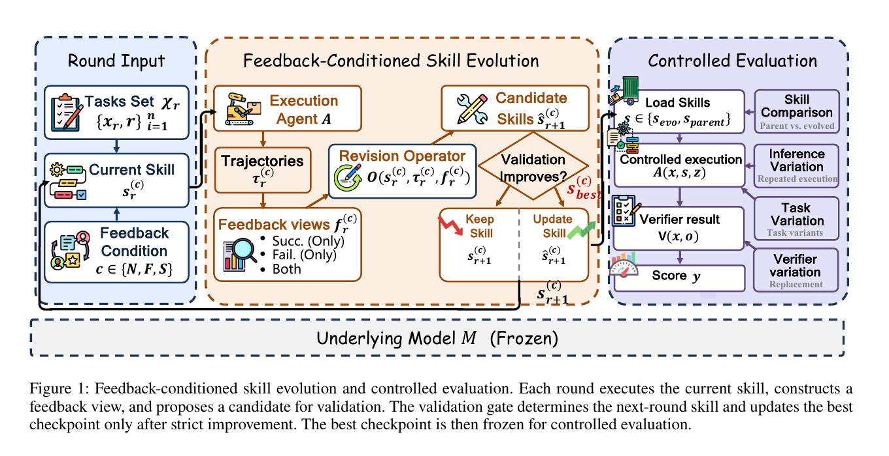
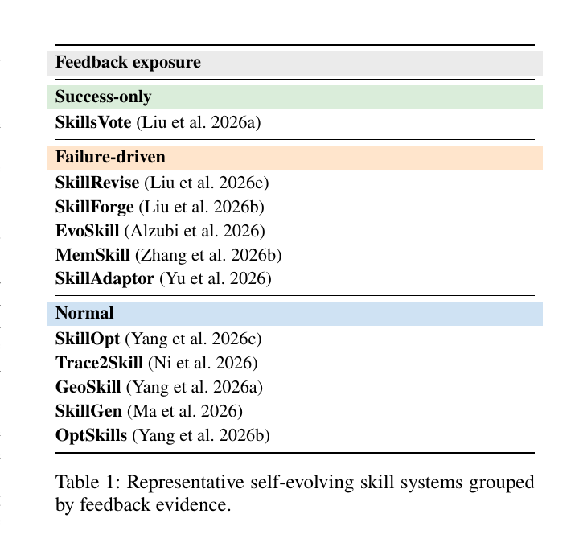
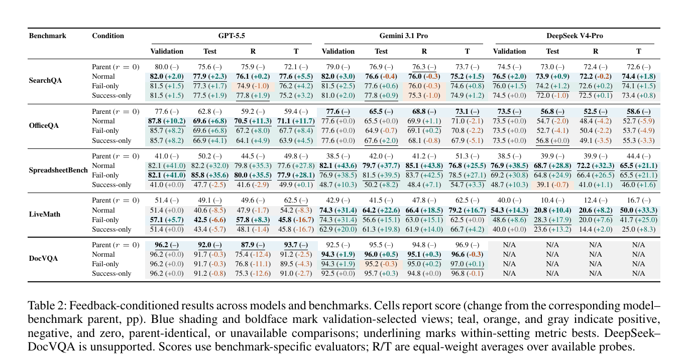

# 论文解读：Agent Skill 自进化到底会不会持续变好？

> 论文：**Rethinking Self-Evolving Agent Skills: Feedback Dynamics over Multiple Rounds**  
> 作者：Yuxuan Liu, Zhaochen Su, Yuhao Zhang, Jiahe Guo, Zhongwei Xie, Huihao Jing, Lingyun Xie, Qing Zong, Yauwai Yim, Zhixiong Zhang, Haoran Li, Yangqiu Song  
> 论文链接：[arXiv:2608.02636](https://arxiv.org/abs/2608.02636)  
> 阅读范围：论文正文与主要实验表格。原文图表见文中图片，图片均来自论文 PDF，并标注了 Figure/Table 编号。

## 1. 先给结论

这篇论文研究的不是“如何让基础模型参数更新”，而是另一个更具体的问题：

> 当一个固定的 Agent 通过执行反馈不断修改自己的持久化 Skill 时，Skill 是否会随着演化轮数稳定变好？成功轨迹和失败轨迹，哪一种反馈更有用？

论文的主要结论可以压缩成四句话：

1. Skill 演化的有效改进是稀疏的，不是每轮都会提升；
2. 失败轨迹通常比成功轨迹更能帮助发现需要修复的行为缺陷；
3. 效果高度依赖模型和任务，不能把一个 benchmark 的提升推广到所有 Agent；
4. 一部分提升可能来自更多测试时尝试，而不一定来自 Skill 本身学会了可迁移的策略。

因此，这篇论文真正的价值不是提出一个“自动变强”的神奇框架，而是把 Agent 自进化拆成可控实验，追问：

```text
Candidate 被修改出来
≠
Candidate 真的变好了
```

## 2. 问题背景：为什么要研究 Skill Evolution？

一个 Agent 可以把经验保存成可复用的 Skill。例如表格 Agent 可能学到：

```text
处理表格时：
1. 先检查重复列名；
2. 处理空值；
3. 修改文件；
4. 保存后重新读取验证。
```

如果这个规则能够被后续任务复用，它就不只是一次回答，而是一个持久化的操作 Skill。

这类方法有一个直觉：

```text
执行任务
→ 得到成功 / 失败反馈
→ 修改 Skill
→ 下一轮使用新 Skill
→ 继续修改
```

但是这里至少存在四个不确定性：

- 新 Skill 是真的更好，还是只是偶然在验证集上成功？
- 失败反馈是否比成功反馈更有价值？
- 多轮修改是否会持续积累收益，还是很快停滞？
- 结果是否只是更多 test-time computation 带来的？

这篇论文专门研究这些问题。

## 3. 论文中的基本对象

论文固定底层 Agent 模型 \(M\)，只允许外部 Skill 发生变化。

```text
模型参数 M：冻结
持久化 Skill s：可修改
```

第 \(r\) 轮在反馈条件 \(c\) 下的 Skill 记作：

\[
s_r^{(c)}
\]

Agent 使用当前 Skill 执行一组任务，得到轨迹：

\[
\tau_r^{(c)}
\]

然后根据反馈视图生成候选 Skill：

\[
\hat{s}_{r+1}^{(c)}=O\left(s_r^{(c)},\tau_r^{(c)},f_r^{(c)}\right)
\]

其中：

- \(O\)：Skill Revision Operator；
- \(f_r^{(c)}\)：优化器能看到的反馈；
- \(\hat{s}_{r+1}^{(c)}\)：候选 Skill，不一定会被接受。

如果候选 Skill 的 Validation 不下降，就进入下一轮：

\[
s_{r+1}^{(c)}=\hat{s}_{r+1}^{(c)}
\]

如果候选 Skill 退化，就保留当前 Skill：

\[
s_{r+1}^{(c)}=s_r^{(c)}
\]

## 4. 原文 Figure 1：一次 Skill Evolution 到底怎么跑？

{ .paper-figure }

> 来源：论文 Figure 1。原图展示了“反馈条件化 Skill Evolution”和“Controlled Evaluation”。

### 4.1 左侧：Round Input

左侧输入包含三类东西：

```text
Tasks Set
Current Skill
Feedback Condition
```

当前轮不是随机换一个 Skill，而是从上一轮保留下来的 Skill 开始。

Feedback Condition 有三种：

```text
N = Normal
F = Fail-only
S = Success-only
```

### 4.2 中间：Skill Evolution

中间是论文真正的演化循环：

```text
Execution Agent
→ Trajectories
→ Feedback views
→ Revision Operator
→ Candidate Skill
→ Validation
→ Keep / Update Skill
```

注意：Revision Operator 生成的是 Candidate，不是必然接受的新版本。

### 4.3 右侧：Controlled Evaluation

演化结束后，论文把结果冻结，再进入统一评测路径：

```text
加载 Parent / Evolved Skill
→ Controlled Execution
→ Verifier
→ Score
```

右侧还改变四类变量：

| 变量 | 论文想测什么 |
| --- | --- |
| Skill | Parent 和 Evolved 的差异 |
| Inference | 重复执行和 test-time scaling |
| Task | 任务变化后的泛化 |
| Verifier | 换评测器后结果是否稳定 |

这就是为什么 Figure 1 右侧很重要：它防止论文只报告一个演化过程中的 Validation 分数。

## 5. 三种反馈条件

### Normal

优化器看到：

```text
成功轨迹 + 失败轨迹
```

优点是同时知道：

```text
哪些策略应该保留
哪些策略需要修正
```

### Fail-only

优化器只看到：

```text
失败轨迹
```

它更适合定位：

```text
错误动作
工具调用失败
输出格式错误
边界条件遗漏
```

### Success-only

优化器只看到：

```text
成功轨迹
```

它可以总结成功模式，但不知道失败案例中到底出现了什么错误。

论文的关键实验思想是：

> 三种条件使用同一个 Parent Skill、同一个模型、同一个优化器配置和同样的轮数，只改变优化器能看到的反馈。

这才是一个有效的 controlled comparison。

## 6. 实验怎么做？

### 6.1 模型和 Benchmark

论文在三个模型、五类 benchmark 上做主实验：

```text
模型：GPT-5.5、Gemini 3.1 Pro、DeepSeek V4-Pro
任务：SearchQA、OfficeQA、SpreadsheetBench、LiveMath、DocVQA
```

由于 DeepSeek V4-Pro 的 endpoint 不接受 DocVQA 的原生页面图片，论文没有把它放进 DeepSeek-DocVQA，而是保留了 14 个 model-benchmark settings。

### 6.2 为什么是 42 次 runs

每个模型和 benchmark 组合都要跑三种反馈条件：

\[
14\text{ 个 model-benchmark settings}
\times
3\text{ 个 feedback views}
=42\text{ 次 feedback runs}
\]

一次 run 不是只执行一个任务，而是：

```text
同一个反馈条件下
从 Parent Skill 开始
最多演化 10 轮
每轮执行任务、生成候选、Validation 筛选
```

### 6.3 每轮执行多少任务

论文规定每轮通常执行 40 条训练轨迹，LiveMath 使用 36 条；反馈视图非空时，优化器提出最多 4 个最小、任务通用的修改，然后在完整 Validation split 上验证。

如果 Validation 不下降，候选可以成为下一轮 Skill；但只有严格提升才会更新“历史最佳 Skill”。

### 6.4 什么时候停止

一轮演化最多 10 轮，但如果出现以下情况也会提前停止：

- 连续回归；
- 连续 no-op；
- 反馈池为空；
- 没有可用的有效反馈。

这说明论文不是强行跑满 10 轮，而是允许演化停滞。

## 7. Validation、Test、Robustness、Transfer 分别是什么？

这是读表格前必须先弄懂的部分。

### Validation

用于决定候选 Skill 是否被接受：

```text
Validation 提升或不下降 → 候选可以继续
Validation 下降 → 保留旧 Skill
```

### Test

演化结束后才使用的独立测试集，用来报告最终结果。

不能用 Test 集来挑最好的 Skill，否则 Test 就被间接用于训练。

### Robustness

任务本身基本不变，但改变输入表面形式或加入干扰，例如：

```text
改写问题表达
增加无关上下文
改变输入格式
保留答案但改变表面形式
```

### Transfer

换任务、换来源、换题型或改变分布，测试 Skill 是否迁移。

所以论文并不是只问：

```text
Validation 分数涨了吗？
```

而是还问：

```text
Test 涨了吗？
Robustness 涨了吗？
Transfer 涨了吗？
```

## 8. 原文 Table 1：相关系统按反馈证据分类

{ .paper-figure }

> 来源：论文 Table 1。原表按系统使用的反馈证据，将相关工作分为 Success-only、Failure-driven 和 Normal。

表格不是在比较模型分数，而是在做研究谱系分类。

### Success-only

这类系统主要从成功轨迹中学习可复用行为。

直觉：

```text
成功了 → 提取成功操作 → 保存 Skill
```

优点：成功轨迹通常更容易形成可执行模板。

缺点：看不到失败模式，可能无法知道哪些动作应该避免。

### Failure-driven

这类系统重点使用失败反馈修复 Skill。

直觉：

```text
失败 → 定位错误 → 修改受影响的 Skill
```

适合工具调用、代码执行、文档操作等错误可定位的任务。

### Normal

同时使用成功和失败轨迹。

它理论上可以获得最完整的证据，但反馈更多不一定总是更好，因为优化器可能受到噪声、冲突或无关轨迹影响。

论文使用 Table 1 的目的不是说哪一类一定最好，而是说明：过去不同工作使用了不同反馈策略，不能直接把它们的结果横向比较；这篇论文将这些反馈条件放进同一个控制实验中比较。

## 9. 原文 Table 2 怎么读？

{ .paper-figure }

> 来源：论文 Table 2。表格单元格格式为“分数（相对于 Parent 的变化，百分点）”。蓝色和粗体表示 Validation 选择出的反馈视图；R/T 是可用 probe 的等权平均。

这张表是全文最重要的结果表。不要把它当成普通排行榜，要按下面顺序读。

### 9.1 先看 Parent

例如 GPT-5.5 / SearchQA：

```text
Parent Validation = 80.0
Parent Test = 75.6
```

Parent 是演化前的基准 Skill。

### 9.2 再看三种反馈条件

同一个模型和 benchmark 下，会有三行：

```text
Normal
Fail-only
Success-only
```

例如 GPT-5.5 / SearchQA：

| 条件 | Validation | Test |
| --- | ---: | ---: |
| Parent | 80.0 | 75.6 |
| Normal | 82.0 (+2.0) | 77.9 (+2.3) |
| Fail-only | 81.5 (+1.5) | 77.3 (+1.7) |
| Success-only | 81.5 (+1.5) | 77.5 (+1.9) |

这里的 `+2.0` 不是相对上一轮，而是相对 Parent：

\[
82.0-80.0=+2.0
\]

### 9.3 蓝色和粗体是什么意思

蓝色和粗体表示：

```text
这个反馈视图在 Validation 阶段被选为该设置的最终 Skill 分支
```

它不等于所有列都最好。

例如一个条件可能 Validation 最好，但 Test 不一定最好，这正是论文要研究的选择差距。

### 9.4 R 和 T 是什么

表中：

```text
R = Robustness
T = Transfer
```

它们是多个 probe 的等权平均。

因此：

```text
R 上升：同类任务在改写、干扰或输入变化下更稳
T 上升：在新任务、新来源或分布变化下更能迁移
```

### 9.5 正负颜色是什么意思

| 颜色 | 含义 |
| --- | --- |
| Teal / 绿色 | 相对 Parent 提升 |
| Orange | 相对 Parent 下降 |
| Gray | 无变化、Parent-identical 或不可用 |
| 下划线 | 该设置中对应指标最好 |

## 10. Table 2 的具体解读

### 10.1 SpreadsheetBench：最稳定的提升

GPT-5.5 的 Parent：

```text
Validation = 41.0
Test = 50.2
```

Normal：

```text
Validation = 82.1 (+41.0)
Test = 82.2 (+32.0)
R = 79.8 (+35.3)
T = 77.6 (+27.8)
```

Gemini 3.1 Pro 的 Normal：

```text
Validation = 82.1 (+43.6)
Test = 79.7 (+37.7)
R = 85.1 (+43.8)
T = 76.8 (+25.5)
```

DeepSeek V4-Pro 的 Normal：

```text
Validation = 76.9 (+38.5)
Test = 68.7 (+28.8)
R = 72.2 (+32.3)
T = 65.5 (+21.1)
```

这里最值得注意的不是单纯的 Test 分数，而是四个方向都同时提升：

```text
Validation ↑
Test ↑
Robustness ↑
Transfer ↑
```

这说明在 SpreadsheetBench 上，进化后的 Skill 很可能学到了可迁移的操作规范，而不是只适应 Validation。

### 10.2 SearchQA：提升小，且容易接近多次采样

GPT-5.5 Normal：

```text
Validation = 82.0 (+2.0)
Test = 77.9 (+2.3)
R = 76.1 (+0.2)
T = 77.6 (+5.5)
```

提升相对小，而且不同模型、不同反馈条件的结果并不一致。

这表示：

```text
SearchQA 上可能存在较强的随机性和 test-time sampling 影响
```

论文还用 Parallel Sampling 做对照：如果多次独立回答后事后选择最好结果，SearchQA 的收益接近 Skill Evolution，这会削弱“真正学到 Skill”的解释。

### 10.3 LiveMath：模型依赖很明显

GPT-5.5 的 Normal：

```text
Test = 40.6 (-8.5)
```

Gemini 3.1 Pro 的 Normal：

```text
Test = 64.2 (+22.6)
```

DeepSeek V4-Pro 的 Normal：

```text
Test = 20.8 (+10.4)
```

同样的 Evolution Protocol，在不同底层模型上结果差异很大。

因此不能写成：

```text
这种自进化方法普遍有效
```

更准确的解读是：

> Skill Evolution 的效果依赖模型的代码/规则修改能力、任务反馈结构和 benchmark 的可验证性。

### 10.4 OfficeQA：有提升，但不是所有模型都能泛化

GPT-5.5 Normal：

```text
Test = 69.6 (+6.8)
R = 70.5 (+11.3)
T = 71.1 (+11.7)
```

但 Gemini 和 DeepSeek 上，某些反馈条件 Validation 没有提升，最终保留 Parent Skill。

这告诉我们：

```text
验证门控不是失败，而是保护机制
```

如果新 Skill 没有可靠提升，系统应该拒绝修改，而不是为了展示“自进化”而强行接受。

## 11. 关键数字到底是什么意思？

论文摘要和正文中有几个容易混淆的数字。

### 388 个 Candidate

所有 42 次 run 中，Skill Optimizer 一共提出了 388 个候选 Skill 版本。

它们包括：

```text
完全相同的重跑
没有带来 Validation 提升的修改
短暂变好但后来退化的修改
真正成为新最佳的修改
```

### 55 个新的 Validation Best

只有 55 个 Candidate 同时满足：

1. 相对历史最佳 Validation 严格提升；
2. Skill 文件内容与原最佳版本不同。

\[
55/388\approx14.2\%
\]

这说明有效修改只占少数。

### 11 / 14 个设置选择了 Evolved Skill

14 个 model-benchmark settings 中，有 11 个最终通过 Validation 选择了一个不同于 Parent 的 Evolved Skill。

剩余 3 个保留 Parent：

```text
Gemini-OfficeQA
DeepSeek-OfficeQA
GPT-5.5-DocVQA
```

### 9 / 11 个 Test 提升

11 个 Validation 选中的 Evolved Skill 中，9 个在 released Test 上优于 Parent。

这说明：

```text
Validation 选择有一定有效性
但仍有 2 个没有泛化到 Test
```

### Success-only 从未被选中

主实验中，最终选中的 11 个 Evolved Skill 全部来自：

```text
Normal：9 个
Fail-only：2 个
Success-only：0 个
```

这支持一个谨慎结论：

> 对这组任务和实验协议，失败轨迹是发现 Skill 缺陷的重要证据；只看成功轨迹不足以稳定产生新的 Validation Best。

但不能进一步推导出：

```text
Fail-only 在所有任务上都优于 Normal
```

## 12. Test-time Scaling 对照实验

论文担心一个问题：

> Skill Evolution 的收益是否只是因为它比 Parent 多执行了几次？

所以它比较了：

```text
Evolved Skill 一次执行
vs
Parallel Sampling 多次独立尝试后选最好
vs
Sequential Refinement 顺序式继续改进回答
```

### SearchQA

Parallel Sampling 几乎恢复了 Skill Evolution 的提升。

这说明 SearchQA 的一部分收益可能来自：

```text
更多尝试次数
```

而不是 Skill 本身学到了一个稳定规则。

### SpreadsheetBench

Parallel Sampling 明显落后于 Evolved Skill。

这意味着 SpreadsheetBench 上的 Skill 更可能包含：

```text
可复用的操作流程
错误处理规则
保存与验证规范
```

而不是简单地多生成几次答案。

这就是控制实验的价值：它帮助区分：

```text
真正的 Skill 改进
vs
额外推理预算
```

## 13. 论文真正证明了什么？

比较稳妥的结论是：

1. 固定模型参数时，外部 Skill 仍有可能通过反馈迭代得到改进；
2. 这种改进并不稳定，很多 Candidate 不会成为新的 Validation Best；
3. 失败轨迹通常是有价值的修正证据；
4. Skill 改进是否泛化，强烈依赖任务、模型和 evaluator；
5. 某些 benchmark 的提升可以被多次采样接近，不能直接归因于能力学习；
6. Validation Gate 和 Parent 回滚是必要的，而不是可选项。

## 14. 论文没有证明什么？

这篇论文没有证明：

- Agent 参数发生了学习；
- 自进化会随着轮数稳定单调提升；
- Fail-only 在所有任务中都最好；
- Skill 改进一定能跨环境迁移；
- Validation 提升一定等于真实能力提升；
- 更多 Candidate 就会产生更强的 Agent；
- Skill Evolution 一定优于参数训练。

这一部分对阅读论文非常重要。论文结果支持的结论必须比论文标题更具体。

## 15. 我的实验设计理解

如果把这篇论文压缩成一个最小实验，应该是：

```text
固定一个基础模型
固定一个 Parent Skill
固定一个任务集
固定一个 Skill Optimizer
固定一个 Validation 规则

只改变：
Normal / Fail-only / Success-only

多轮运行
→ Candidate Skill
→ Validation Gate
→ 冻结最佳 Skill
→ Test / Robustness / Transfer
```

伪代码：

```python
for condition in ["normal", "fail_only", "success_only"]:
    skill = parent_skill
    best_skill = parent_skill
    best_val = evaluate(skill, validation_set)

    for round_id in range(10):
        trajectories = execute(skill, evolution_tasks)
        feedback = select_feedback(trajectories, condition)
        candidate = optimizer.revise(skill, feedback)
        candidate_val = evaluate(candidate, validation_set)

        if candidate_val >= current_val:
            skill = candidate

        if candidate_val > best_val and candidate != best_skill:
            best_skill = candidate
            best_val = candidate_val

    evaluate_final(best_skill, test_set)
    evaluate_robustness(best_skill)
    evaluate_transfer(best_skill)
```

## 16. 这篇论文最值得学习的实验习惯

### 习惯一：先定义“什么算成功”

不是候选文件变了，而是：

```text
Validation 严格提升
+ Artifact 真正不同
+ 独立 Test 验证
```

### 习惯二：分离选择集和报告集

```text
Validation：选版本
Test：报告最终结果
```

### 习惯三：控制 test-time computation

否则可能把多次采样误认为能力提升。

### 习惯四：报告失败和回滚

Parent 被保留不是失败，而是实验结果：

```text
新修改没有带来可靠收益
```

### 习惯五：报告泛化，而不是只报告单一分数

```text
Test
Robustness
Transfer
```

三者一起看，才能知道 Skill 是否真的有用。

## 17. 阅读后的最终判断

我对这篇论文的理解是：

> Agent Skill 自进化目前更像一个带验证器的外部策略搜索过程，而不是稳定的持续学习。它能够在部分结构化、可验证任务上学到可迁移的操作规范，但有效修改是稀疏的，结果依赖模型、任务和反馈构造。失败轨迹通常比成功轨迹更容易暴露可修复缺陷，但最终是否泛化，必须通过独立 Test、Robustness、Transfer 和 test-time scaling 对照来判断。

## 参考资料

- Liu et al., [Rethinking Self-Evolving Agent Skills: Feedback Dynamics over Multiple Rounds](https://arxiv.org/abs/2608.02636)
- 论文原始 PDF 中的 Figure 1、Table 1、Table 2 已作为原图放入本文。
