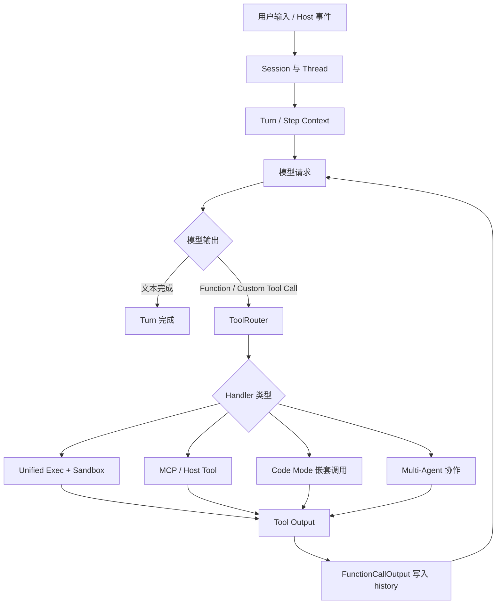
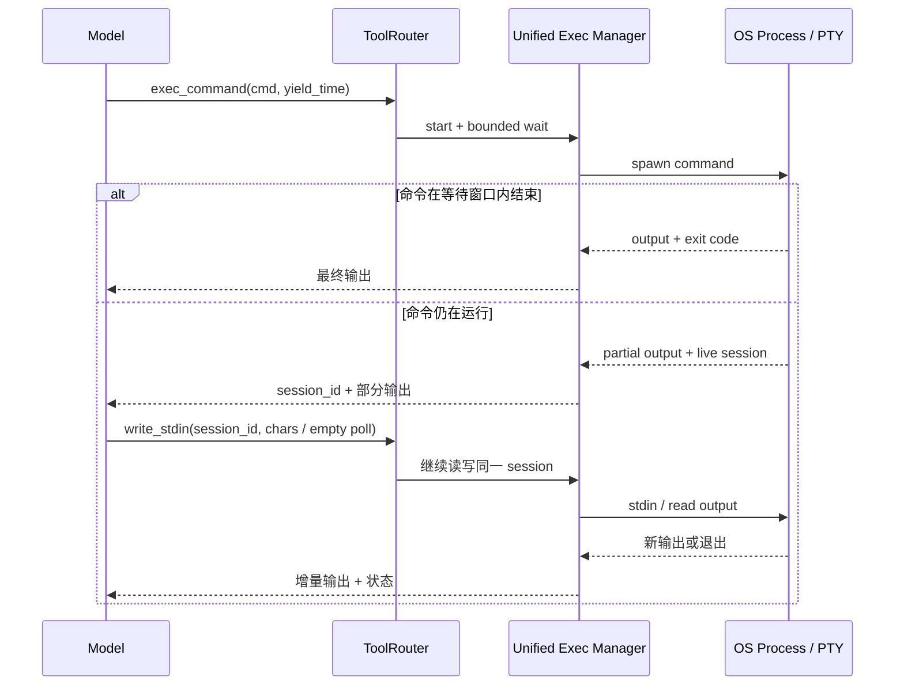
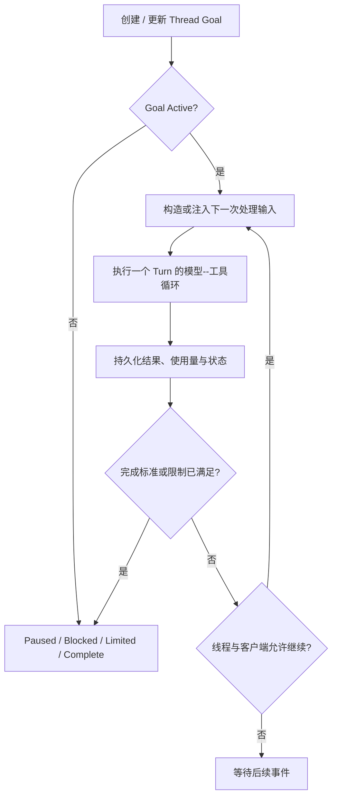
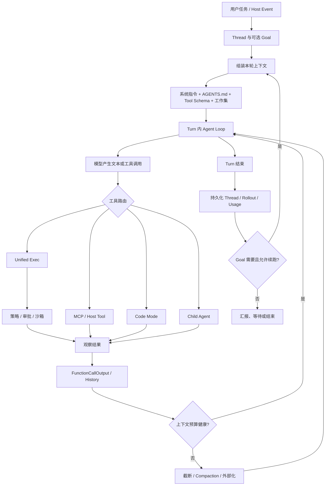

# Codex 源码解读：从一次 Turn 到长程 Goal 的 Agent Harness

> **阅读范围。** 本文以 OpenAI 公开仓库 [openai/codex](https://github.com/openai/codex) 的提交 [`970111f`](https://github.com/openai/codex/tree/970111f) 为代码锚点，阅读日期为 2026 年 10 月 26 日。本文讨论公开仓库中的 CLI、Core、App Server 与协议实现。Codex Desktop App、云端服务、模型服务和宿主运行环境包含未公开部分，不能由公开代码直接推出其内部实现。

Codex 并不是“模型调用命令行”的单一循环。更准确地说，它是一套 **Agent Harness**：把模型推理、Turn 生命周期、工具路由、命令执行、审批策略、沙箱、会话历史、上下文压缩、持久状态、子 Agent 以及客户端/宿主协议组合成一个可运行的工程系统。

本文基于自己的学习笔记重写，并补充公开源码、[Codex 官方文档](https://developers.openai.com/codex/) 与官方工程材料。阅读时应始终区分两类结论：

```text
公开源码事实：可以在固定 commit 的模块、类型和 handler 中定位。
宿主行为推断：当前 Desktop UI、云端服务或模型端的具体实现，不应写成源码事实。
```

## 1. 仓库地图：先找到主干

公开仓库同时包含多层能力。它们并不都属于同一个“Agent Loop”。

| 层次 | 主要目录 | 职责 |
| --- | --- | --- |
| CLI 外壳 | `codex-cli/`、`codex-rs/cli/` | 本地终端交互、命令入口与分发 |
| Agent Core | `codex-rs/core/` | Session、Turn、工具、历史、压缩、协作 |
| App Server | `codex-rs/app-server/` | 面向 App/IDE 的线程、Goal、配置和客户端协议 |
| 协议与状态 | `protocol/`、`state/`、`thread-store/` | 事件、状态机、线程元数据与持久化 |
| 执行与安全 | `exec/`、`exec-server/`、`execpolicy/`、`sandboxing/` | 命令执行、策略判断、文件/网络隔离 |
| 扩展能力 | `skills/`、`code-mode*/`、MCP 相关模块 | Skills、Code Mode、外部工具与宿主能力 |

一个很重要的边界是：

```text
公开源码能够证明“有哪些抽象、协议与默认实现”。
它不能自动证明“每一个 Desktop UI 操作、云端调度和模型服务细节”。
```

例如浏览器、Computer Use 的鼠标键盘事件或某个审批弹窗，都可能由宿主层实现；Core 侧看到的往往只是工具调用、MCP namespace、配置和协议事件。

## 2. 一次 Turn：模型、工具和历史怎样形成内层循环

先建立最核心的一条调用链：



### 2.1 Session、Turn、Step 的区别

| 概念 | 生命周期 | 可以理解为 |
| --- | --- | --- |
| `Session` | 一个线程或会话存续期间 | 保存配置、历史、服务、活跃 Turn、取消状态 |
| `Turn` | 处理一轮用户输入或内部触发任务期间 | 当前任务的模型调用与工具调用链 |
| `StepContext` | Turn 内的更细执行阶段 | 工具调用、权限、环境快照与取消上下文 |

一次用户任务不等于一次模型请求。模型先决定调用工具，工具返回 Observation 后，模型可能继续搜索、改代码、运行测试，最后才给出文本结果。抽象为：

\[
C_t \xrightarrow{\text{model}} a_t \xrightarrow{\text{tool/environment}} o_t
\xrightarrow{\text{append}} C_{t+1}
\]

- \(C_t\)：当前模型可见上下文；
- \(a_t\)：文本回答或工具调用；
- \(o_t\)：工具输出、失败、审批结果或子 Agent 消息；
- `append`：把调用与结果组织为下一次请求可见的历史项。

### 2.2 模型并不直接执行 shell

[`core/src/tools/router.rs`](https://github.com/openai/codex/blob/970111f/codex-rs/core/src/tools/router.rs) 中的 `ToolRouter` 同时维护模型可见的 `ToolSpec` 与可执行的工具 registry。因此：

```text
模型看到工具 schema
不等于
所有工具使用同一种执行方式。
```

工具结果随后在 [`tools/context.rs`](https://github.com/openai/codex/blob/970111f/codex-rs/core/src/tools/context.rs) 中转换为 `ResponseInputItem::FunctionCallOutput` 或自定义工具输出，写回后续模型上下文。模型不是“天然知道命令已经运行”，而是拿到一个结构化 Observation 后再继续推理。

| 工具类别 | 公开源码中的典型路径 | 执行边界 |
| --- | --- | --- |
| Shell / terminal | Unified Exec handler 与执行管理器 | 命令、PTY、会话、策略与沙箱 |
| MCP | MCP client / protocol | 本地或远程 MCP server 的协议调用 |
| Code Mode | `code-mode*` 与 Core delegate | 运行时发起的嵌套工具调用 |
| Multi-Agent | `multi_agents_v2`、`thread_spawn.rs` | child thread 与协作消息 |
| Host 工具 | App Server / protocol / MCP namespace | 宿主执行浏览器、原生应用等能力 |

所以，原笔记里的“工具通过独立进程去执行”需要收窄为：**部分 Shell 工具通过进程/PTY 执行；Codex 的工具后端整体是异构的。**

## 3. 长命令：`exec_command` 与 `write_stdin`

公开源码可以直接定位到：

- [`unified_exec/exec_command.rs`](https://github.com/openai/codex/blob/970111f/codex-rs/core/src/tools/handlers/unified_exec/exec_command.rs)
- [`unified_exec/write_stdin.rs`](https://github.com/openai/codex/blob/970111f/codex-rs/core/src/tools/handlers/unified_exec/write_stdin.rs)

`exec_command` 的工具说明指出，命令可以在 PTY 中运行，并返回输出或用于持续交互的 session 标识。`write_stdin` 则要求 terminal session 存在，把写入或轮询请求交给 unified exec manager。



这使 Agent 能处理持续运行的开发服务器、长时间编译、测试和交互式程序，而不是把一个工具调用永久阻塞到进程结束。

它也带来成本：需要管理 session、取消、超时和退出码；轮询过密会增加工具调用与 token 成本；部分日志不是最终结论，模型仍需确认最终退出状态。

**结论：** 工具调用结束不等于底层命令结束。这是长命令设计最重要的一点。

## 4. 上下文管理：截断、Compaction 与持久化不是一回事

原笔记中“上下文压缩与会话持久化是两层机制”的判断是对的，但还要再拆一层：

| 问题 | 机制 | 对模型意味着什么 |
| --- | --- | --- |
| 单次工具输出太长 | truncation / bounded output | 这条 Observation 不能无限塞入 Prompt |
| 多轮历史过长 | compaction | 将后续所需状态重组为较短工作集 |
| 任务稍后需要恢复 | thread / rollout / state 持久化 | 系统可恢复历史或检查点，不代表每轮输入完整历史 |

### 4.1 当前模型上下文是什么

一次模型请求概念上由下列工作集组成，而不是完整聊天记录：

```text
基础系统指令
+ 用户当前任务
+ 项目规则（AGENTS.md）
+ 当前可用工具 schema
+ 经选择的历史 / 工具 Observation
+ 可能的摘要、状态片段与宿主注入信息
```

这就是 Context Engineering 的核心：模型能容纳的 token，不等于每一轮都值得保留的 token。

### 4.2 单条工具输出为什么要限制

一次 `rg`、编译、网页抓取或 JSON dump 可能产生数万 token。公开实现中 Unified Exec 的结果会结合模型的 truncation policy 处理；`compact_retained_tool_outputs.rs` 还说明，即使被标为保留的工具输出，也与普通 history 共享 token budget。

好的返回不是“完整打印一切”，而是：

```text
状态：失败（exit code 1）
关键错误：src/auth.ts:42, unknown field refreshToken
上下文：已省略大量日志；完整证据仍能从同一命令、文件或 artifact 重新获取
```

### 4.3 Compaction 是重建工作集

主要源码入口：

- [`core/src/compact.rs`](https://github.com/openai/codex/blob/970111f/codex-rs/core/src/compact.rs)
- `compact_remote_v2.rs`
- `compact_retained_tool_outputs.rs`
- `compact_token_budget.rs`
- `session/async_compaction.rs`

公开代码可确认 Manual / Auto 触发模式、`CompactionTrigger`、`CompactionReason`、pre/post hook、保留工具输出和 token budget 的处理。常规 compaction 产生 summary，并在重建后的 history 中写入 `CompactionSummary`；token-budget compaction 可以不进行模型摘要，而直接安装新的上下文窗口。

\[
H_{0:t}\xrightarrow{\text{compact}}\widetilde{H}_{0:t}
\]

这里 \(H_{0:t}\) 是累积历史，\(\widetilde{H}_{0:t}\) 是下一轮模型使用的短工作状态。压缩时真正应保留的是：

```text
当前目标与验收条件
已经验证的事实与修改
仍未解决的错误
下一步行动
可以重新定位完整证据的位置
```

### 4.4 Compaction 不等于删除持久化历史

不要进行下面的推理：

```text
模型上下文被 compact
⇒ 系统完整历史已删除
```

更准确的说法：

```text
持久化回答“任务状态以后能否恢复”。
Compaction 回答“下一次模型调用现在该看什么”。
```

`thread-store/`、`state/` 和 Core history / rollout 负责不同层面的持久状态。实际产品保存多久、保存哪些服务端记录，则不能由这里的局部源码推断。

### 4.5 与四种上下文方法的对应

| 方法 | Codex 式 harness 中的对应 | 作用 |
| --- | --- | --- |
| 可逆卸载与按需检索 | 文件、日志、工作区、工具再次读取 | 完整证据留在外部状态，不常驻 Prompt |
| 可恢复摘要与 Compaction | `CompactionSummary`、状态快照、保留片段 | 降低历史成本，维持连续性 |
| 上下文隔离 | child thread / 子 Agent | 独立探索在独立窗口中完成，只回传结论 |
| Prompt / KV Cache | 稳定前缀与模型服务优化 | 减少重复 prefill，不能替代历史管理 |

KV Cache / Prompt Cache 是推理基础设施能力。公开 Codex 源码可说明稳定指令与工具 schema 的存在，但不能据此断言某一模型服务的缓存实现或命中率。

## 5. 长任务：外层 Goal 和内层 Agent Loop

需要分开看：

```text
内层循环：一个 Turn 内的 模型 -> 工具 -> Observation 迭代。
外层循环：特定 App Server / 客户端场景里，Goal 驱动的跨 Turn 续跑。
```

公开的 `ThreadGoal` 具有 `objective`、`status`、`token_budget`、`tokens_used`、`time_used_seconds` 等字段。状态定义可以在 `state/src/model/thread_goal.rs` 中看到：

| 状态 | 含义 |
| --- | --- |
| `Active` | 可继续处理 |
| `Paused` | 已暂停 |
| `Blocked` | 需要外部条件或用户输入 |
| `UsageLimited` | 受使用量限制 |
| `BudgetLimited` | 达到目标预算 |
| `Complete` | 已完成 |

[`thread_goal_processor.rs`](https://github.com/openai/codex/blob/970111f/codex-rs/app-server/src/request_processors/thread_goal_processor.rs) 中的注释指出：Active goal 可以立即注入 objective 或启动 idle turn。这说明 Goal 不只是任务备注，而是 App Server 管理的持久状态对象。



Goal 提供的是 **可续跑、可预算化、可停止的跨 Turn 管理**，而不是无限后台循环。并非每一次 CLI 单轮调用都天然拥有 Goal；任务是否完成仍需测试、检查、用户验收或明确证据来判断。

## 6. 多 Agent：创建可协作的 child thread

多 Agent 不应理解为“把主 Agent 原样复制几份”。公开源码中相关入口包括：

- [`multi_agents_v2/spawn.rs`](https://github.com/openai/codex/blob/970111f/codex-rs/core/src/tools/handlers/multi_agents_v2/spawn.rs)
- [`thread_spawn.rs`](https://github.com/openai/codex/blob/970111f/codex-rs/core/src/thread_spawn.rs)
- `agent_communication.rs`
- `agent_message_board.rs`
- `tools/handlers/multi_agents_spec.rs`

从工具规格和实现中能够看到 `spawn_agent`、消息发送、后续任务与等待等协作语义。子 Agent 具有独立 identity、独立生命周期和自己的 Turn；主 Agent 使用消息或等待结果进行协调。

### 6.1 上下文继承是显式选择

工具规格提供 `fork_turns` 一类能力：

```text
fork_turns = none：不传递周边上下文，子 Agent 可能缺少完成任务所需背景。
fork_turns = all：把周边上下文提供给子 Agent。
```

与此同时，`AGENTS.md` manager 中也能看到子 Agent 可以继承已应用的 instruction snapshot，并叠加允许共享的 thread provider。因此更准确的结论是：

```text
子 Agent 并非天然没有上下文；
子 Agent 也并不必然完整复制父线程全部历史。
```

这正是上下文隔离的价值。比如“在三个模块独立搜索配置”“分别比较两种方案”“并行定位前后端错误”，探索过程可以在子线程中进行；主线程只接收证据、结论和可执行建议，而不被全量探索日志污染。

### 6.2 工作区是否共享，不能一概而论

`thread_spawn.rs` 的注释说明：调用者提供捕获的 step settings，配置的 agent backend 负责 child 生命周期。实际文件工作区、环境、权限和 Git worktree 是否共享，属于 host / thread 配置问题。因而下列说法不严谨：

```text
所有子 Agent 总是共享同一工作区和全部历史。
```

更好的任务设计是明确写出共享关系：

| 场景 | 建议 |
| --- | --- |
| 只读调研、代码搜索 | 可并行；要求返回文件路径、证据和置信度 |
| 互不重叠的文件修改 | 先明确每个 Agent 的写入范围，最后统一测试 |
| 同一文件或数据库写入 | 避免并发写入；交给单一 owner 或明确合并协议 |
| 需要共享发现 | 使用结构化报告、共享 artifact 或消息板，而不是广播完整 transcript |

## 7. 项目规则：`AGENTS.md` 如何加载

主要文件：

- [`core/src/agents_md.rs`](https://github.com/openai/codex/blob/970111f/codex-rs/core/src/agents_md.rs)
- [`core/src/agents_md_manager.rs`](https://github.com/openai/codex/blob/970111f/codex-rs/core/src/agents_md_manager.rs)

公开实现的默认规则可以概括为：

1. 默认项目根标记是 `.git`；
2. 从项目根到当前工作目录按路径顺序收集 `AGENTS.md`；
3. 收集结果按这个顺序拼接，且不会越过项目根继续向上扫描；
4. `AGENTS.override.md` 是优先的本地覆盖文件；
5. 项目规则受 `project_doc_max_bytes` 等尺寸预算约束；
6. 不可信项目会跳过项目级指令发现；
7. 已加载的规则可以作为 snapshot 被后续 Turn / 子 Agent 继承。

```text
repo/
├─ AGENTS.md                  # 全仓约定
├─ services/
│  ├─ AGENTS.md               # services 目录额外约定
│  └─ payments/
│     ├─ AGENTS.override.md   # 本机、局部覆盖
│     └─ src/...
```

当当前目录是 `services/payments/` 时，可以把最终规则理解为：

```text
用户 / Host 指令
+ repo/AGENTS.md
+ services/AGENTS.md
+ payments/AGENTS.override.md（若存在）
```

`AGENTS.md` 应保存长期稳定、可验证的协作规则，例如测试命令、目录边界、代码风格、危险操作要求与交付格式。一次性任务目标、冗长产品文档和过期流程不应放进它。因为仓库指令也是输入的一部分，不可信项目中的 `AGENTS.md` 还需要被视为 Prompt Injection 风险面。

## 8. 审批与沙箱：决策层和执行边界层

这两个概念经常混淆，但职责不同：

| 机制 | 解决的问题 | 典型结果 |
| --- | --- | --- |
| Approval | 这次动作是否需要用户同意 | 确认、拒绝、允许一次或记住规则 |
| Sandbox | 动作即使被执行后，实际可访问什么 | 文件读写范围、网络限制、受限 token / namespace |

公开仓库中，`execpolicy/` 侧重命令策略，`sandboxing/` 提供 Linux、macOS/Windows 等平台相关的隔离实现和权限模型。Windows sandbox 测试展示了受限文件系统与网络策略；Linux 路径涉及 Bubblewrap 和 user namespace。

因此下面两件事不能互相替代：

```text
用户已经批准了吗？
```

```text
进程在技术上被允许访问这个目录或网络吗？
```

前者属于人机决策与产品策略，后者属于执行环境的强制边界。成熟 Agent 必须同时处理两者，并将审批结果、权限失败与安全错误作为下一轮模型的 Observation。

## 9. Skills、Tool Discovery、Code Mode 与 Computer Use

### 9.1 Skills：可发现的工作单元

`codex-rs/skills/` 与 `core/src/skills.rs` 表明 Skills 具备 metadata、多个 skill root、插件 snapshot 与 host-provided prompts 等结构。可以将 Skill 看成：

```text
有名称、适用条件、操作规范与必要资源的任务能力包。
```

它不只是“多加一段 Prompt”，而是让 Agent 对复杂任务按需使用结构化工作流，例如文献综述、PDF、幻灯片和图像生成。具体 Skill 是否可用、何时触发、能使用哪些运行时资源，仍取决于当前 host、配置和权限。

### 9.2 Tool Discovery：模型只应看到当前工具表面

`ToolRouter` 保存 `model_visible_specs`、tool mode 与 namespace 信息。好的工具发现不追求把所有内部能力都塞给模型，而是向模型清楚表达：

```text
当前任务能用什么；
每个工具的输入输出是什么；
哪些工具需要更高权限或更高成本；
哪些能力由宿主负责。
```

工具表面越大，模型越容易选错工具、误解参数或消耗不必要的 token。因此按需发现和权限过滤既属于 Context Engineering，也属于安全设计。

### 9.3 Code Mode：独立运行时与嵌套工具调用协议

公开仓库单列了：

```text
code-mode/
code-mode-host/
code-mode-runtime/
code-mode-protocol/
```

Core 中还存在 Code Mode delegate、dispatch broker、nested tool call 等结构。比较准确的理解是：**Code Mode 让受控运行时发起嵌套工具调用，再经 broker/delegate 回到主工具体系执行，并保留调用来源以追踪和写回上下文。**

它不同于“模型输出一段 Python，然后系统无约束执行”。运行时、协议、权限和工具分发仍是 harness 的一部分。

### 9.4 Computer Use：模型意图、宿主执行、权限配置三层分离

公开协议可以识别 `cua_repl`、`browser`、`computer` 等 namespace；App Server 配置中也有 Computer Use requirements，例如锁屏状态、持久审批、默认应用访问、Windows 可执行文件或 macOS bundle ID 的 allow/deny 条件。

但真正的鼠标键盘事件、截图、浏览器 tab 和原生窗口属于宿主能力。公开代码足以表明它们经由协议、工具 namespace 与权限配置接入；不能据此复原某个 Desktop build 的完整 UI automation 实现。

## 10. 运行中干预：用户新输入如何影响正在运行的任务

`core/src/session/inject.rs` 中有 `inject_if_running` 与 `inject_client_response_items`。这表明 active turn 存在时，部分新的 client response items 可以被注入；不存在可注入 Turn 时，系统走其他处理路径。`extension_interruption.rs` 还提供取消与 interrupt 相关逻辑。

```text
用户补充约束 / 改变方向
→ 客户端尝试向当前 Turn 注入输入
→ 当前步骤在安全边界观察取消或新状态
→ 后续模型请求基于更新后的上下文决策
```

但是，何时立即打断、何时排队、哪些 Turn 不能 steering，取决于 Turn 类型和 host 协议。源码中存在 `ActiveTurnNotSteerable` 一类错误，因此不能把运行中干预理解为“任何时刻都能强行改写任何执行线程”。

## 11. 端到端视图：把各个生命周期串起来



这张图中最值得记住的是四个边界：

```text
模型决策边界：模型产生内容与工具意图。
执行边界：ToolRouter 选择 handler 或 host。
安全边界：策略、审批和 sandbox 约束实际动作。
状态边界：history、compaction、thread persistence 与 Goal 决定跨轮连续性。
```

## 12. 常见面试问题与标准回答

### 12.1 Codex 的 Agent Loop 本质是什么？

**回答：** 它是一个以 Session / Turn 为单位的闭环：模型基于当前上下文生成文本或工具调用；ToolRouter 分发到不同执行后端；工具结果作为 `FunctionCallOutput` 等 Observation 回写 history；模型基于更新后的工作集继续决策，直至 Turn 结束。它不是“LLM 直接运行 shell”的单层循环。

**解释：** 这个回答包含模型、工具、状态回写三部分，也体现了执行后端的异构性。

### 12.2 `exec_command` 返回了，为什么命令还可能在运行？

**回答：** Unified Exec 支持有界等待和会话化交互。命令未在 wait window 内结束时，系统可返回 partial output 与 session 标识；后续通过 `write_stdin` 在同一 terminal session 中读新输出或写入输入。工具调用结束不等于底层进程结束。

**解释：** 这使 Agent 能处理长期编译、开发服务器与交互式程序，而不阻塞整个任务。

### 12.3 上下文压缩会不会导致历史被删除？

**回答：** 不应这样理解。Compaction 的作用是构造下一次模型调用的短工作集；线程、rollout、状态持久化解决恢复与续接。模型当前窗口没有完整原文，不等于系统没有持久化记录。

**解释：** 具体产品的留存时间和服务端存储策略仍要看当前产品文档，不能由该架构结论推出。

### 12.4 Goal 和普通 Prompt 有什么区别？

**回答：** 普通 Prompt 是一次 Turn 的输入；Goal 是绑定 Thread 的显式持久目标，携带 objective、状态、预算和使用量。App Server 可以在合适的空闲边界续跑，但会受完成、暂停、阻塞、使用量和预算限制。

### 12.5 子 Agent 会共享主 Agent 的全部上下文吗？

**回答：** 不一定。公开工具规格支持不同的 `fork_turns` 策略，并允许继承部分 instruction snapshot。是否获得完整父历史、同一工作区或同等权限，取决于 host / thread 配置。

### 12.6 审批与沙箱有什么区别？

**回答：** 审批决定高风险动作是否要先征求用户同意；沙箱决定动作即使执行后，在文件系统、网络和系统能力上实际能做什么。审批是决策层，沙箱是技术隔离层，二者不能互相替代。

### 12.7 `AGENTS.md` 为什么要分层？

**回答：** 根目录文件写全仓约定，子目录文件写局部约束。Codex 按项目根到当前目录的顺序收集并拼接，规则既可复用，也可随目录细化。规则应短小、稳定、可验证，不要放一次性任务与过期文档。

### 12.8 Code Mode 只是让模型多写一点代码吗？

**回答：** 不是。公开仓库为它提供 host、runtime、protocol 和 Core delegate 等独立模块，支持嵌套工具调用并经 broker 接入主工具体系。它是一套受控的运行时与协议设计，而不是一句“允许执行代码”的提示词。

## 13. 源码导航：下一步如何真正读进去

| 学习问题 | 首先阅读 | 理解标准 |
| --- | --- | --- |
| Agent 主循环 | `session/session.rs`、`session/handlers.rs` | 能画出输入、Turn、模型请求与结束事件 |
| 工具分发 | `tools/router.rs`、`tools/registry.rs`、`tools/context.rs` | 能解释 schema、handler、FunctionCallOutput 的关系 |
| 长命令 | `unified_exec/exec_command.rs`、`write_stdin.rs` | 能区分启动、轮询、交互、退出与取消 |
| 上下文压缩 | `compact*.rs`、`async_compaction.rs` | 能区分输出截断、摘要 compaction、token-budget compaction |
| 任务续跑 | `thread_goal_processor.rs`、`state/.../thread_goal.rs` | 能解释 Goal 状态和预算的意义 |
| 多 Agent | `thread_spawn.rs`、`multi_agents_v2/` | 能说清 parent/child、fork、通信与等待 |
| 项目规则 | `agents_md.rs`、`agents_md_manager.rs` | 能描述目录层级与指令 snapshot |
| 安全 | `execpolicy/`、`sandboxing/` | 能区分 approval 和 sandbox |

推荐以“一个问题 + 一条调用链”的方式阅读。例如追踪 `exec_command`：先看工具 schema，再看 router 如何调用 handler，接着看 handler 如何调用 unified exec manager，最后看结果怎样回写 history。不要从第一天开始试图通读整个仓库。

## 14. 对原始笔记的修订结论

| 原始表述 | 调整后的表述 |
| --- | --- |
| “工具通过独立进程去执行” | 只有部分 Shell 工具走进程/PTY；MCP、Code Mode、协作和宿主工具走不同后端。 |
| “长任务由外层和内层循环构成” | 该框架有助理解，但 Goal 是 App Server 的线程状态，不能泛化为所有 CLI 调用都有外层自动循环。 |
| “压缩后历史没了” | Compaction 重建后续模型工作集；持久化历史与当前模型上下文应分开理解。 |
| “子 Agent 共享父线程历史和工作区” | 上下文继承、共享 provider、工作区和权限均是配置相关行为，不能写成无条件事实。 |
| “Computer Use 就是模型操作电脑” | 还包括协议、宿主执行、状态回写、应用访问控制和审批边界。 |

## 参考资料

1. [OpenAI Codex 官方文档](https://developers.openai.com/codex/)
2. [Codex 官方开源仓库](https://github.com/openai/codex)，本文固定版本 [`970111f`](https://github.com/openai/codex/tree/970111f)
3. [Codex 官方 Prompting Guide](https://developers.openai.com/cookbook/examples/gpt-5/codex_prompting_guide)
4. [ToolRouter 源码](https://github.com/openai/codex/blob/970111f/codex-rs/core/src/tools/router.rs)
5. [`AGENTS.md` discovery 源码](https://github.com/openai/codex/blob/970111f/codex-rs/core/src/agents_md.rs)
6. [Context Compaction 源码](https://github.com/openai/codex/blob/970111f/codex-rs/core/src/compact.rs)
7. [Thread Goal processor 源码](https://github.com/openai/codex/blob/970111f/codex-rs/app-server/src/request_processors/thread_goal_processor.rs)

> 这是一次基于公开源码的学习记录，不是对所有 Codex 产品实现的逆向说明。源码会继续演进；阅读时应固定 commit，并在形成实践结论前结合当前产品文档、日志和真实运行行为验证。
