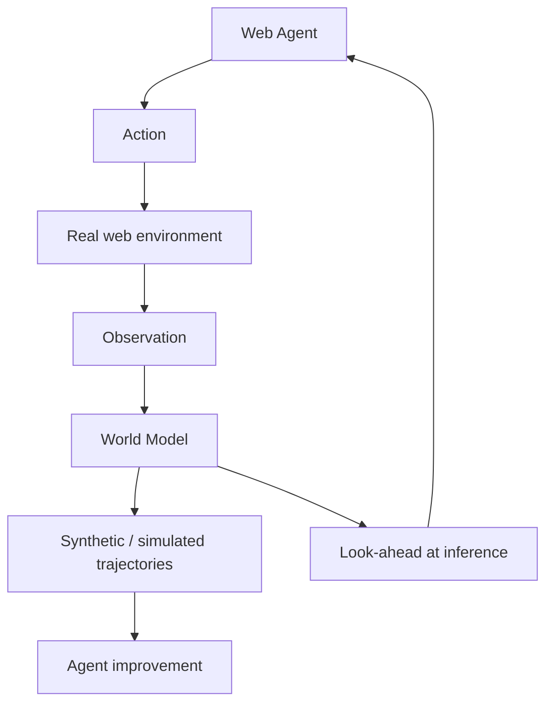

# WebEvolver：World Model 驱动的 Web Agent 自我改进

> 阅读状态：**资料卡，待深读**。当前页面基于论文身份、摘要和已核验的公开方法信息整理；尚未完成原文图表、实验设置、结果表格与消融实验的逐项解读。

> 论文：**[WebEvolver: Towards Self-Improving Web Agents via Co-evolving World Models](https://aclanthology.org/2025.emnlp-main.454/)**  
> 作者单位：腾讯 AI Lab。  
> 发表状态：EMNLP 2025 主会。  
> 方向：Web Agent、World Model、模拟轨迹与推理时 look-ahead。

## 1. 研究问题

网页环境具有高交互成本和高不确定性：

```text
真实网页状态变化快；
错误行动成本高；
探索步骤多；
大规模在线采集数据昂贵。
```

WebEvolver 的问题是：

> 是否可以训练一个与 Web Agent 共同演化的 World Model，以提供额外训练交互，并在推理时模拟未来网页观察？

## 2. 方法概览



World Model 有双重用途：

```text
训练阶段：扩增交互数据；
推理阶段：预测动作可能引发的未来 observation。
```

## 3. 实验与结果

论文在 Mind2Web-Live、WebVoyager 与 GAIA-web 上评估，并报告相对已有自我改进 Web Agent 约 10% 的性能提升。

阅读时应重点区分：

- 真实网页环境结果；
- World Model 模拟环境结果；
- 推理时 look-ahead 带来的收益；
- 模拟偏差带来的失败模式。

## 4. 证据边界

World Model 可能减少探索成本，但存在 simulation bias：若模型预测到不存在的网页状态，Agent 可能在模拟中变好、在真实网页中退化。

因此必须检查真实环境的独立评测，而不能只报告模拟轨迹表现。

## 5. 阅读结论

WebEvolver 代表 Agent 自进化中的“环境模型”路线：

> 除了更新 Agent 本身，还可以更新 Agent 对环境后果的预测模型；但环境模型必须持续被真实环境校准。
