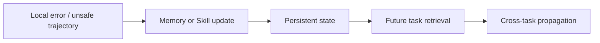

# Safety in Self-Evolving Agents：长期演化的安全问题

> 阅读状态：**资料卡，待深读**。当前页面基于论文身份、摘要和已核验的公开方法信息整理；尚未完成原文图表、实验设置、结果表格与消融实验的逐项解读。

> 方向：错误经验继承、记忆投毒、Skill 权限扩张、反馈污染与长期回滚。

## 核心区别

单次 Agent 安全通常关心一次执行是否越权或产生错误输出。自进化安全还需要考虑错误是否被持久化：



## 主要风险

- 错误反思进入长期 Memory；
- 低质量 Skill 被反复复用；
- reward hacking 影响后续更新；
- 自生成 verifier 被当前策略迎合；
- 参数记忆跨用户或跨任务泄漏；
- Skill/SOP 获得超出任务需要的工具权限；
- 缺少版本控制导致无法回滚。

## 缓解原则

```text
独立验证
最小权限
版本化与回滚
隔离 Memory / Fast Weights
持续回归测试
跨任务安全评测
对候选更新设置继承门槛
```

## 阅读结论

安全不是 Agent 自进化之后的附加模块，而是决定“经验能否被长期继承”的基本条件。
