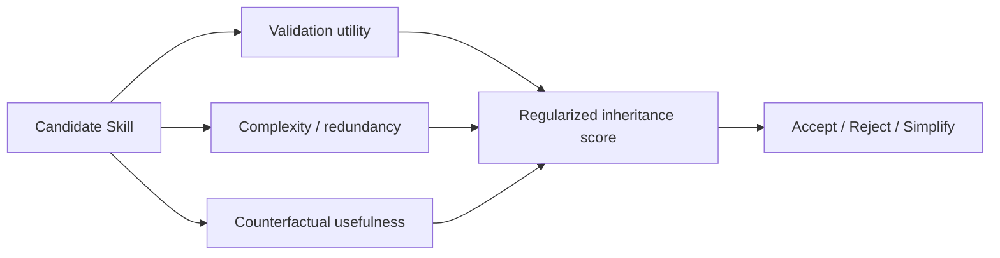

# SkillEvoReg：Skill 更新的正则化与反过拟合

> 阅读状态：**资料卡，待深读**。当前页面基于论文身份、摘要和已核验的公开方法信息整理；尚未完成原文图表、实验设置、结果表格与消融实验的逐项解读。

> 论文：**[SkillEvoReg](https://arxiv.org/abs/2609.30861)**  
> 方向：Skill 复杂度、更新频率、反事实效用与长期泛化。

## 研究问题

当系统反复接受 Validation 提升的 Skill 时，可能发生：

```text
Skill 越写越长
近似 Skill 越来越多
对当前任务更适配
对新任务更不稳定
```

SkillEvoReg 研究如何通过复杂度约束、更新控制和反事实评估缓解这种演化过拟合。

## 方法视角



## 阅读结论

SkillEvoReg 的主要贡献是将“是否继承更新”从单一 Validation 判定扩展为：

```text
效用
+
复杂度
+
冗余
+
反事实边际价值
```

它适合与 Rethinking Self-Evolving Agent Skills 对读。
