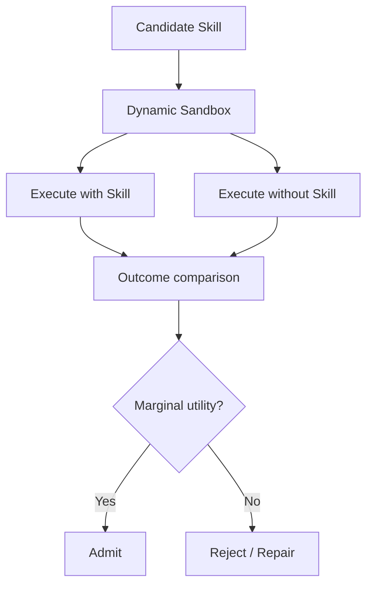

# SkillSandbox：Skill 的动态验证与继承决策

> 阅读状态：**资料卡，待深读**。当前页面基于论文身份、摘要和已核验的公开方法信息整理；尚未完成原文图表、实验设置、结果表格与消融实验的逐项解读。

> 论文：**[SkillSandbox](https://arxiv.org/abs/2610.10088)**  
> 方向：Sandbox、边际执行效用、Skill 入库验证。

## 研究问题

一条 Skill 即使内容合理，也不代表它能执行、能迁移或有边际效用。SkillSandbox 使用动态 sandbox 比较：

```text
使用候选 Skill 的执行结果
vs
不使用候选 Skill 的执行结果
```

## 验证闭环



## 阅读结论

SkillSandbox 强调：Skill 继承应以执行后果为依据，而不应以文本外观、模型自评或单次成功作为唯一依据。
