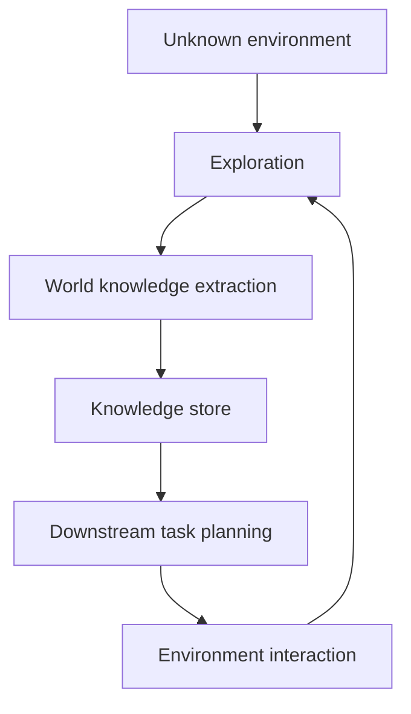

# Native Evolution：未知环境中的自主知识形成

> 阅读状态：**资料卡，待深读**。当前页面基于论文身份、摘要和已核验的公开方法信息整理；尚未完成原文图表、实验设置、结果表格与消融实验的逐项解读。

> 论文：**[Native Evolution](https://arxiv.org/abs/2604.18131)**  
> 方向：未知环境探索、World Knowledge、自发推理时演化。

## 1. 研究问题

传统 Agent 往往在固定任务与明确 reward 下优化。Native Evolution 关注未知环境中的更开放问题：

> Agent 能否先通过探索形成环境知识，再利用这些知识完成后续任务，而不依赖人工指令或外部奖励设计？

## 2. 方法直觉

与显式 Challenger 课程不同，任务和知识可以由环境探索过程自然诱发。

## 3. 阅读重点

- 环境知识如何表示与验证；
- 无外部 reward 时，探索目标如何形成；
- “world knowledge”是否只是轨迹摘要；
- 下游任务收益是否来自知识，还是更多探索步数；
- 是否有跨环境或跨任务迁移评测。

## 4. 阅读结论

Native Evolution 的价值在于将自进化从“已有 benchmark 上优化”扩展到“环境中先形成知识再执行任务”。但未知环境探索的成本和知识可靠性是该路线的核心挑战。
