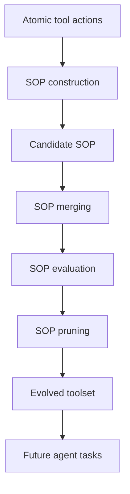

# EvoSOP：从原子动作到标准作业流程

> 阅读状态：**资料卡，待深读**。当前页面基于论文身份、摘要和已核验的公开方法信息整理；尚未完成原文图表、实验设置、结果表格与消融实验的逐项解读。

> 论文：**[From Atomic Actions to Standard Operating Procedures: Iterative Tool Optimization for Self-Evolving LLM Agents](https://arxiv.org/abs/2607.07321)**  
> 方向：工具集演化、SOP、可调用高阶工具。

## 研究问题

许多 Agent 工具集由低层原子动作构成，例如文件读写、单次搜索或单个 API 调用。面对重复工作流时，Agent 需要反复规划相同的多步逻辑，导致推理开销和失败率增加。

EvoSOP 提出的核心问题是：

> 能否从已执行的轨迹中自动合成可复用 SOP，使其成为后续任务可直接调用的高阶工具？

## 方法

论文将 SOP 视为封装多步逻辑的 callable higher-order tool，并提出一个迭代生命周期：



关键在于：生成 SOP 只是第一步。论文明确将合并、评估和剪枝纳入生命周期，以避免工具集持续积累近似或低价值 SOP。

## 实验设计与结果

摘要报告 EvoSOP 相比基线显著提高任务成功率，并显著减少交互轮数。阅读正文时应重点核对：

- 使用哪些工具任务和环境；
- SOP 的执行是否接受独立验证；
- 成功率提升是否与更少交互轮数同时出现；
- 剪枝是否真正控制了 SOP 库规模；
- 与仅保存文本经验、仅保存原始轨迹的基线差异。

## 贡献与边界

EvoSOP 的核心贡献不是简单保存成功轨迹，而是将轨迹转化为可调用、可维护的操作程序。

其证据边界包括：

```text
SOP 适用条件是否被明确表达？
复杂 SOP 是否会隐藏错误分支？
高阶工具是否降低了模型对底层细节的可控性？
跨工具、跨环境迁移是否成立？
```

## 阅读结论

EvoSOP 是“Skill 演化”向工程化生命周期发展的代表：

> 自进化不仅要创建新能力单元，也要维护能力单元的版本、冗余和效用。
