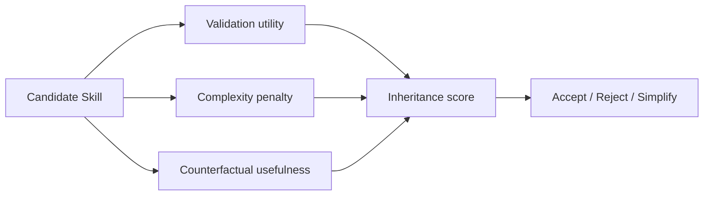

# SkillEvoReg：Skill 演化中的过拟合与正则化

> 阅读状态：**资料卡，待深读**。当前页面基于论文身份、摘要和已核验的公开方法信息整理；尚未完成原文图表、实验设置、结果表格与消融实验的逐项解读。

> 论文：**[SkillEvoReg](https://arxiv.org/abs/2609.30861)**  
> 方向：Skill 过拟合、复杂度控制、反事实效用与长期库治理。

## 研究问题

多轮 Skill Evolution 常采用“Validation 提升就继承”的规则。但持续接受局部改进可能导致：

```text
Skill 越来越长
Skill 库越来越大
近似 Skill 持续重复
对当前验证集越来越适配
对未见任务的收益下降
```

## 方法视角

SkillEvoReg 研究如何对 Skill 演化过程加入正则化。可概括为：



可能的控制对象包括：

- Skill 更新频率；
- Skill 文本或程序复杂度；
- Skill 与已有库的冗余；
- 移除某条 Skill 后的边际性能变化；
- 在新任务上的反事实效用。

## 为什么重要

如果只看当前 Validation，系统可能把局部规则误认为通用能力。因此“继承选择”本身需要接受泛化约束。

## 阅读结论

SkillEvoReg 的中心信息是：

> Skill 演化是模型选择与状态管理问题，而不只是生成问题。任何长期 Skill 系统都需要考虑复杂度、冗余、反事实效用与回滚。
