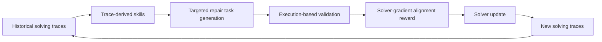

# Socratic-SWE：由解题轨迹驱动的自进化编码 Agent

> 阅读状态：**资料卡，待深读**。当前页面基于论文身份、摘要和已核验的公开方法信息整理；尚未完成原文图表、实验设置、结果表格与消融实验的逐项解读。

> 论文：**[Socratic-SWE: Self-Evolving Coding Agents via Trace-Derived Agent Skills](https://arxiv.org/abs/2606.07412)**  
> 方向：软件工程 Agent、轨迹提炼 Skill、课程生成与 Solver 训练。

## 研究问题

软件工程 Agent 的训练依赖高质量仓库修复任务。固定 bug 注入或 mutation 方法难以针对当前 Agent 的能力缺口生成任务。

Socratic-SWE 的问题定义是：

> 能否将历史修复轨迹中的失败模式与有效修复策略提炼为 Skill，再由这些 Skill 生成更适合训练当前 Solver 的真实仓库修复任务？

## 方法闭环



论文强调轨迹不是只用于 reward 计算，而是作为生成 Skill 的原材料。Skill 再反向约束任务生成方向，使课程与当前 Agent 缺口相关。

## 关键机制

### Trace-derived Skill

Skill 应总结：

```text
重复出现的失败模式；
有效的修复路径；
适用条件与操作约束。
```

### Execution-based Validation

候选修复任务需要执行验证，避免生成不可运行、不可判定或无关的训练样本。

### Solver-gradient Alignment Reward

论文用该奖励衡量候选任务是否对 Solver 的训练更新有实际价值，而非只关注任务本身是否困难。

## 实验设计与结果

论文在 SWE-bench Verified、SWE-bench Lite、SWE-bench Pro 与 Terminal-Bench 2.0 上评估，并报告在相同计算预算下优于自进化基线；摘要报告三轮后在 SWE-bench Verified 达到 50.40%。

结果解读需要注意：

- 50.40% 是特定版本、迭代轮数和评测协议下的结果；
- 关键证据应包括任务生成是否真实可验证、训练与评测仓库是否隔离；
- 与固定 synthetic task、随机任务和仅轨迹训练的基线比较是否公平。

## 证据边界

Socratic-SWE 支持“Skill 能引导更有训练价值的任务生成”，但不直接证明：

```text
所有 trace-derived Skill 都可靠；
课程生成不会向 benchmark 过拟合；
三轮收益会在更多迭代中持续增加；
生成任务能迁移到完全不同的代码生态。
```

## 阅读结论

Socratic-SWE 是 Skill 演化、课程生成和 Agentic RL 连接最紧密的案例之一：

> Agent 的历史失败不只用于复盘，也可以决定下一轮需要构造什么训练环境。
