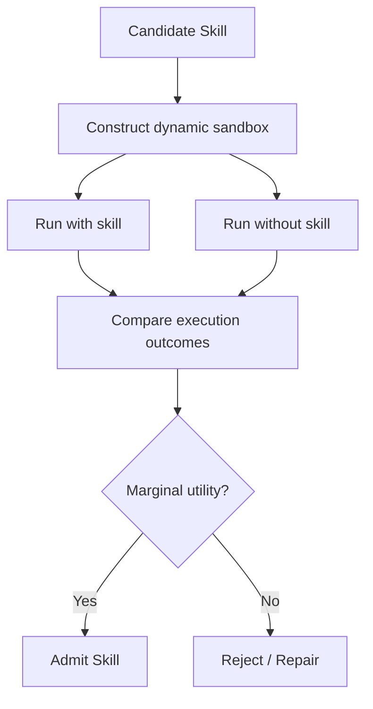

# SkillSandbox：候选 Skill 的动态执行验证

> 阅读状态：**资料卡，待深读**。当前页面基于论文身份、摘要和已核验的公开方法信息整理；尚未完成原文图表、实验设置、结果表格与消融实验的逐项解读。

> 论文：**[SkillSandbox](https://arxiv.org/abs/2610.10088)**  
> 方向：Skill 继承决策、动态 sandbox、边际效用验证。

## 1. 研究问题

候选 Skill 的自然语言描述可能看起来合理，但不代表其可执行、可迁移或真正带来收益。SkillSandbox 关注：

> 进入长期 Skill Library 前，如何用动态环境验证一条 Skill 的实际边际价值？

## 2. 基本思路



重点是以实际执行差值作为入库依据，而非单靠模型自评。

## 3. 实验阅读重点

- sandbox 是否覆盖真实任务关键状态；
- “without skill”对照是否公平；
- Skill 是否仅对构造 sandbox 有效；
- 多次运行是否报告执行随机性；
- 验证成本是否低于 Skill 带来的后续收益。

## 4. 研究价值

SkillSandbox 与 Rethinking Self-Evolving Agent Skills 的共同立场是：

```text
Candidate 被生成
≠
Candidate 值得继承
```

前者从多轮 Validation/Test 角度验证，后者从动态执行对照角度验证。

## 5. 阅读结论

SkillSandbox 的意义在于为长期 Skill Library 提供“入库前试验场”：

> Skill 的质量必须由执行后果而非文本外观决定。
